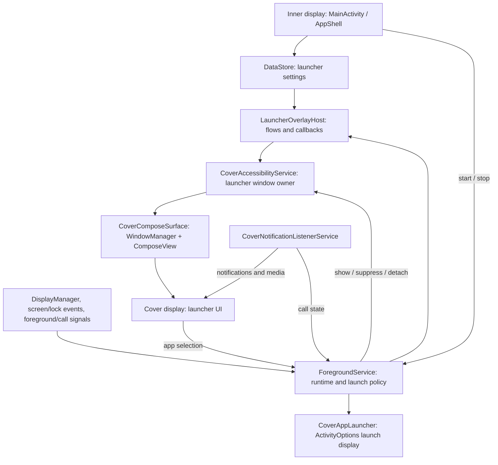

# Cover Screen OS

An Android launcher surface for the outer display of clamshell foldable phones.
Cover Screen OS uses an accessibility-owned overlay instead of replacing the
phone's default Home app. The inner-display app handles setup and customization;
the cover surface provides an app drawer, dock, notifications, media controls,
search, and Quick Settings.

**Requirements:** Android 14+ (API 34) and a device that exposes a usable secondary
display. Cover-display behavior depends on the phone's Android and OEM build.

## Documentation

| Guide | Purpose |
| --- | --- |
| [New Project: architecture and setup](docs/architecture/new-project.md) | Current system blueprint, ownership, lifecycle, source map, and development setup |
| [Contributing](CONTRIBUTING.md) | Issue, milestone, branch, and PR workflow |
| [Agent protocol](docs/agent-protocol.md) | Repository rules for automated contributions |
| [Module organization plan](docs/architecture/module-organization-plan.md) | Proposed package/module organization, not the current build structure |
| [Overlay migration history](docs/architecture/Overlay-architecture-shift-plan.md) | How the launcher moved to accessibility hosting |

The architecture guide describes implemented behavior. Older plans describe
design goals and migration stages; they are not proof that a feature has shipped.

## System architecture blueprint



The foreground service is the persistent runtime engine, **not the window
owner**. The launcher accessibility service attaches a `TYPE_ACCESSIBILITY_OVERLAY`
window on the selected display. The shared surface supplies the lifecycle and
saved-state owners that Compose needs outside an Activity.

App launches request a display through `ActivityOptions`. The runtime hides the
launcher while another app or a system prompt needs focus, then restores it when
the relevant policy allows. A foreground notification and `START_STICKY` support
recovery; neither guarantees survival of force-stop or OEM process restrictions.
See the [lifecycle details](docs/architecture/new-project.md#foreground-service-lifecycle).

## Build and install

Use Android Studio with JDK 21 and the Android SDK platform matching
`compileSdk` 37. The app targets API 37. Versions are pinned in the
[version catalog](gradle/libs.versions.toml) and
[Gradle wrapper](gradle/wrapper/gradle-wrapper.properties).

1. Clone the repository and open it in Android Studio.
2. Set `ANDROID_HOME` to your Android SDK, or set `sdk.dir` in an untracked `local.properties`.
3. Build the debug APK with the wrapper:

```sh
bash gradlew :app:assembleDebug
```

The APK is written to `app/build/outputs/apk/debug/app-debug.apk`. Install it
through Android Studio or, with an authorized device connected:

```sh
adb install -r app/build/outputs/apk/debug/app-debug.apk
```

## Required setup and permissions

Open the inner-display app's **Permissions** screen and complete the core
readiness checklist before starting the launcher:

- [ ] Allow notifications (`POST_NOTIFICATIONS`).
- [ ] Enable **Cover Screen OS Launcher** in Android Accessibility settings.
- [ ] Grant Cover Screen OS notification access.
- [ ] Allow the app to ignore battery optimizations.

The foreground-service start helper checks all four. Permission revocation can
stop the runtime. Battery exemption reduces restrictions; it does not prevent
every OEM background kill.

On Android 13 and newer, the system may block accessibility for an app
installed outside a trusted store. If the service is marked **Restricted
setting**, open **Settings > Apps > Cover Screen OS**, tap the menu, choose
**Allow restricted settings**, then return to **Settings > Accessibility** and
enable **Cover Screen OS Launcher**. Use the official store listing when it is
available for your device.

### Manifest declarations and service access

| Permission or declaration | How it is used |
| --- | --- |
| `FOREGROUND_SERVICE`, `FOREGROUND_SERVICE_SPECIAL_USE` | Declared for the persistent engine; its service uses the `specialUse` type |
| `BIND_ACCESSIBILITY_SERVICE` | Guards the two accessibility service components; users enable them in Settings, not a runtime permission dialog |
| `BIND_NOTIFICATION_LISTENER_SERVICE` | Guards the notification listener; users grant notification access in Settings |
| `REQUEST_IGNORE_BATTERY_OPTIMIZATIONS` | Allows the app to open the battery-exemption request |
| `RECEIVE_BOOT_COMPLETED` | Allows boot and package-update startup requests, subject to readiness and Android restrictions |
| Launcher-intent `<queries>` | Makes launchable apps visible to the app scanner without `QUERY_ALL_PACKAGES` |

**`SYSTEM_ALERT_WINDOW` is not required or declared.** Both overlays use
accessibility-service-owned windows. There is no legacy "Draw over other apps"
launcher mode.

### Optional feature access

| Permission or access | Feature |
| --- | --- |
| Separate **Cover Screen OS** input accessibility service | Cover typing fallback in other apps; not required just to run the launcher |
| Enable/select **CoverScreenOS Keyboard** in keyboard settings (`BIND_INPUT_METHOD` service guard) | System IME using the target app's `InputConnection` |
| `RECORD_AUDIO` | Voice input |
| `READ_CONTACTS` plus explicit consent in keyboard settings | Contact-name suggestions |
| `READ_MEDIA_VISUAL_USER_SELECTED` | Selected-image access offered by setup; wallpaper selection uses an image URI |
| `BLUETOOTH_CONNECT` | Bluetooth state and best-effort Quick Settings actions |
| `WRITE_SETTINGS` | Brightness control; granted through "Modify system settings" |
| `ACCESS_WIFI_STATE`, `CHANGE_WIFI_STATE` | WiFi state and best-effort actions; Android may require opening system settings instead |
| `USE_BIOMETRIC` | System unlock bridge where available |
| `VIBRATE` | Haptic feedback |

The [manifest](app/src/main/AndroidManifest.xml) is the source of truth for
declarations. Optional access is not part of the core launcher-start checklist.

## Using the launcher

Fold the phone with the runtime enabled and a usable cover display available.
The cover launcher has notification, lock, and app-grid pages. Tap a grid or dock
entry to request an app launch; locked-device launches use the system unlock
bridge. On the lock page, swipe down for Quick Settings or tap search for the
search/input surface.

Use **Customize** on the inner display to select and reorder dock apps, show or
hide the dock, choose wallpaper and its crop/fit mode, adjust dim/blur, and tune
appearance or input settings. Changes are persisted in DataStore and observed
by the launcher.

Quick Settings reflects WiFi and Bluetooth state, offers flashlight control,
and adjusts brightness when allowed. Restricted actions can open system
settings instead of changing a toggle directly.

### System keyboard

Enable **CoverScreenOS Keyboard** under Android keyboard settings, then select
it with the system keyboard picker. On Samsung phones, look under
**General management > Keyboard list and default**. Keyboard settings allow
separate defaults for field classes; the keyboard also offers QWERTY, T9,
numeric, and symbol layouts.

The system IME is separate from the launcher search keypad and the input
accessibility fallback. It writes through `InputConnection` and does not require
accessibility-based text injection.

## Validation

```sh
# Local JVM / Robolectric tests
bash gradlew :app:testDebugUnitTest

# Instrumented UI tests: requires a connected Android device or emulator
bash gradlew :app:connectedDebugAndroidTest
```

Real foldable hardware is required to verify cover-display routing and OEM
behavior. After launcher changes, check:

- App launches from grid, dock, and search, with correct cover bounds and input focus.
- Overlay suppression and recovery after app navigation, locking, unlocking, and calls.
- Fold/unfold and screen-off transitions without a launcher window appearing on the inner display.
- Media updates, Quick Settings fallbacks, keyboard routing, and permission revocation.
- Inner-display tasks remain usable and are not unexpectedly moved to the cover.

## Releasing

The [Release workflow](.github/workflows/release.yml) builds and signs the APK
and publishes it to GitHub Releases.

1. Bump the version: `python3 tools/bump_version.py 0.1.0-beta.1`. This sets
   `versionName` and adds 1 to `versionCode`. Merge that change to `main` first.
2. Push a matching tag: `git tag v0.1.0-beta.1 && git push origin v0.1.0-beta.1`.
3. The workflow creates the release once. Re-running it uploads the APK to the
   same release. Tags with a `-` are marked as pre-releases.

It needs these repo secrets: `RELEASE_KEYSTORE_BASE64` (base64 of the keystore
file), `RELEASE_KEYSTORE_PASSWORD`, `RELEASE_KEY_ALIAS`, and `RELEASE_KEY_PASSWORD`.
The workflow stops if the keystore secret is missing, so an unsigned APK is never
published.

## Current scope

The project builds as one Android application module (`:app`). Third-party
`AppWidgetHost` hosting is planned in #7, #8, and #9; it is not implemented.
Display and screen events drive current topology handling; the app does not
currently use Jetpack WindowManager hinge tracking.

New work must follow the [repository protocol](docs/agent-protocol.md): use an
issue with a milestone, create a descriptive branch before editing, and open a
linked PR. Do not work directly on `main`.
