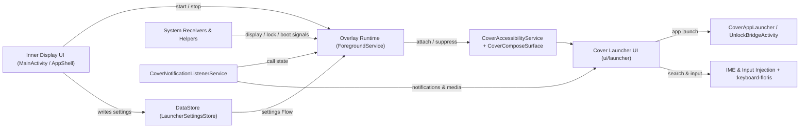

# `:app` Module

The primary Android application module (`com.tyejaedon.coverscreenos`) for Cover Screen OS. It hosts the inner-display configuration UI, the persistent foreground runtime, the accessibility-hosted cover launcher overlay, notification/media listeners, the system IME service, and DataStore persistence.

## What This Module Holds

| Path | Role | Link |
| --- | --- | --- |
| `src/main/java/com/tyejaedon/coverscreenos/` | Root package (`MainActivity`) and feature packages | [Package README](src/main/java/com/tyejaedon/coverscreenos/README.md) |
| `src/main/AndroidManifest.xml` | App components, permissions, accessibility/IME/notification service declarations | — |
| `src/main/assets/` | Bundled NLP dictionary binaries (`english_words.bin`, `english_bigrams.bin`) and icon artwork | — |
| `src/main/res/` | Strings, themes, XML service configs, mipmap/drawable assets | — |
| `src/test/` & `src/androidTest/` | Unit, Robolectric, and instrumented tests | — |
| `build.gradle.kts` | Module build config, `guardRemovedHomeScreen` check, and dependencies | — |

## Data Flow Diagram

## Works Hand-in-Hand With

| Module | Relationship | Link |
| --- | --- | --- |
| `:keyboard-floris` | Provides Floris-inspired keyboard UI, layout parser, editor bridge, and NLP prediction engines | [keyboard-floris](../keyboard-floris/README.md) |
| `tools/` | Bumps `versionCode`/`versionName` in `app/build.gradle.kts` and generates launcher icon assets into `app/src/main/res/` | [tools](../tools/README.md) |
