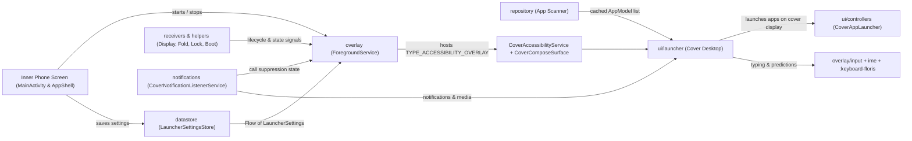

# `:app` Module

## What This Module Does

The `:app` module (`com.tyejaedon.coverscreenos`) is the **complete Android application** that ships on your foldable phone.

Because foldable OEMs do not allow third-party apps to replace the built-in outer cover launcher through normal Android Home intents, `:app` solves the problem in two halves working side by side:
1. **The Inner-Screen Companion App**: A standard Material/OneUI-inspired Compose app (`MainActivity` -> `AppShell`) where you grant permissions, pick your wallpaper and dock apps, host cover widgets, and toggle the engine on or off.
2. **The Outer-Screen Cover Desktop**: A background runtime (`ForegroundService` + `CoverAccessibilityService`) that detects the phone's secondary cover display, watches the hinge fold angle and lock screen, and projects an interactive Compose homescreen (`TYPE_ACCESSIBILITY_OVERLAY`) directly onto the outer display.

---

## How It Works Step-by-Step

1. **Manifest & Permissions Declaration (`AndroidManifest.xml`)**:
   - Declares `MainActivity`, the persistent `ForegroundService`, `CoverAccessibilityService` (for attaching windows to the cover display), `CoverNotificationListenerService`, `CoverT9InputMethodService`, `BootCompletedReceiver`, and `CoverWidgetPickerActivity`.
2. **Configuration & Persistence (`datastore/`, `ui/customize/`)**:
   - Users customize dock apps, wallpaper media (image/GIF/video), theme/accents, widgets, and keyboard preferences on the phone screen; `LauncherSettingsStore` saves everything in Jetpack DataStore and broadcasts live updates.
3. **Display, Fold & Lock Sensing (`helpers/`, `receivers/`)**:
   - Helpers discover the secondary hardware display via `DisplayManager` and fold state via Jetpack `WindowManager`, while `LockStatusReceiver` tracks screen power and keyguard locks.
4. **Overlay Attachment & Suppression (`overlay/`)**:
   - Policy engines decide when the cover desktop should attach, stay hidden (e.g., unfolded flat or during active calls), or reclaim focus, then host a Compose surface on the cover display.
5. **Interactive Cover Desktop (`ui/launcher/`, `notifications/`, `repository/`, `ime/`, `:keyboard-floris`)**:
   - Users launch apps onto the cover display, browse notifications and media controls, scroll Quick Settings and AppWidgets, or type using either the built-in T9/Floris keyboard (`:keyboard-floris` + bundled `assets/` dictionaries) or the system IME.

---

## Module Contents Guide

### `src/main/java/com/tyejaedon/coverscreenos/` ([Package README](src/main/java/com/tyejaedon/coverscreenos/README.md))
- **In plain terms**: All Kotlin source code for the app, organized into clean layers:
  - `MainActivity.kt` — Companion phone-screen entry point.
  - `datastore/` — DataStore `<Preferences>`, JSON backup export/import, wallpaper validation limits, and input telemetry.
  - `helpers/` — Display discovery, hinge fold posture tracking, permissions, service launcher, IME detector, and Quick Settings toggles.
  - `ime/` & `keyboard/nlp/` — Built-in `CoverT9InputMethodService`, editor profiling, and NLP dictionary loader.
  - `models/` — Immutable `AppModel`, `CoverNotificationModel`, and `CoverMediaModel` snapshots.
  - `notifications/` — `CoverNotificationListenerService` for live notifications, media playback, and call detection.
  - `overlay/` — `ForegroundService`, `CoverAccessibilityService`, attachment/suppression policies, input injection (`overlay/input/`), and Compose surface (`overlay/surface/`).
  - `receivers/` — Boot/update restart receiver and dynamic lock-status receiver.
  - `repository/` — Cached `PackageManager` scanner for installed launchable apps.
  - `ui/` — Companion setup/customization screens and cover-display homescreen, drawer, keyboard, widgets, and theme components.

### `src/main/AndroidManifest.xml`
- **In plain terms**: The app's official registration card read by Android at install time—wiring up activities, background services, accessibility/IME/notification service bindings, boot receiver intent filters, and required permissions.

### `src/main/assets/`
- **In plain terms**: Read-only binary data packaged directly inside the APK, including bundled NLP word/bigram prediction dictionaries (`english_words.bin`, `english_bigrams.bin`) and icon artwork.

### `src/main/res/`
- **In plain terms**: Standard Android XML resources—app strings, themes, XML metadata configs for accessibility/IME services, and launcher mipmap/drawable icon assets.

### `src/test/` & `src/androidTest/`
- **In plain terms**: Automated unit tests (JUnit 4, Robolectric, MockK) and Android instrumented test suites verifying overlay policies, DataStore serialization, receivers, scanners, and UI behavior.

### `build.gradle.kts`
- **In plain terms**: Gradle build definition configuring Android SDK targets, Jetpack Compose, DataStore, Haze blur, testing libraries, dependencies on `:keyboard-floris`, and module build guards (such as `guardRemovedHomeScreen`).

---

## Quick-Reference Summary

| Path | Role | Key Contents | Link |
| --- | --- | --- | --- |
| `src/main/java/com/tyejaedon/coverscreenos/` | Application Kotlin source | `MainActivity`, `datastore`, `helpers`, `ime`, `keyboard/nlp`, `models`, `notifications`, `overlay`, `receivers`, `repository`, `ui` | [Package README](src/main/java/com/tyejaedon/coverscreenos/README.md) |
| `src/main/AndroidManifest.xml` | Component & permission wiring | Services, `BootCompletedReceiver`, activities, permissions | — |
| `src/main/assets/` | Bundled static assets | `english_words.bin`, `english_bigrams.bin`, icon artwork | — |
| `src/main/res/` | Android resources | Strings, themes, service XML configs, icons | — |
| `src/test/` & `src/androidTest/` | Test suites | Unit, Robolectric, and instrumented tests | — |
| `build.gradle.kts` | Module build script | Dependencies, Compose/Kotlin setup, `guardRemovedHomeScreen` | — |

---

## Architecture & Data Flow

---

## Works Hand-in-Hand With

| Module | Relationship | Link |
| --- | --- | --- |
| `com.tyejaedon.coverscreenos` | Root Kotlin package containing all app subsystems | [Package README](src/main/java/com/tyejaedon/coverscreenos/README.md) |
| `:keyboard-floris` | Library module providing the Floris-inspired keyboard UI, layout parser, editor bridge, and NLP prediction engines | [keyboard-floris](../keyboard-floris/README.md) |
| `tools/` | Helper scripts that bump `versionCode`/`versionName` in `app/build.gradle.kts` and generate launcher icons into `app/src/main/res/` | [tools](../tools/README.md) |
