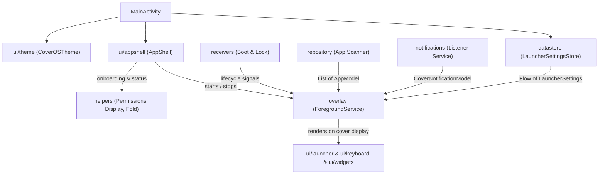

# `com.tyejaedon.coverscreenos` Root Package

## What This Folder Does

This folder is the **main switchboard** for Cover-Screen-OS's Kotlin code.

Because foldable phones have two very different jobs for this app—a **phone-side setup app** you open when the phone is unfolded, and an **always-ready cover desktop** that floats on the outer screen when folded—the code here is split cleanly into focused sub-packages. At the root sits [`MainActivity.kt`](MainActivity.kt), the front door that opens when you tap the Cover-Screen-OS icon on your phone's inner screen.

---

## How It Works Step-by-Step

1. **You open Cover-Screen-OS on the unfolded phone**:
   - Android launches [`MainActivity`](MainActivity.kt), which calls `enableEdgeToEdge()` so the UI extends smoothly behind status and navigation bars.
2. **Preferences flow in from storage**:
   - `MainActivity` creates a remembered `LauncherSettingsStore` and collects `settingsStore.settings` via `collectAsState(...)`.
3. **Theme and companion shell render**:
   - `MainActivity` wraps `AppShell` (`ui/appshell`) inside `CoverOSTheme` (`ui/theme`), letting you grant permissions (`ui/permissions`), customize dock/wallpaper/input (`ui/customize`), and start/stop the cover runtime (`overlay` + `helpers`).
4. **Cover-display runtime takes over independently**:
   - Once started, `ForegroundService` (`overlay`), `CoverAccessibilityService` (`overlay`), `CoverNotificationListenerService` (`notifications`), `BootCompletedReceiver` (`receivers`), and `PackageManagerAppScannerRepository` (`repository`) keep the outer cover screen running even after `MainActivity` closes.

---

## File-by-File Guide

### [MainActivity.kt](MainActivity.kt)

- **In plain terms**: The single Android Activity entry point for the phone-side companion app—it turns on edge-to-edge layout, loads your theme preferences, and hands the screen over to `AppShell`.
- **Key variables & state**:
  - `settingsStore: LauncherSettingsStore` — Remembered handle to DataStore preferences created with `applicationContext` so Compose recompositions never recreate it or leak the Activity.
  - `settings: LauncherSettings` — Live `State` collected from `settingsStore.settings`, starting with default `LauncherSettings()` on frame 1 until DataStore finishes reading from disk.
- **How it connects**: Reads `LauncherSettingsStore` from [`datastore`](datastore/README.md), applies `CoverOSTheme` from [`ui/theme`](ui/theme/README.md), and renders `AppShell` from [`ui/appshell`](ui/appshell/README.md).

### Sub-Packages Overview

| Sub-Package | In Plain Terms | Link |
| --- | --- | --- |
| `datastore/` | Persistent DataStore settings notebook, JSON backup export/import, wallpaper validation limits, and input telemetry counters | [datastore](datastore/README.md) |
| `helpers/` | System adapters for finding the cover display, tracking hinge fold posture, checking permissions, starting/stopping the service, detecting IME capability, and toggling Quick Settings | [helpers](helpers/README.md) |
| `ime/` | Built-in `CoverT9InputMethodService` system keyboard and editor field profiling | [ime](ime/README.md) |
| `keyboard/nlp/` | Loads bundled binary English word and bigram prediction assets into the cover keyboard | [keyboard/nlp](keyboard/nlp/README.md) |
| `models/` | Clean, immutable data snapshots (`AppModel`, `CoverNotificationModel`, `CoverMediaModel`) shared across layers | [models](models/README.md) |
| `notifications/` | `CoverNotificationListenerService` for reading live notifications, media playback state, and call detection | [notifications](notifications/README.md) |
| `overlay/` | Persistent `ForegroundService`, `CoverAccessibilityService` window hosting, visibility/suppression policies, input injection (`overlay/input/`), and Compose window surface (`overlay/surface/`) | [overlay](overlay/README.md) |
| `receivers/` | `BootCompletedReceiver` (restart after reboot/update) and `LockStatusReceiver` (live lock/screen state) | [receivers](receivers/README.md) |
| `repository/` | `PackageManagerAppScannerRepository` for scanning launchable apps with a 2-minute metadata cache | [repository](repository/README.md) |
| `ui/` | All Compose UI: companion screens (`ui/appshell`, `ui/dashboard`, `ui/customize`, `ui/permissions`, `ui/about`), cover desktop (`ui/launcher`), keyboard UI (`ui/keyboard`), app/unlock launchers (`ui/controllers`), widgets (`ui/widgets`), and themes (`ui/theme`) | [ui](ui/README.md) |

---

## Quick-Reference Summary

| Item | Type | Role | Link |
| --- | --- | --- | --- |
| `MainActivity.kt` | `ComponentActivity` | Companion phone-screen entry point & theme host | [MainActivity.kt](MainActivity.kt) |
| `datastore/` | Persistence layer | Preferences, JSON backups, wallpaper guardrails, IME telemetry | [datastore](datastore/README.md) |
| `helpers/` | Platform adapters | Displays, hinge posture, permissions, Quick Settings, service helpers | [helpers](helpers/README.md) |
| `overlay/` | Cover runtime | Foreground service, accessibility overlay host, policies, input injection | [overlay](overlay/README.md) |
| `ui/` | Compose UI | Phone companion tabs + cover homescreen, drawer, keyboard, widgets | [ui](ui/README.md) |
| `notifications/` & `models/` | Signal pipeline | Notification/media extraction and shared immutable models | [notifications](notifications/README.md) · [models](models/README.md) |
| `receivers/` & `repository/` | System listeners & data | Boot/lock broadcasts and cached `PackageManager` app scanner | [receivers](receivers/README.md) · [repository](repository/README.md) |
| `ime/` & `keyboard/nlp/` | Text input engine | System T9 IME service and bundled NLP dictionary loader | [ime](ime/README.md) · [keyboard/nlp](keyboard/nlp/README.md) |

---

## Architecture & Data Flow

---

## Works Hand-in-Hand With

| Module / Sub-Package | How They Connect | Link |
| --- | --- | --- |
| `datastore` | `MainActivity` observes `LauncherSettingsStore.settings` to drive app-wide theming | [datastore](datastore/README.md) |
| `ui/appshell` | `MainActivity` sets `AppShell` as its root composable for the companion app | [ui/appshell](ui/appshell/README.md) |
| `ui/theme` | `MainActivity` wraps `AppShell` in `CoverOSTheme` using persisted appearance preferences | [ui/theme](ui/theme/README.md) |
| `overlay` & `ui/launcher` | Independent cover-screen runtime launched from `AppShell` and restored by `receivers` | [overlay](overlay/README.md) · [ui/launcher](ui/launcher/README.md) |
