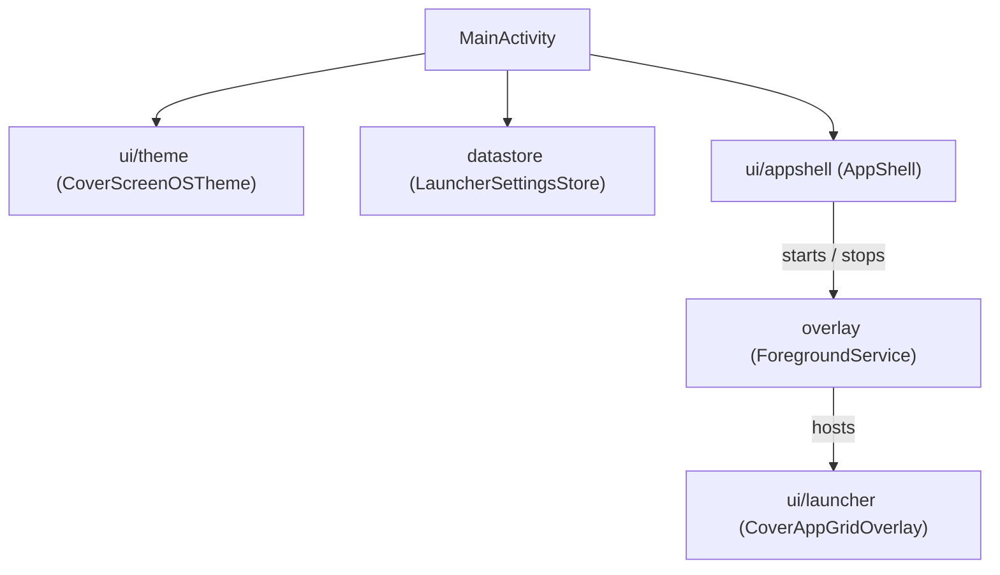

# `com.tyejaedon.coverscreenos` Root Package

Root Kotlin package of the `:app` module, containing the inner-display Activity entry point and organizing all feature sub-packages.

## What This Module Holds

| File / Sub-Package | Responsibility | Link |
| --- | --- | --- |
| `MainActivity.kt` | Inner-display `ComponentActivity` hosting `AppShell` inside `CoverScreenOSTheme` | — |
| `datastore/` | DataStore preferences, JSON serialization, and input telemetry | [datastore](datastore/README.md) |
| `helpers/` | Display discovery, fold posture tracking, permissions, service start/stop, input capability detection, and quick settings | [helpers](helpers/README.md) |
| `ime/` | System IME service (`CoverT9InputMethodService`) and editor field profiling | [ime](ime/README.md) |
| `keyboard/nlp/` | App-level NLP dictionary asset loader (`CoverKeyboardNlpManager`) | [keyboard/nlp](keyboard/nlp/README.md) |
| `models/` | Shared domain models (`AppModel`, `CoverNotificationModel`, `CoverMediaModel`) | [models](models/README.md) |
| `notifications/` | Notification listener, media extraction, and call-package detection | [notifications](notifications/README.md) |
| `overlay/` | Persistent foreground runtime, accessibility overlay service, policies, input injection, and Compose surface | [overlay](overlay/README.md) |
| `receivers/` | Boot-completed and lock/screen broadcast receivers | [receivers](receivers/README.md) |
| `repository/` | Installed launcher app scanner and cache (`PackageManagerAppScannerRepository`) | [repository](repository/README.md) |
| `ui/` | Inner-display setup screens, cover launcher UI, controllers, widgets, keyboard UI, and themes | [ui](ui/README.md) |

## Data Flow Diagram

## Works Hand-in-Hand With

| Module | Relationship | Link |
| --- | --- | --- |
| `datastore` | `MainActivity` observes `LauncherSettingsStore.settings` for theme configuration | [datastore](datastore/README.md) |
| `ui/appshell` | `MainActivity` renders `AppShell` as its root composable | [ui/appshell](ui/appshell/README.md) |
| `ui/theme` | `MainActivity` wraps `AppShell` in `CoverScreenOSTheme` | [ui/theme](ui/theme/README.md) |
