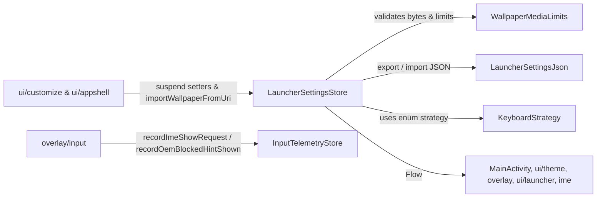

# `datastore` Package

## What This Folder Does

Think of `datastore` as the **settings notebook and wallpaper safety vault** for Cover-Screen-OS.

Every time you pick a custom wallpaper, pin four apps to your dock, adjust corner roundness, or choose between the built-in T9 keypad and your phone's default keyboard, those choices need to survive app restarts and update both screens instantly. Instead of using old blocking `SharedPreferences`, this package uses **Jetpack DataStore (`Preferences`)**—a modern, asynchronous key-value store that emits live updates through Kotlin `Flow` whenever a preference changes.

It also guards your wallpaper imports like an airport security scanner: before a new photo, GIF, or video becomes your cover wallpaper, it checks file size, pixel dimensions, video codecs, and frame rates, then copies the file safely into app-private storage so gallery permission changes won't break your lock/cover screen later.

---

## How It Works Step-by-Step

1. **Reading settings safely**:
   - UI screens and the cover overlay observe `LauncherSettingsStore.settings` (`Flow<LauncherSettings>`).
   - DataStore reads `cover_launcher_settings.preferences_pb` off the main thread. If a disk read fails, `.catch` logs the warning and emits empty defaults instead of crashing the app.
   - `mapStoredPreferences(...)` clamps out-of-range numbers, removes duplicate dock packages, and migrates any old wallpaper paths into the current managed directory.
2. **Changing a preference**:
   - Customization screens call `suspend` setters (like `setDockPackage`, `setThemePreference`, or `setWallpaperDimAmount`).
   - Each setter switches to `ioDispatcher` and performs an atomic `DataStore.edit { ... }` write, which automatically pushes the new `LauncherSettings` snapshot to every active `Flow` collector.
3. **Importing a custom wallpaper**:
   - `importWallpaperFromUri(...)` locks `wallpaperMutationMutex`, copies the picked file into a temporary `.part` staging file within a 64 MiB cap (`WallpaperMediaLimits.copyBounded`), verifies the format (static image via two-pass `BitmapFactory`, GIF via `WallpaperMediaLimits.validateGif` + `ImageDecoder`, or video via `MediaMetadataRetriever` + `MediaExtractor`), atomically renames it, commits the URI inside `NonCancellable`, and prunes old wallpaper copies.
4. **Backing up, restoring, and tracking input stats**:
   - `LauncherSettingsJson` converts `LauncherSettings` to/from validated version-1 JSON backups.
   - `InputTelemetryStore` keeps separate DataStore counters tracking how often the system keyboard succeeds or gets blocked by the OEM on the cover display.

---

## File-by-File Guide

### [LauncherSettingsStore.kt](LauncherSettingsStore.kt)

- **In plain terms**: The central hub for reading, clamping, saving, resetting, and migrating all cover-screen preferences and custom wallpaper files.
- **Key variables & state**:
  - `COVER_DOCK_SLOT_COUNT` (`4`), `MIN_/MAX_/DEFAULT_*` constants — Safe bounds for dock slots, panel corner rounding (`0..32 dp`), wallpaper dimming (`0..0.8`), blur (`0..18 dp`), crop/zoom (`1x..3x`), and extra key height (`0..24 dp`).
  - `Context.coverLauncherSettingsDataStore` — Process-wide `preferencesDataStore` delegate backed by `cover_launcher_settings.preferences_pb`.
  - `LauncherPreferencesKeys` — Strongly-typed DataStore keys (`welcome_tour_seen`, `wallpaper_uri`, `dock_slot_0..3`, `cover_widget_ids`, keyboard/theme keys, etc.).
  - `LauncherSettings` — Immutable snapshot class holding every user preference with safe out-of-the-box defaults.
  - `wallpaperMutationMutex: Mutex` — Ensures two wallpaper edits, imports, or resets never race on disk files or overwrite each other mid-flight.
  - `appContext` — Application-scoped `Context` handle used for DataStore, `filesDir`, and `ContentResolver`.
  - `settings: Flow<LauncherSettings>` & `welcomeTourSeen: Flow<Boolean>` — Live streams observed by Compose UI and the overlay service.
- **How it connects**: Driven by customization and onboarding UI (`ui/customize`, `ui/appshell`) and observed live by `MainActivity`, `ui/theme`, `ui/launcher`, `overlay` (`ForegroundService` / `LauncherOverlayHost`), and `ime`.

### [LauncherSettingsJson.kt](LauncherSettingsJson.kt)

- **In plain terms**: A strict backup translator that turns `LauncherSettings` into readable JSON text for export and validates every field before restoring an imported backup.
- **Key variables & state**:
  - `json: JSONObject` — Parsed root backup document checked for `"version": 1` and required keys.
  - `slots` / `dock` — Parsed 4-slot dock package list verified to have no blank, untrimmed, or duplicate package IDs.
  - `dim`, `blur`, `cropX`, `cropY`, `zoom`, `rotation`, `radius` — Numeric visual bounds verified to be finite and within range (with older v1 backup fallbacks).
  - `modes` / `savedModes` — Map of per-app keyboard mode overrides (`packageName -> CoverKeyboardMode`).
  - `decodedWidgetIds` — Ordered list of AppWidget IDs restored onto the cover widget panel.
- **How it connects**: Called exclusively by `LauncherSettingsStore.exportSettingsJson()` and `importSettingsJson(...)` using Android's built-in `org.json` APIs.

### [KeyboardStrategy.kt](KeyboardStrategy.kt)

- **In plain terms**: A simple two-way switch deciding *who* handles typing in the cover-screen app drawer search: Cover-Screen-OS's compact built-in T9 keypad or Android's regular system keyboard.
- **Key variables & state**:
  - `KeyboardStrategy.T9` / `KeyboardStrategy.SYSTEM_IME` — Enum modes stored by enum `.name` string instead of numeric ordinal so future enum edits won't corrupt saved data.
  - `isSystemIme: Boolean` — Quick helper flag telling overlay UI whether IME insets/routing are active.
  - `DEFAULT_KEYBOARD_STRATEGY` — Defaults to `KeyboardStrategy.T9` for narrow cover displays.
- **How it connects**: Stored in `LauncherSettingsStore`, toggled from the overlay search/input UI, and read by `overlay/input` and `ui/launcher`.

### [WallpaperMediaLimits.kt](WallpaperMediaLimits.kt)

- **In plain terms**: A bouncer at the door of the wallpaper importer—inspecting raw file header bytes ("magic bytes"), bounding stream copies, and walking GIF frames to block giant, corrupt, or battery-draining files before they ever reach the cover screen.
- **Key variables & state**:
  - `MAX_FILE_BYTES` (`64 MiB`), `MAX_WIDTH` / `MAX_HEIGHT` (`8192px`), `MAX_IMAGE_PIXELS` (`40 MP`) — Safety caps for static image wallpapers.
  - `MAX_ANIMATED_WIDTH` / `MAX_ANIMATED_HEIGHT` (`2048px`), `MAX_ANIMATED_PIXELS` (`4 Mi pixels`), `MAX_DURATION_MS` (`10s`), `MAX_FRAME_RATE` (`30 fps`), `MAX_FRAME_COUNT` (`300`), `MIN_FRAME_DELAY_MS` (`34 ms`) — Stricter caps for looping GIFs and videos.
  - `mp4Brands` / `supportedVideoCodecs` — Allowed ISO BMFF `ftyp` brands and H.264/HEVC/VP9 codec MIME types.
  - `GifMetadata` / `GifReader` — Extracted GIF dimensions, frame count, and duration from streaming block traversal without decoding full frame bitmaps.
- **How it connects**: Used directly by `LauncherSettingsStore` during `copyWallpaperImportStream(...)` and `validateWallpaperFile(...)`.

### [InputTelemetryStore.kt](InputTelemetryStore.kt)

- **In plain terms**: A private scorecard tracking how reliably the system keyboard appears on the cover screen so the app can diagnose OEM restrictions without blocking UI threads.
- **Key variables & state**:
  - `Context.coverInputTelemetryDataStore` — Dedicated DataStore instance (`cover_input_telemetry.preferences_pb`) separate from user settings.
  - `InputTelemetryKeys` — Four `longPreferencesKey` entries (`imeShowRequestCount`, `imeShowSuccessCount`, `imeShowFailureCount`, `oemBlockedHintCount`).
  - `InputTelemetryCounters` — Snapshot data class exposing those counts plus computed `imeShowSuccessRatePercent` (`0..100`).
  - `counters: Flow<InputTelemetryCounters>` — Reactive stream falling back to `emptyPreferences()` on disk read errors.
- **How it connects**: Updated by `overlay/input` whenever system IME show attempts succeed, fail, or trigger an OEM-blocked hint, and read by diagnostics/input UI.

---

## Quick-Reference Summary

| File | Store / Mechanism | Primary Types | Purpose |
| --- | --- | --- | --- |
| [LauncherSettingsStore.kt](LauncherSettingsStore.kt) | `DataStore<Preferences>` + `files/cover_wallpaper` | `LauncherSettingsStore`, `LauncherSettings`, `WallpaperScaleMode`, `ThemePreference`, `AccentColor`, `HapticStrength`, `KeyboardAnchor` | Central settings repository & transactional wallpaper importer |
| [LauncherSettingsJson.kt](LauncherSettingsJson.kt) | `org.json` (`JSONObject` / `JSONArray`) | `LauncherSettingsJson` | Versioned JSON backup export/import & validation |
| [KeyboardStrategy.kt](KeyboardStrategy.kt) | Enum persisted by `.name` | `KeyboardStrategy`, `DEFAULT_KEYBOARD_STRATEGY` | Chooses built-in T9 vs system IME input |
| [WallpaperMediaLimits.kt](WallpaperMediaLimits.kt) | Byte-header sniffing & GIF block reader | `WallpaperMediaType`, `WallpaperMediaLimits`, `GifMetadata` | Enforces wallpaper size, resolution, codec, and GIF limits |
| [InputTelemetryStore.kt](InputTelemetryStore.kt) | Separate `DataStore<Preferences>` | `InputTelemetryStore`, `InputTelemetryCounters`, `imePickerSuccessRatePercent` | Tracks cover-screen IME reliability counters |

---

## Architecture & Data Flow

---

## Works Hand-in-Hand With

| Package | How They Work Together | Link |
| --- | --- | --- |
| `overlay` | `ForegroundService` and `LauncherOverlayHost` observe `LauncherSettingsStore.settings` for live cover screen updates | [overlay](../overlay/README.md) |
| `overlay/input` | Reads `KeyboardStrategy` / keyboard settings and logs IME success/failure metrics to `InputTelemetryStore` | [overlay/input](../overlay/input/README.md) |
| `ui/customize` | Inner-display customization screens mutate dock, wallpaper, appearance, and input settings | [ui/customize](../ui/customize/README.md) |
| `ui/launcher` | Cover launcher reads dock packages, wallpaper URI/transforms, corner radius, and widget IDs | [ui/launcher](../ui/launcher/README.md) |
| `ui/theme` | Applies `ThemePreference`, `AccentColor`, and `panelCornerRadiusDp` across Compose surfaces | [ui/theme](../ui/theme/README.md) |
| `ime` | Reads keyboard haptics, sound, autocorrect, height, and one-handed layout settings | [ime](../ime/README.md) |
