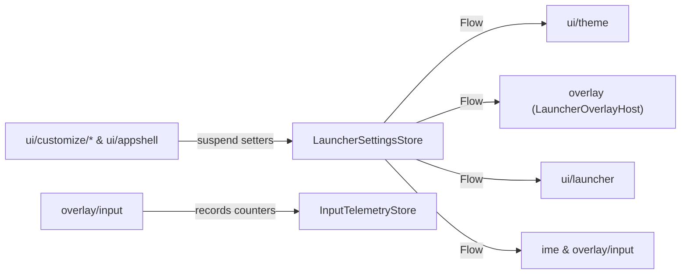

# `datastore` Package

Persistent configuration and telemetry layer backed by Jetpack DataStore Preferences.

## What This Module Holds

| File | Key Types | Responsibility |
| --- | --- | --- |
| `LauncherSettingsStore.kt` | `LauncherSettings`, `LauncherSettingsStore`, `WallpaperScaleMode` | Reads/writes launcher appearance, dock, wallpaper, and input preferences via DataStore `Flow` |
| `LauncherSettingsJson.kt` | `LauncherSettingsJson` | JSON serialization helpers for structured settings (such as dock package slots) |
| `KeyboardStrategy.kt` | `KeyboardStrategy` | Enum defining keyboard routing strategy (`SYSTEM_IME`, `OVERLAY_FALLBACK`, etc.) |
| `WallpaperMediaLimits.kt` | `WallpaperMediaType`, `WallpaperMediaLimits`, `GifReader` | Validates wallpaper image/GIF/video sizes and media limits |
| `InputTelemetryStore.kt` | `InputTelemetryKeys`, `InputTelemetryCounters`, `InputTelemetryStore`, `imePickerSuccessRatePercent` | Tracks input fallback, IME picker, and keyboard usage counters |

## Data Flow Diagram

## Works Hand-in-Hand With

| Module | Relationship | Link |
| --- | --- | --- |
| `overlay` | `ForegroundService` and `LauncherOverlayHost` observe settings `Flow` for live cover UI updates | [overlay](../overlay/README.md) |
| `ui/customize/*` | Inner-display customization screens mutate `LauncherSettingsStore` | [ui/customize](../ui/customize/README.md) |
| `ui/launcher` | Cover launcher reads grid, dock, appearance, and wallpaper settings | [ui/launcher](../ui/launcher/README.md) |
| `overlay/input` & `ime` | Reads `KeyboardStrategy` / keyboard preferences and records `InputTelemetryStore` metrics | [overlay/input](../overlay/input/README.md) |
| `ui/theme` | Applies accent/theme settings from `LauncherSettingsStore` | [ui/theme](../ui/theme/README.md) |
