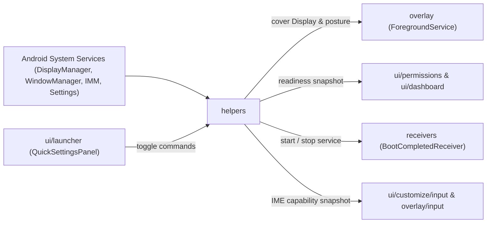

# `helpers` Package

Platform-level Android system adapters for display discovery, fold posture tracking, permissions, foreground service lifecycle, input capability detection, and Quick Settings toggles.

## What This Module Holds

| File | Key Types | Responsibility |
| --- | --- | --- |
| `CoverDisplayHelper.kt` | `CoverDisplayHelper` | Discovers usable secondary/presentation `Display` instances via `DisplayManager` |
| `FoldPostureTracker.kt` | `CoverFoldPosture`, `FoldPostureTracker` | Tracks foldable hinge/posture state (`FLAT`, `HALF_FOLDED`, `CLOSED`, etc.) |
| `AppPermissionHelper.kt` | `AppPermissionHelper` | Checks readiness of `POST_NOTIFICATIONS`, accessibility service, notification listener, and battery optimization exemption |
| `ForegroundServiceHelper.kt` | `ForegroundServiceHelper` | Starts/stops `ForegroundService` after verifying core readiness |
| `InputCapabilityDetector.kt` | `InputCapabilityDetector`, `InputCapabilitySnapshot`, `InputAvailabilityTier` | Inspects enabled IMEs and accessibility input services to estimate input readiness |
| `QuickSettingsController.kt` | `QuickSettingsController` | Reads and toggles system Quick Settings (brightness, Wi-Fi/Bluetooth/flashlight/etc.) from the cover panel |

## Data Flow Diagram

## Works Hand-in-Hand With

| Module | Relationship | Link |
| --- | --- | --- |
| `overlay` | `ForegroundService` uses `CoverDisplayHelper` and `FoldPostureTracker` for attachment decisions | [overlay](../overlay/README.md) |
| `receivers` | `BootCompletedReceiver` calls `ForegroundServiceHelper.startForegroundService()` | [receivers](../receivers/README.md) |
| `ui/permissions` & `ui/dashboard` | Displays readiness state from `AppPermissionHelper` and starts/stops runtime via `ForegroundServiceHelper` | [ui/permissions](../ui/permissions/README.md) |
| `ui/launcher` | `OverlayQuickSettingsPanel` delegates system toggles to `QuickSettingsController` | [ui/launcher](../ui/launcher/README.md) |
| `overlay/input` & `ui/customize/input` | Uses `InputCapabilityDetector` to pick or report input strategy | [overlay/input](../overlay/input/README.md) |
