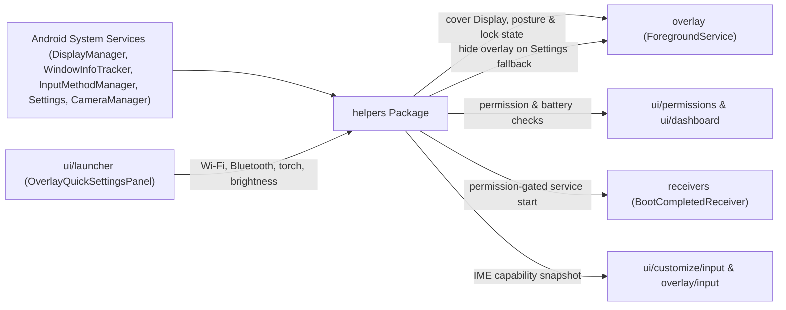

# `helpers` Package

## What This Folder Does

Think of `helpers` as the **translation desk between Cover-Screen-OS and the Android phone hardware**.

Android hides sensitive phone controls behind different system services—one service knows which screens are attached, another tracks the hinge angle, another controls Wi-Fi or the flashlight, and another decides which apps have permission to run in the background. Instead of letting UI screens wrestle with raw Android APIs directly, every screen and background service asks the utilities in `helpers` for clean answers and simple actions.

---

## How It Works Step-by-Step

1. **Check the safety checklist (`AppPermissionHelper` + `ForegroundServiceHelper`)**: Before anything runs on the outer cover screen, Cover-Screen-OS verifies that the user granted notification posting, accessibility overlay access, notification listening, and battery-saver exemption. Only when all four pass does `ForegroundServiceHelper` boot the background runtime.
2. **Find the right screen and hinge angle (`CoverDisplayHelper` + `FoldPostureTracker`)**: Once running, `CoverDisplayHelper` watches `DisplayManager` for an active secondary screen (skipping the main inner display) while `FoldPostureTracker` listens to Jetpack `WindowInfoTracker` to confirm the phone is actually closed (`CLOSED`) rather than half-open (`HALF_FOLDED`) or flat (`FLAT`).
3. **Track lockscreen security (`CoverDisplayHelper`)**: `CoverDisplayHelper` pairs a system broadcast listener (`LockStatusReceiver`) with a 10-second backup timer so the cover UI always knows whether the phone is locked or unlocked.
4. **Check typing options (`InputCapabilityDetector`)**: During setup or settings checks, `InputCapabilityDetector` scans installed keyboards (`InputMethodManager` and `Settings.Secure`), spots CoverT9 or Gboard, flags Samsung cover-screen keyboard quirks, and produces a plain 0–100 readiness score.
5. **Run Quick Settings tiles (`QuickSettingsController`)**: When you tap Wi-Fi, Bluetooth, Flashlight, or drag the Brightness slider on the cover panel, `QuickSettingsController` applies the change directly when Android allows it—or hides the overlay and opens the matching system Settings screen when Android restricts background toggles.

---

## File-by-File Guide

### `AppPermissionHelper.kt`

- **In plain terms**: The **clipboard inspector** for permissions and settings shortcuts. It checks whether Android permissions and special system toggles are turned on, and builds safe `Intent` shortcuts to open the exact Settings page when something is missing.
- **Key variables & state**:
  - `ENABLED_NOTIFICATION_LISTENERS_KEY`: Raw `Settings.Secure` key (`"enabled_notification_listeners"`) queried to confirm notification access.
  - `galleryMediaPermissions`: Shared array holding `READ_MEDIA_VISUAL_USER_SELECTED` so permission requests and checks never go out of sync.
  - `accessibilityEnabled`, `enabledServices`, `targetService`: Master accessibility toggle check plus the colon-separated enabled services list matched against our service's flattened `ComponentName`.
  - `preferredIntents` & `appDetailsFallbackIntent`: Ordered battery-exemption intents (per-app allow prompt first, system list second, App Info fallback third) so Samsung and other OEM builds never crash with `ActivityNotFoundException`.
- **How it connects**: Called by `ForegroundServiceHelper` before starting the service, and by onboarding/permission screens in `ui/permissions` and `ui/dashboard`.

### `CoverDisplayHelper.kt`

- **In plain terms**: The **lookout tower** for the outer screen and lock state. It finds which display is the outer cover panel, delegates hinge tracking, and keeps an up-to-date `StateFlow` telling the rest of the app whether the phone is currently locked.
- **Key variables & state**:
  - `displayManager`: Lazy handle to Android's `DisplayManager` service used to query attached screens and power states.
  - `USABLE_COVER_STATES`: Allowed screen power states (`STATE_ON`, `STATE_VR`, `STATE_ON_SUSPEND`, `STATE_DOZE`) so brief fold/unfold transitions don't falsely treat the cover screen as missing.
  - `_isDeviceLocked` / `isDeviceLocked`: Reactive `StateFlow<Boolean>` defaulting to `true` (locked) for safety until `LockStatusReceiver` or polling confirms otherwise.
  - `lockStatusReceiver`, `isLockStatusReceiverRegistered`, `mainHandler`, `lockStatusPoller`, `LOCK_STATUS_POLL_INTERVAL_MS`: Broadcast receiver handle, registration guard, main-thread `Handler`, and 10-second fallback polling `Runnable`.
  - `foldPostureTracker` / `foldPosture`: Delegated `FoldPostureTracker` instance and its live `CoverFoldPosture` stream.
- **How it connects**: Used directly by `overlay` (`ForegroundService`) to decide whether the cover screen should attach, stay hidden, or enforce lockscreen security.

### `FoldPostureTracker.kt`

- **In plain terms**: The **hinge angle interpreter**. Like a laptop lid sensor, it watches Android's window-folding events and translates raw hinge states into three simple postures: `CLOSED`, `HALF_FOLDED` (Flex Mode), or `FLAT`.
- **Key variables & state**:
  - `context` & `windowInfoTracker`: Host `Context` and Jetpack `WindowInfoTracker` instance streaming `WindowLayoutInfo` updates.
  - `_posture` / `posture`: `StateFlow<CoverFoldPosture>` starting at `CLOSED` so the outer cover display stays active unless an unfolded `FoldingFeature` is reported.
  - `trackingJob`: Active coroutine `Job` collecting `windowLayoutInfo`, used to prevent duplicate listeners and cancel collection in `stopMonitoring()`.
  - `foldingFeature`: First `FoldingFeature` inside `WindowLayoutInfo.displayFeatures` mapped to `HALF_FOLDED`, `FLAT`, or `CLOSED` (when `null`).
- **How it connects**: Owned and exposed by `CoverDisplayHelper`; read by `overlay` so the cover UI cleanly steps aside as soon as you flip the phone open.

### `ForegroundServiceHelper.kt`

- **In plain terms**: The **ignition switch and safety interlock** for Cover-Screen-OS's background runtime. It refuses to turn the engine on unless every required permission is ready.
- **Key variables & state**:
  - `LOG_TAG`: Logcat prefix for skipped-start warnings.
  - `appContext`: Application-scoped `Context` extracted before calling `ContextCompat.startForegroundService(...)` or `startService(...)` so UI contexts are never leaked.
- **How it connects**: Gates `ForegroundService` startup via `AppPermissionHelper`; invoked by `BootCompletedReceiver` on device boot and by dashboard/permission UI buttons.

### `InputCapabilityDetector.kt`

- **In plain terms**: The **keyboard scout**. Typing on a tiny outer screen is tricky across phone brands, so this helper inspects which keyboards are installed and enabled, checks if CoverT9 or Gboard is active, warns about Samsung One UI restrictions, and scores typing readiness (`HIGH`, `MODERATE`, `LOW`).
- **Key variables & state**:
  - `GBOARD_PACKAGE_NAME`: Constant package ID for Gboard (`"com.google.android.inputmethod.latin"`).
  - `appContext`, `contentResolver`, `packageManager`, `inputMethodManager`: Cached system handles used to read enabled IMEs, labels, and `Settings.Secure` entries.
  - `coverT9ImeIds`: Normalized set of both full and short `ComponentName` formats for `CoverT9InputMethodService`.
  - `allInputMethods` / `inputMethodById`, `enabledEntries`, `defaultImeEntry`: Installed and active keyboard snapshots paired with friendly display labels.
  - `hasSamsungOemRisk`, `oemRestrictionHint`, `availabilityPercent`, `availabilityEstimateTier`: Samsung device detection, cover-screen warning message, and 0–100 readiness score mapped into `InputAvailabilityTier`.
- **How it connects**: Used by `ui/customize/input` and `overlay/input` to report keyboard readiness and guide users when switching IMEs.

### `QuickSettingsController.kt`

- **In plain terms**: The **utility switchboard** behind the cover Quick Settings panel. It handles Wi-Fi, Bluetooth, flashlight, and screen brightness without containing any UI code—returning a clear `ToggleOutcome` (`Changed`, `OpenedSystemSettings`, or `Failed`) for every action.
- **Key variables & state**:
  - `MIN_BRIGHTNESS` / `MAX_BRIGHTNESS`: Raw `Settings.System.SCREEN_BRIGHTNESS` integer bounds (`0..255`) mapped to/from `0f..1f` slider fractions.
  - `ToggleOutcome`: Sealed result type telling callers whether a toggle happened silently, fell back to Settings, or failed.
  - `wifiManager`, `bluetoothAdapter`, `cameraManager`: System service handles for radios and `CameraManager.setTorchMode(...)`.
  - `targetPackage`: Resolved destination package passed to `ForegroundService.createHideOverlayIntent(...)` before opening system Settings so the cover overlay hides cleanly.
- **How it connects**: Called by `OverlayQuickSettingsPanel` in `ui/launcher` and coordinates overlay hiding with `ForegroundService` in `overlay`.

---

## Quick-Reference Summary

| File | Key Types | Role in Plain English |
| --- | --- | --- |
| `AppPermissionHelper.kt` | `AppPermissionHelper` | Checks runtime permissions, accessibility/notification services, battery exemption, and builds safe Settings intents |
| `CoverDisplayHelper.kt` | `CoverDisplayHelper` | Finds the usable outer cover `Display` via `DisplayManager` and tracks keyguard lock status |
| `FoldPostureTracker.kt` | `CoverFoldPosture`, `FoldPostureTracker` | Reads Jetpack `WindowInfoTracker` hinge data (`CLOSED`, `HALF_FOLDED`, `FLAT`) |
| `ForegroundServiceHelper.kt` | `ForegroundServiceHelper` | Starts/stops `ForegroundService` only when all core permissions are granted |
| `InputCapabilityDetector.kt` | `InputCapabilityDetector`, `InputCapabilitySnapshot`, `InputAvailabilityTier` | Inspects enabled keyboards/IMEs and scores cover-screen typing readiness |
| `QuickSettingsController.kt` | `QuickSettingsController`, `ToggleOutcome` | Controls Wi-Fi, Bluetooth, camera torch, and brightness, with overlay-aware Settings fallback |

---

## Data Flow Diagram

---

## Works Hand-in-Hand With

| Module | Relationship | Link |
| --- | --- | --- |
| `overlay` | `ForegroundService` reads `CoverDisplayHelper` display/lock/posture flows and hides when `QuickSettingsController` opens Settings | [overlay](../overlay/README.md) |
| `receivers` | `BootCompletedReceiver` calls `ForegroundServiceHelper.startForegroundService()` after boot | [receivers](../receivers/README.md) |
| `ui/permissions` & `ui/dashboard` | Displays permission checklist from `AppPermissionHelper` and toggles runtime via `ForegroundServiceHelper` | [ui/permissions](../ui/permissions/README.md) |
| `ui/launcher` | `OverlayQuickSettingsPanel` sends hardware toggle and brightness commands to `QuickSettingsController` | [ui/launcher](../ui/launcher/README.md) |
| `overlay/input` & `ui/customize/input` | Uses `InputCapabilityDetector` to evaluate CoverT9 / third-party IME readiness | [overlay/input](../overlay/input/README.md) |
