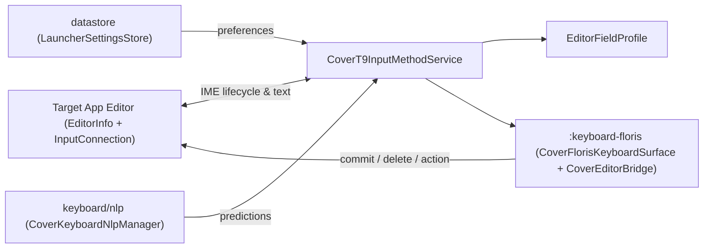

# `ime` Package

System Input Method Editor (`InputMethodService`) implementation for Cover Screen OS, providing a clamshell-sized Floris/T9 keyboard bound directly to Android's `InputConnection`.

## What This Module Holds

| File | Key Types | Responsibility |
| --- | --- | --- |
| `CoverT9InputMethodService.kt` | `CoverT9InputMethodService`, `ImeComposeOwner`, `CoverImeLayout`, `CoverLayoutMode`, `CoverImePreferences` | Android `InputMethodService` hosting Compose keyboard UI (`CoverFlorisKeyboardSurface`) and `CoverEditorBridge` |
| `EditorFieldProfile.kt` | `EditorFieldProfile` | Inspects `EditorInfo` to classify input type, IME action, and layout mode |

## Data Flow Diagram

## Works Hand-in-Hand With

| Module | Relationship | Link |
| --- | --- | --- |
| `:keyboard-floris` (`keyboard.floris`, `keyboard.nlp`) | Renders `CoverFlorisKeyboardSurface` and routes edits through `CoverEditorBridge` | [keyboard-floris](../../../../../../../../keyboard-floris/README.md) |
| `keyboard/nlp` | Initializes `CoverKeyboardNlpManager` for predictions and autocorrect | [keyboard/nlp](../keyboard/nlp/README.md) |
| `datastore` | Reads keyboard preferences (`LauncherSettingsStore`) | [datastore](../datastore/README.md) |
| `ui/theme` | Applies CoverOS theme styling | [ui/theme](../ui/theme/README.md) |
| `helpers` | `InputCapabilityDetector` checks whether `CoverT9InputMethodService` is enabled/selected | [helpers](../helpers/README.md) |
