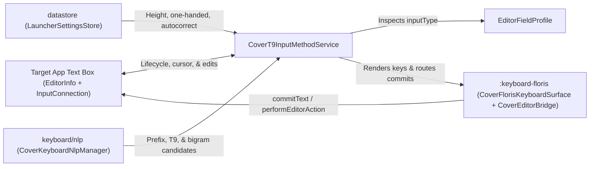

# `ime` Package

The `ime` package is Cover Screen OS's **custom system keyboard**. Think of it like a compact pocket-sized typewriter built specifically for the tiny outer screen of a flip phone: whenever you tap a text box on the cover display, Android hands the typing session to this package so you can type with full **QWERTY**, classic **T9 predictive**, **Numbers**, or **Symbols** without launching the oversized main-screen keyboard.

---

## 1. What This Folder Does

Because Android covers a wide variety of apps—chats, PIN pads, phone dialers, web search bars—a good keyboard cannot behave the exact same way everywhere.

This folder solves three core jobs:
1. **Hosts the Cover Keyboard Window**: Runs an Android `InputMethodService` (`CoverT9InputMethodService`) and paints a modern Jetpack Compose keyboard (`CoverFlorisKeyboardSurface`) directly into the system keyboard slot.
2. **Reads the Room (Field Privacy & Type)**: Checks each text box before you start typing (`EditorFieldProfile`) to see whether it wants letters, numbers, or a secret password—automatically switching to a number pad or turning off word suggestions and key popups for sensitive fields.
3. **Remembers Your Preferences**: Gives users a dedicated **Keyboard Settings** screen (`CoverImeSettingsActivity`) to choose default layouts per field type and optionally opt into on-device contact-name predictions.

---

## 2. How It Works Step-by-Step

1. **System Startup**: When Android activates Cover Screen OS's keyboard, `CoverT9InputMethodService.onCreate()` boots a synthetic Compose lifecycle owner (`ImeComposeOwner`) and starts warming up the word dictionaries in `CoverKeyboardNlpManager` on a background thread.
2. **Opening a Text Box**: When you tap an input field, Android calls `onStartInput(EditorInfo, ...)`. `EditorFieldProfile.from()` reads bit-packed flags from `EditorInfo.inputType` to set `isNumeric` and `isSensitive`, while `CoverImePreferences.defaultLayout()` picks your preferred layout (`QWERTY`, `T9`, `NUMBER`, or `SYMBOLS`) and `imeActionLabel()` chooses the action button text (`GO`, `SEARCH`, `SEND`, `DONE`, etc.).
3. **Drawing & Typing**: `onCreateInputView()` creates a `ComposeView` containing `CoverFlorisKeyboardSurface` wired through `CoverEditorBridge` to Android's live `currentInputConnection`.
4. **Live Word Suggestions**: Every keystroke or cursor tap bumps `mutationRevision`, reading up to 50 characters before the cursor (`textBeforeCursor`):
   - If `uiState.isSensitive` or `uiState.isNumeric` is `true`, `candidates` stays empty for privacy.
   - If you are mid-word (`word`), `CoverKeyboardNlpManager.getCandidates()` returns prefix/T9 matches.
   - If you just hit space after a word (`prev`), `CoverKeyboardNlpManager.getNextWordSuggestions()` predicts the next word using bigrams.
5. **Pressing Enter / Action**: `handleEnterPressed()` checks whether the app expects an action (like `SEARCH` or `SEND`) and triggers `InputConnection.performEditorAction()`. If the field is multiline (`IME_FLAG_NO_ENTER_ACTION`) or ignores actions, it sends a standard `KEYCODE_ENTER` key event instead.
6. **Hiding & Cleanup**: Closing the keyboard pauses Compose animations (`onFinishInputView`), leaving the field resets `uiState` (`onFinishInput`), and stopping the service clears the ViewTree store (`onDestroy`).

---

## 3. File-by-File Guide

### `CoverT9InputMethodService.kt`

- **In plain terms**: The main keyboard engine and its companion Settings screen. It acts like the translator between Android's legacy View-based keyboard service API and Cover Screen OS's modern Jetpack Compose keyboard UI.
- **Key variables & state**:
  - `composeOwner` (`ImeComposeOwner`): Synthetic `LifecycleOwner`, `SavedStateRegistryOwner`, and `ViewModelStoreOwner`—needed because an `InputMethodService` is a `Service`, not an `Activity`, and Compose refuses to render without those owners.
  - `fieldProfile` (`EditorFieldProfile`): Cached numeric/sensitive snapshot for the currently focused field.
  - `activeEditorInfo` (`EditorInfo?`): Raw metadata describing the target field's `inputType` and `imeOptions`.
  - `uiState` (`CoverImeUiState`): Compose-observed state holding the active `CoverImeLayout`, `isNumeric`, `isSensitive`, `shifted`, and `actionLabel`.
  - `activeBridge` / `bridge` (`CoverEditorBridge`): Wraps `currentInputConnection` lazily (because Android swaps connections whenever focus moves) and exposes `mutationRevision` so Compose knows when text or cursor position changed.
  - `settingsStore` & `settings` (`LauncherSettingsStore` / `LauncherSettings`): DataStore preferences controlling extra height, one-handed left/right `dockAnchor`, suggestion strip visibility, autocorrect, and popup key previews.
  - `candidates` & `textBeforeCursor`: Current suggestion pills and the trailing 50-character context left of the cursor.
  - `ContactsSuggestionConsent`: Helper tying the `"include_contact_names"` preference in `"keyboard_words"` `SharedPreferences` to runtime `READ_CONTACTS` permission (automatically clearing stale opt-in if the user later revokes Contacts permission in Android settings).
- **How it connects**: Pulls keyboard visuals from `:keyboard-floris` (`CoverFlorisKeyboardSurface` + `CoverEditorBridge`), pulls word predictions/autocorrect/glide decoding from `keyboard/nlp` (`CoverKeyboardNlpManager`), reads user styling from `datastore` (`LauncherSettingsStore`), and inspects fields via `EditorFieldProfile`.

### `EditorFieldProfile.kt`

- **In plain terms**: A fast security-and-layout scanner for text boxes. Before a single key is drawn, it peeks at Android's bit-packed `EditorInfo.inputType` number and answers two simple yes/no questions: *"Is this a numbers-only box?"* and *"Is this a password?"*
- **Key variables & state**:
  - `inputType` (`Int`): Raw bit-packed integer from `EditorInfo.inputType` (defaults to `0` if null).
  - `inputClass` (`Int`): Masked with `InputType.TYPE_MASK_CLASS` to isolate the broad category (`TYPE_CLASS_NUMBER`, `TYPE_CLASS_PHONE`, `TYPE_CLASS_DATETIME`, or text).
  - `variation` (`Int`): Masked with `InputType.TYPE_MASK_VARIATION` to detect exact subtypes like passwords inside numeric or text boxes.
  - `isNumericClass` (`Boolean` -> `isNumeric`): `true` for number, phone, and date/time inputs.
  - `isPasswordField` (`Boolean` -> `isSensitive`): `true` for `TYPE_NUMBER_VARIATION_PASSWORD`, `TYPE_TEXT_VARIATION_PASSWORD`, `TYPE_TEXT_VARIATION_VISIBLE_PASSWORD`, and `TYPE_TEXT_VARIATION_WEB_PASSWORD`.
- **How it connects**: Called exclusively by `CoverT9InputMethodService.onStartInput()` to gate predictions, word learning, and key-preview popups so passwords never leak into suggestions or dictionaries.

---

## 4. Quick-Reference Summary

| File | Key Types | Role |
| --- | --- | --- |
| [CoverT9InputMethodService.kt](./CoverT9InputMethodService.kt) | `CoverT9InputMethodService`, `ImeComposeOwner`, `CoverImeSettingsActivity`, `ContactsSuggestionConsent`, `CoverImePreferences` | Hosts the Compose IME surface, bridges `InputConnection`, manages layout defaults, and provides Keyboard Settings |
| [EditorFieldProfile.kt](./EditorFieldProfile.kt) | `EditorFieldProfile` | Decodes `EditorInfo.inputType` bitmasks into `isNumeric` and `isSensitive` flags |

---

## 5. Architecture Flow

---

## 6. Works Hand-in-Hand With

| Module | Relationship | Link |
| --- | --- | --- |
| `:keyboard-floris` (`keyboard.floris`) | Renders `CoverFlorisKeyboardSurface` and routes commits/deletes through `CoverEditorBridge` | [keyboard-floris](../../../../../../../../keyboard-floris/README.md) |
| `keyboard/nlp` | Supplies word predictions, T9 decoding, autocorrect, and swipe decoding | [keyboard/nlp](../keyboard/nlp/README.md) |
| `datastore` | Stores keyboard height, one-handed anchor, autocorrect, and suggestion strip toggles | [datastore](../datastore/README.md) |
| `ui/theme` | Applies Cover Screen OS Material 3 theme colors to the keyboard and settings screen | [ui/theme](../ui/theme/README.md) |
| `helpers` | `InputCapabilityDetector` checks whether `CoverT9InputMethodService` is enabled and active | [helpers](../helpers/README.md) |
