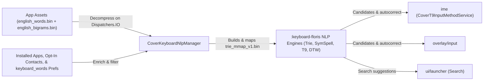

# `keyboard.nlp` Package (`:app`)

The `keyboard.nlp` package is Cover Screen OS's **word brain** inside the `:app` module. Think of it like a bilingual librarian who starts with a pocket phrasebook on frame one so typing never lags, then quietly unpacks a full encyclopedia, your installed app names, and (only if you say yes) your contacts onto a fast shelf in the background.

---

## 1. What This Folder Does

Typing on a tiny cover display—whether tapping full QWERTY, punching classic 9-key T9 digits (`43556` -> `"hello"`), or swiping across keys—depends on instant, privacy-respecting word intelligence.

This package bridges the raw dictionary files stored in `:app/src/main/assets` with the reusable algorithmic engines in `:keyboard-floris`:
1. **Zero-Jank Startup**: Seeds a small in-memory vocabulary immediately, then decompresses `english_words.bin` and `english_bigrams.bin` asynchronously on `Dispatchers.IO` and builds a memory-mapped `BinaryTrieDictionary` (`trie_mmap_v1.bin`).
2. **Unified Suggestions & Correction**: Powers prefix completions (`getQwertySuggestions`), next-word bigram predictions (`getNextWordSuggestions`), Space-bar typo fixes (`autocorrectWord`), T9 digit/multi-tap predictions (`getT9Suggestions`), and continuous swipe-path decoding (`decodeGlidePath`).
3. **Personalization & Privacy**: Persists words you teach or hide in `SharedPreferences` (`keyboard_words`) and strictly gates contact-name suggestions behind both explicit user opt-in and Android's `READ_CONTACTS` runtime permission.

---

## 2. How It Works Step-by-Step

1. **Instant Seed on Launch**: At class load, `CoverKeyboardNlpManager` initializes `trieDictionary`, `symSpellAutocorrect`, `t9Engine`, and `glideDecoder` using `defaultCorpus` (~36 common words) so callers never hit `null` or block on disk I/O.
2. **Background Corpus Hydration**: When `initializeFromContext(context)` runs, it immediately reads `learned` and `suppressed` words from `keyboard_words` `SharedPreferences`, then launches a single `initMutex`-guarded coroutine on `Dispatchers.IO`:
   - Loads `english_bigrams.bin` (GZIP) into `bigramFollowers` (keeping the top 5 follower words per word).
   - Loads `english_words.bin` (GZIP) word frequencies into `frequencies`.
   - Indexes installed application names (`PackageManager.getInstalledApplications`) at weight `50,000` so app searches rank well.
   - If the user opted in (`include_contact_names`) and `READ_CONTACTS` is granted, queries `ContactsContract` display names at weight `120,000`.
   - Boosts user-`learnedWords` to weight `500,000`.
3. **Memory-Mapped Binary Cache**: Compiles the final `CompactTrieDictionary`, writes `trie_mmap_v1.bin` in `cacheDir` if missing, maps it via `BinaryTrieDictionary.mapFromFile()` for low Java-heap lookups, and swaps the live engine references atomically.
4. **Multi-Stage Suggestion Pipeline**:
   - **QWERTY (`getQwertySuggestions`)**: Checks (1) `learnedWords`, (2) `binaryTrie` / `trieDictionary` prefix completions, and (3) `symSpellAutocorrect` edit-distance fixes—filtering every word through `isWordAvailable()`.
   - **T9 (`getT9Suggestions`)**: Accepts pure digits (`"43556"`) or hyphenated multi-tap sequences (`"44-33-55-55-666"`, collapsing each repeated digit group first), then queries `binaryTrie.predictForDigits()` or `t9Engine`.
   - **Next Word (`getNextWordSuggestions`)**: Looks up `bigramFollowers[previousWord]`, falling back to common conversational phrases when unknown.
   - **Autocorrect (`autocorrectWord`)**: Leaves valid/learned/unavailable words alone; otherwise replaces typos with the top `SymSpellAutocorrect` suggestion while preserving initial uppercase capitalization.
5. **Privacy Enforcement**: `isWordAvailable(word)` ensures `suppressedWords` are never shown and `contactOnlyWords` vanish immediately if consent or `READ_CONTACTS` permission is revoked.

---

## 3. File-by-File Guide

### `CoverKeyboardNlpManager.kt`

- **In plain terms**: The singleton orchestrator that loads dictionaries, enriches them with app names and optional contacts, remembers words you add or block, and routes prediction requests from every keyboard surface in Cover Screen OS.
- **Key variables & state**:
  - `scope`, `initMutex`, `isInitialized`: Background `Dispatchers.IO` coroutine scope, mutex preventing duplicate asset loads, and volatile completion flag.
  - `defaultCorpus`: Small hardcoded English frequency seed active before asset decompression finishes.
  - `trieDictionary` (`CompactTrieDictionary`): Mutable in-memory prefix Trie supporting runtime insertion of learned and contact words.
  - `binaryTrie` (`BinaryTrieDictionary?`): Read-only memory-mapped Trie backed by `trie_mmap_v1.bin` for low-memory prefix and T9 lookups.
  - `symSpellAutocorrect` (`SymSpellAutocorrect`): Symmetric-delete fuzzy spelling engine powering QWERTY typo suggestions and Space-bar autocorrect.
  - `t9Engine` (`T9PredictiveEngine`): Classic 2–9 keypad predictive candidate engine.
  - `glideDecoder` (`DTWGlideDecoder`): Dynamic Time Warping gesture decoder translating swipe `Offset` trails into words.
  - `bigramFollowers` (`Map<String, List<String>>`): Up to 5 ranked follower words per antecedent word from `english_bigrams.bin`.
  - `contactOnlyWords`, `contactsAllowedProvider`: Tracks words sourced strictly from Contacts and dynamically re-verifies consent + `READ_CONTACTS` on every query.
  - `learnedWords`, `suppressedWords`, `sharedPreferences`: Synchronized user vocabulary overrides persisted asynchronously in `keyboard_words` `SharedPreferences`.
- **How it connects**: Reads `english_words.bin` and `english_bigrams.bin` from `:app` assets, instantiates engines defined in `:keyboard-floris` (`keyboard.nlp`), and feeds suggestions to `ime` (`CoverT9InputMethodService`), `overlay/input`, and `ui/launcher` search.

---

## 4. Quick-Reference Summary

| File | Key Types | Role |
| --- | --- | --- |
| [CoverKeyboardNlpManager.kt](./CoverKeyboardNlpManager.kt) | `CoverKeyboardNlpManager` | Loads GZIP/mmap corpora, manages Trie/SymSpell/T9/DTW engines, enforces contact consent, and persists learned/suppressed words |

---

## 5. Architecture Flow

---

## 6. Works Hand-in-Hand With

| Module | Relationship | Link |
| --- | --- | --- |
| `:keyboard-floris` (`keyboard.nlp`) | Provides `CompactTrieDictionary`, `BinaryTrieDictionary`, `SymSpellAutocorrect`, `T9PredictiveEngine`, and `DTWGlideDecoder` | [floris nlp](../../../../../../../../../keyboard-floris/src/main/java/com/tyejaedon/coverscreenos/keyboard/nlp/README.md) |
| `ime` | Calls `getCandidates`, `getNextWordSuggestions`, `autocorrectWord`, `learnWord`, and `suppressWord` | [ime](../../ime/README.md) |
| `overlay/input` | Uses NLP engines for the accessibility-injected fallback keyboard overlay | [overlay/input](../../overlay/input/README.md) |
| `ui/launcher` | Uses NLP predictions via `OverlaySearchKeyboardBridge` inside cover search | [ui/launcher](../../ui/launcher/README.md) |
