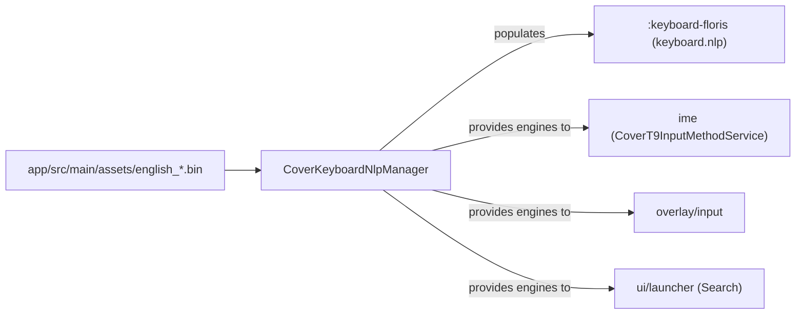

# `keyboard.nlp` Package (`:app`)

Application-level bridge that loads bundled dictionary binaries from `:app` assets into `:keyboard-floris` NLP engines.

## What This Module Holds

| File | Key Types | Responsibility |
| --- | --- | --- |
| `CoverKeyboardNlpManager.kt` | `CoverKeyboardNlpManager` | Loads `english_words.bin` and `english_bigrams.bin` from `AssetManager` and manages `BinaryTrieDictionary`, `SymSpellAutocorrect`, `T9PredictiveEngine`, and `DTWGlideDecoder` instances |

## Data Flow Diagram

## Works Hand-in-Hand With

| Module | Relationship | Link |
| --- | --- | --- |
| `:keyboard-floris` (`keyboard.nlp`) | Instantiates and populates `BinaryTrieDictionary`, `SymSpellAutocorrect`, `T9PredictiveEngine`, and `DTWGlideDecoder` | [floris nlp](../../../../../../../../../keyboard-floris/src/main/java/com/tyejaedon/coverscreenos/keyboard/nlp/README.md) |
| `ime` | Supplies NLP prediction engines to `CoverT9InputMethodService` | [ime](../../ime/README.md) |
| `overlay/input` | Supplies NLP prediction engines to the accessibility input fallback overlay | [overlay/input](../../overlay/input/README.md) |
| `ui/launcher` | Supplies NLP prediction engines to `OverlaySearchKeyboardBridge` | [ui/launcher](../../ui/launcher/README.md) |
