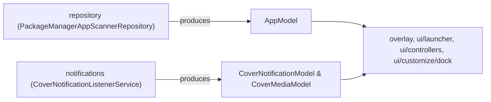

# `models` Package

Lightweight, immutable domain data models shared across repositories, notification listeners, controllers, and UI layers.

## What This Module Holds

| File | Key Types | Responsibility |
| --- | --- | --- |
| `AppModel.kt` | `AppModel` | Represents an installed launchable app (`name`, `packageName`, `iconDrawable`) |
| `CoverNotificationModel.kt` | `CoverMediaModel`, `CoverNotificationModel` | Represents active cover notifications and extracted media playback metadata/artwork |

## Data Flow Diagram

## Works Hand-in-Hand With

| Module | Relationship | Link |
| --- | --- | --- |
| `repository` | Populates `List<AppModel>` from Android `PackageManager` | [repository](../repository/README.md) |
| `notifications` | Publishes `CoverNotificationModel` and `CoverMediaModel` streams | [notifications](../notifications/README.md) |
| `ui/launcher` | Renders `AppModel` in the app grid/dock and `CoverNotificationModel` in notification/media panels | [ui/launcher](../ui/launcher/README.md) |
| `ui/controllers` & `overlay` | Uses `AppModel` for app launch coordination | [ui/controllers](../ui/controllers/README.md) |
