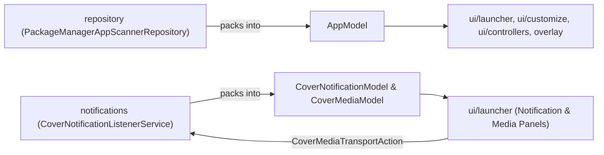

# `models` Package

## What This Folder Does

Think of the `models` folder as the **shared shipping boxes** used across Cover-Screen-OS.

Different parts of the app speak to different parts of Android—one reads installed apps from `PackageManager`, another listens to incoming notifications and music players, and the UI draws cards and icons on the tiny outer cover display. Instead of passing raw, messy Android system objects (`ResolveInfo` or `StatusBarNotification`) straight into Compose screens, those producers pack only the clean fields the cover screen actually cares about into simple, read-only Kotlin data classes here.

Because every model in this folder is **immutable** (`val` properties only, no business logic, no Android Context references), UI composables can compare them cheaply, preview them in tests, and pass them safely across threads.

---

## How It Works Step-by-Step

1. **System data arrives in a producer**:
   - `PackageManagerAppScannerRepository` asks Android for installed launchable apps.
   - `CoverNotificationListenerService` receives active notifications and media playback metadata from Android.
2. **Producers translate raw Android objects into shared models**:
   - Each installed app becomes an [`AppModel`](AppModel.kt).
   - Each notification (and optional music/podcast card) becomes a [`CoverNotificationModel`](CoverNotificationModel.kt) (with an optional nested `CoverMediaModel`).
3. **Consumers read the clean snapshots without Android coupling**:
   - The cover launcher draws app grids and dock shortcuts from `List<AppModel>`.
   - The cover notification drawer and now-playing widget render `CoverNotificationModel` and send button clicks back using `CoverMediaTransportAction`.

---

## File-by-File Guide

### [AppModel.kt](AppModel.kt)

- **In plain terms**: An ID badge for a single launchable app on your phone—its display name, its unique Android package ID, and (optionally) its app icon.
- **Key variables & state**:
  - `name: String` — The friendly title shown under the icon (like `"Messages"` or `"Spotify"`).
  - `packageName: String` — Android's unique technical ID (like `"com.spotify.music"`). Used as the stable key in lists, dock slots, and app launch intents.
  - `iconDrawable: Drawable?` — The app's icon graphic, defaulting to `null`. Keeping it nullable lets the app scanner run fast, lightweight text-only scans and cache them in memory without holding heavy icon bitmaps.
- **How it connects**: Produced by `PackageManagerAppScannerRepository` in [`repository`](../repository/README.md) and consumed by the cover app drawer (`ui/launcher`), dock slot picker (`ui/customize`), and launch coordinators (`overlay`, `ui/controllers`).

### [CoverNotificationModel.kt](CoverNotificationModel.kt)

- **In plain terms**: Everything the cover screen needs to show a notification card or a mini music player—without carrying around heavy system notification handles.
- **Key variables & state**:
  - `CoverMediaTransportAction` (enum) — The three playback commands a user can tap on the cover media card: `PLAY_PAUSE`, `PREVIOUS`, and `NEXT`.
  - `CoverMediaModel` — Playback snapshot for music/podcast cards:
    - `title` / `artist` (`String?`) — Track title and artist/subtitle text.
    - `isPlaying` (`Boolean`) — Controls whether the UI shows a Pause or Play icon.
    - `canPlayPause`, `canSkipPrevious`, `canSkipNext` (`Boolean`) — Capability flags read from Android's `PlaybackState` so unsupported buttons are disabled or hidden.
    - `artworkBitmap` (`Bitmap?`) — Optional album cover bitmap for thumbnail/backdrop artwork.
  - `CoverNotificationModel` — Card snapshot for any active notification:
    - `notificationKey` (`String`) — Android's unique `StatusBarNotification.key`, used to match updates or swipe-dismiss a specific notification.
    - `packageName` (`String`) — Identifies which app posted the alert.
    - `title` / `previewText` (`String`) — Compact heading and body snippet sized for the narrow cover screen.
    - `isClearable` / `isOngoing` (`Boolean`) — Flags telling the UI whether the card can be swiped away or represents an active background task (call, timer, media).
    - `postTime` (`Long`) — Epoch millisecond timestamp used to sort newest notifications first.
    - `isMediaNotification` (`Boolean`) & `media` (`CoverMediaModel?`) — Marks whether this notification carries live media controls and attaches the parsed `CoverMediaModel`.
- **How it connects**: Produced by `CoverNotificationListenerService` in [`notifications`](../notifications/README.md) and rendered by [`ui/launcher`](../ui/launcher/README.md) (both the notification panel and media panel).

---

## Quick-Reference Summary

| File | Types Defined | Mutable? | Main Producer | Main Consumers |
| --- | --- | --- | --- | --- |
| [AppModel.kt](AppModel.kt) | `AppModel` | No (`data class`) | [`repository`](../repository/README.md) | `ui/launcher`, `ui/customize`, `ui/controllers`, `overlay` |
| [CoverNotificationModel.kt](CoverNotificationModel.kt) | `CoverMediaTransportAction`, `CoverMediaModel`, `CoverNotificationModel` | No (`enum` + `data class`) | [`notifications`](../notifications/README.md) | `ui/launcher`, `overlay` |

---

## Architecture & Data Flow

---

## Works Hand-in-Hand With

| Package | How They Work Together | Link |
| --- | --- | --- |
| `repository` | Scans `PackageManager` and produces sorted `List<AppModel>` snapshots | [repository](../repository/README.md) |
| `notifications` | Converts Android `StatusBarNotification` and `MediaController` state into `CoverNotificationModel` | [notifications](../notifications/README.md) |
| `ui/launcher` | Draws the app grid, dock, notification cards, and media controls using these models | [ui/launcher](../ui/launcher/README.md) |
| `ui/controllers` & `overlay` | Uses `AppModel.packageName` to launch apps onto the cover display | [ui/controllers](../ui/controllers/README.md) · [overlay](../overlay/README.md) |
| `ui/customize` | Lists `AppModel` entries inside the phone-side dock shortcut picker | [ui/customize](../ui/customize/README.md) |
