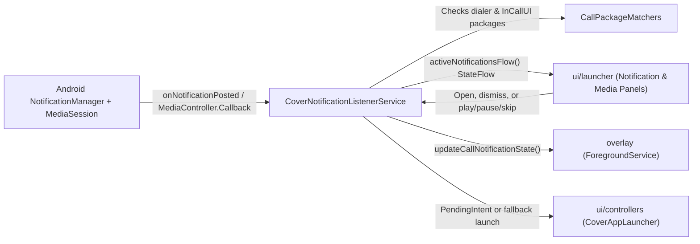

# `notifications` Package

The `notifications` package is Cover Screen OS's **cover-screen messenger and media remote**. Think of it like a smart reception desk for the outer display: whenever your phone receives an alert, starts playing music, or rings with a call, Android rings this service first—and this package sorts everything into clean notification cards, live music controls, or an urgent *"clear the screen for an incoming call"* signal.

---

## 1. What This Folder Does

Apps normally post notifications only to the phone's system shade, and lock/cover overlays cannot read them without a registered `NotificationListenerService`.

This folder handles three key responsibilities:
1. **Mirrors Active Notifications**: Subscribes to Android's notification stream (`onNotificationPosted` / `onNotificationRemoved`), extracts titles, bodies, clearability, and timestamps, and publishes a live sorted list via `activeNotificationsFlow()`.
2. **Powers Live Media Player Controls**: Detects notifications carrying an Android `MediaSession.Token`, binds `MediaController` callbacks for real-time track/play-state updates, normalizes album artwork bitmaps (`ARGB_8888`, capped at 512px), and relays Play/Pause/Previous/Next taps directly to the media app.
3. **Protects Native Call Screens**: Spots active cellular or VoIP calls (using `CallPackageMatchers`, `CATEGORY_CALL`, and ongoing call keywords) and notifies `ForegroundService` so the cover overlay steps aside and lets you answer or decline on the native call UI.

---

## 2. How It Works Step-by-Step

1. **System Binding**: When the user grants Notification Access, Android binds `CoverNotificationListenerService`. `onListenerConnected()` sets `listenerConnected = true`, stores the live singleton in `activeService`, and queues an initial snapshot refresh.
2. **Coalesced Refresh**: Rapid notification arrivals call `scheduleNotificationRefresh()`, which uses `refreshScheduled` + `callbackHandler` (main `Looper`) to merge bursts into a single `refreshActiveNotifications()` pass instead of hammering system Binder IPC on every event.
3. **Media Session Sync**: `syncMediaControllers()` inspects every active `StatusBarNotification` for `Notification.EXTRA_MEDIA_SESSION` (ignoring `NON_MEDIA_CATEGORIES` like calls, alarms, or navigation). It unregisters stale `MediaController.Callback`s and attaches new ones so song changes or pauses trigger instant refreshes without polling.
4. **Model Construction**: `toCoverNotificationModel()` transforms each notification into a `CoverNotificationModel`. For media notifications, it merges `MediaMetadata` (title, artist, album art) and `PlaybackState` bitmasks (`resolvePlaybackCapabilities()`) into an embedded `CoverMediaModel`, downscaling oversized artwork to `<= 512px` `ARGB_8888` bitmaps safe for Compose rendering.
5. **Call-Overlay Yielding**: `isLikelyActiveCallNotification()` checks `CallPackageMatchers.isIncomingCallPackage()`, `Notification.CATEGORY_CALL`, and ongoing call text (`"incoming call"`, `"ringing"`, `"calling"`). `dispatchCallNotificationState()` sends deduplicated changes (`lastCallNotificationState`) to `ForegroundService.updateCallNotificationState()`.
6. **User Actions from the Cover UI**:
   - **Tap a notification**: `openNotificationFromOverlay()` verifies the device isn't locked (`isDeviceLocked()`), asks `ForegroundService` to hide the overlay, sends the notification's `PendingIntent` (`contentIntent`) with Android 16+ `ActivityOptions` visibility flags, and falls back to `CoverAppLauncher.launchPackageOnDisplay()`.
   - **Swipe/Clear**: `dismissNotificationFromOverlay()` or `clearAllNotificationsFromOverlay()` forwards `cancelNotification` / `cancelAllNotifications` to Android.
   - **Music buttons**: `performMediaTransportAction()` dispatches `play()`, `pause()`, `skipToPrevious()`, or `skipToNext()` via `MediaController.transportControls`.

---

## 3. File-by-File Guide

### `CoverNotificationListenerService.kt`

- **In plain terms**: The system-bound listener that turns raw Android status bar notifications and media sessions into live Compose-ready data models, and executes user actions (open, dismiss, play/pause/skip) back on the system.
- **Key variables & state**:
  - `activeService` & `listenerConnected`: Volatile singleton reference to the bound service and connection flag guarding OS calls.
  - `activeNotificationModels` (`MutableStateFlow<List<CoverNotificationModel>>`): Backing stream exposed publicly via `activeNotificationsFlow()`, sorted newest-first.
  - `callbackHandler` & `refreshScheduled` / `refreshRunnable`: Main-thread `Handler` and coalescing guard preventing redundant Binder scans during notification bursts.
  - `mediaControllers` (`MutableMap<String, RegisteredMediaController>`): Tracks bound `MediaController` instances and their `MediaController.Callback`s keyed by `StatusBarNotification.key`.
  - `NON_MEDIA_CATEGORIES`: Notification categories (calls, alarms, progress, navigation, service, status, system, error, `"stopwatch"`) kept as regular cards even if they attach a media token.
  - `lastCallNotificationState` (`Pair<Boolean, String?>`): Deduplicates call-state notifications forwarded to `ForegroundService`.
  - `contentIntent`, `controller`, `controls`, `playbackState`: Per-action handles used to launch deep-link `PendingIntent`s or drive `MediaController.TransportControls`.
- **How it connects**: Consumes `CallPackageMatchers` for dialer/VoIP call detection, builds `CoverNotificationModel` and `CoverMediaModel` from `models`, feeds `OverlayNotificationPanel` and `OverlayMediaPanel` in `ui/launcher`, signals `ForegroundService` in `overlay`, checks lock state via `LockStatusReceiver`, and falls back to `CoverAppLauncher` in `ui/controllers`.

### `CallPackageMatchers.kt`

- **In plain terms**: A compact caller-ID lookup table of package names belonging to phone dialers and voice-call apps so Cover Screen OS knows when a notification represents an incoming or active call UI.
- **Key variables & state**:
  - `INCOMING_CALL_EXACT_PACKAGES`: Exact package matches (`com.google.android.dialer`, `com.whatsapp`, `com.whatsapp.w4b`).
  - `INCOMING_CALL_SURFACE_PREFIXES`: System/OEM telecom and InCallUI prefixes (`com.samsung.android.incallui`, `com.android.incallui`, `com.android.server.telecom`) matched both exactly and as `.subpackage` variants across Android/OneUI versions.
  - `normalizedPackage`: Trimmed, lowercased package identifier checked by `isIncomingCallPackage()`.
- **How it connects**: Queried by `CoverNotificationListenerService.isLikelyActiveCallNotification()` to decide whether an ongoing/call-category notification should suppress the cover overlay via `ForegroundService`.

---

## 4. Quick-Reference Summary

| File | Key Types | Role |
| --- | --- | --- |
| [CoverNotificationListenerService.kt](./CoverNotificationListenerService.kt) | `CoverNotificationListenerService`, `MediaPlaybackCapabilities`, `RegisteredMediaController` | Streams active notifications & media playback controls, handles open/dismiss/transport actions, and signals active calls |
| [CallPackageMatchers.kt](./CallPackageMatchers.kt) | `CallPackageMatchers` | Identifies dialer, VoIP, and system InCallUI packages for call-overlay suppression |

---

## 5. Architecture Flow

---

## 6. Works Hand-in-Hand With

| Module | Relationship | Link |
| --- | --- | --- |
| `models` | Defines `CoverNotificationModel`, `CoverMediaModel`, and `CoverMediaTransportAction` | [models](../models/README.md) |
| `overlay` | `ForegroundService` suppresses or hides the cover overlay during calls and notification launches | [overlay](../overlay/README.md) |
| `ui/launcher` | `OverlayNotificationPanel` and `OverlayMediaPanel` observe `activeNotificationsFlow()` | [ui/launcher](../ui/launcher/README.md) |
| `ui/controllers` | `CoverAppLauncher` launches the notification's source app on the cover display if `PendingIntent` fails | [ui/controllers](../ui/controllers/README.md) |
