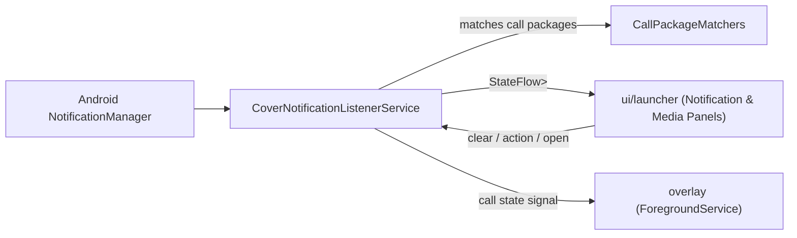

# `notifications` Package

Android `NotificationListenerService` integration that publishes active notifications, media playback state, and incoming/ongoing call signals.

## What This Module Holds

| File | Key Types | Responsibility |
| --- | --- | --- |
| `CoverNotificationListenerService.kt` | `CoverNotificationListenerService` | Listens to posted/removed notifications, extracts `CoverNotificationModel` & `CoverMediaModel`, and broadcasts call state changes |
| `CallPackageMatchers.kt` | `CallPackageMatchers` | Matches known dialer and VoIP call package prefixes (`incallui`, `telecom`, `dialer`, `whatsapp`) |

## Data Flow Diagram

## Works Hand-in-Hand With

| Module | Relationship | Link |
| --- | --- | --- |
| `models` | Builds `CoverNotificationModel` and `CoverMediaModel` | [models](../models/README.md) |
| `overlay` | `ForegroundService` consumes call-state signals to suppress the overlay during incoming calls | [overlay](../overlay/README.md) |
| `ui/launcher` | `OverlayNotificationPanel` and `OverlayMediaPanel` render and act on notification/media streams | [ui/launcher](../ui/launcher/README.md) |
| `ui/controllers` | Launches apps/actions from notification interactions | [ui/controllers](../ui/controllers/README.md) |
