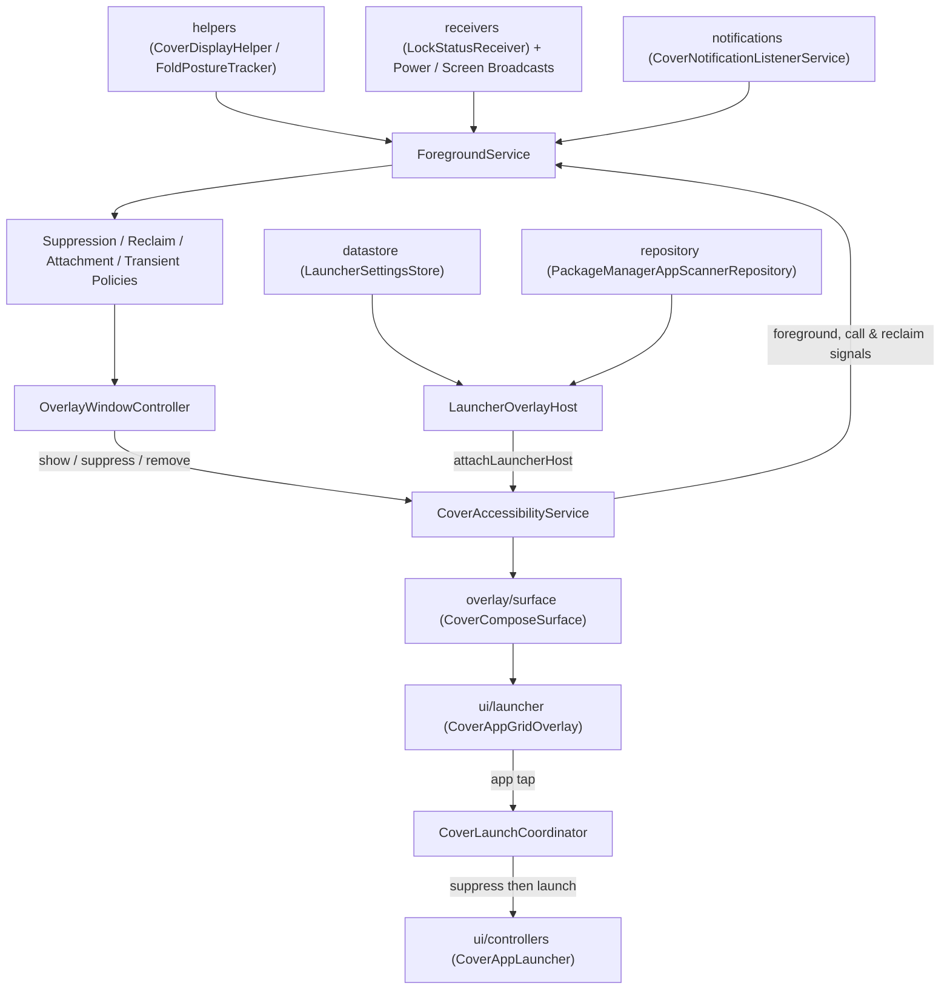

# `overlay` Package

## What This Folder Does

On clamshell foldables like the Samsung Galaxy Z Flip, Android and OEM firmware normally block third-party apps from replacing the cover screen's built-in home screen. The `overlay` package solves this without root or special "draw over other apps" (`SYSTEM_ALERT_WINDOW`) grants by pairing two system services:

- **`ForegroundService`** acts like the **stage manager**: it stays alive in the background, watches the secondary hardware display, hinge fold angle, screen power, device lock state, and active phone calls, and decides when the cover launcher should appear or step aside.
- **`CoverAccessibilityService`** acts like the **window holder**: because Android grants bound accessibility services a privileged `TYPE_ACCESSIBILITY_OVERLAY` window token, it owns the actual Compose window placed on top of the cover screen and reports back which app is currently on screen.

A suite of small policy classes (`OverlaySuppressionState`, `OverlaySuppressionReason`, `OverlayAttachmentPolicy`, `OverlayReclaimPolicy`, `OverlayTransientSignalPolicy`), a command bridge (`OverlayWindowController`), a single-flight launch guard (`CoverLaunchCoordinator`), and a dependency container (`LauncherOverlayHost`) keep those two services cleanly separated and prevent flickering or stuck overlays.

---

## How It Works Step-by-Step

1. **Start & Permission Check**: `ForegroundService` starts via `createStartIntent()`, promotes itself to a persistent foreground session (`ServiceInfo.FOREGROUND_SERVICE_TYPE_SPECIAL_USE`), and verifies core overlay permissions.
2. **Handoff Through `LauncherOverlayHost`**: On creation, `ForegroundService` builds an immutable `LauncherOverlayHost` holding the app repository, DataStore settings flow, widget host manager, lock state flow, and launch callbacks, then hands it to `CoverAccessibilityService.attachLauncherHost()`. Because `CoverAccessibilityService` stashes this in `pendingLauncherHost`, toggling Accessibility off and back on reconnects automatically without restarting `ForegroundService`.
3. **Display & Power Watching**: `ForegroundService` registers a `DisplayManager.DisplayListener` and a screen-state `BroadcastReceiver` (`ACTION_SCREEN_ON` / `ACTION_SCREEN_OFF`, seeded from `PowerManager.isInteractive`), plus lock-status and foldable-posture collectors via `CoverDisplayHelper`.
4. **Attaching to the Outer Screen**: When the device is closed, the screen is interactive, no unlock prompt is open, and a cover display exists, `ForegroundService` asks `OverlayWindowController.showOverlay()` -> `CoverAccessibilityService.showLauncher()`, which mounts `CoverComposeSurface` strictly on the cover `Display` ID (never `Display.DEFAULT_DISPLAY`).
5. **Launching an App (`CoverLaunchCoordinator`)**: When the user taps an app icon, `LauncherOverlayHost.onAppSelected` runs through `CoverLaunchCoordinator` on the main thread. It locks `activeLaunchPackage` against accidental double-taps, tells `ForegroundService` to suppress the overlay (`FLAG_NOT_TOUCHABLE` + `alpha = 0f` rather than tearing down the whole view tree), and launches the app on the cover display. If the launch fails, the overlay is restored immediately.
6. **Waiting While You Use the App**: While suppressed (`APP_LAUNCH`, `INCOMING_CALL`, or `POSTURE_UNFOLDED`), `ForegroundService` runs a 250 ms polling loop (`startSuppressionResumePolling`) and listens to `CoverAccessibilityService.onAccessibilityEvent` window updates. Crucially, `CoverAccessibilityService` ignores events from its own package name so opening Cover-Screen-OS's own keyboard or media panels never accidentally pulls the launcher back on top of an open app.
7. **Stepping Aside for Calls, Unlocking, Unfolding, or Screen-Off**:
   - **Phone calls**: `OverlayReclaimPolicy` keeps the overlay hidden while a dialer window or active call notification is live (plus a 5-second grace window).
   - **Unlock prompts**: `setUnlockPromptActive(true)` hides touchability while the system keyguard unlock UI is open.
   - **Unfolding**: Folding posture `HALF_FOLDED` or `FLAT` triggers `POSTURE_UNFOLDED` suppression until the phone closes (`CLOSED`).
   - **Screen off**: `ACTION_SCREEN_OFF` completely removes the overlay (`removeOverlay()`) so Always-On Display (AOD) and sleep states stay dark and unobstructed, rebuilding on `ACTION_SCREEN_ON`.
8. **Returning Home (Reclaim)**: When the user closes or exits the cover app back to Samsung's `SubHomeActivity` or stock launcher—verified by `CoverHomeSurfaceMatcher`, `OverlayTransientSignalPolicy` (including sustained non-shade SystemUI dwell fallback), and `CoverAccessibilityService`'s two-stage debounce (`RECLAIM_STABILITY_DEBOUNCE_MS = 1_500L` plus API 30+ `inspectDisplayWindowState`, which checks z-order against any remaining user app or dialog window and recognizes `TYPE_SYSTEM` cover surfaces)—`ForegroundService` clears suppression once (`suppressionSessionId` guard) and makes the launcher touchable and visible again. Additionally, `monitoredCoverDisplayId` retains display event tracking across screen-off surface detaches, `startFoldPostureObservation` upgrades active `APP_LAUNCH` sessions to `POSTURE_UNFOLDED` on hinge open, and `priorAppLaunchPackageName` restores interrupted app-launch suppression after mid-app calls end.

---

## File-by-File Guide

### `ForegroundService.kt`

- **In plain terms**: The central brain and persistent runtime engine of Cover-Screen-OS. Like an air-traffic controller, it tracks screen power, display changes, phone fold posture, lock state, active calls, and running apps so the cover launcher only appears when appropriate.
- **Key variables & state**:
  - `runtime` / `mutableRuntime`: `StateFlow<RuntimeSnapshot>` broadcasting service, host, and overlay status plus the latest 20 `OverlayEvent` milestones.
  - `activeServiceRef` (`@Volatile WeakReference<ForegroundService>?`): lets static entry points (`requestOverlayReclaim`, `setUnlockPromptActive`, etc.) reach the live service without leaking memory.
  - `isOverlayActive` (`@Volatile Boolean`): single source of truth checked by `CoverAccessibilityService` before intercepting gestures or hardware Back.
  - `serviceScope` (`CoroutineScope`): main-thread `SupervisorJob` scope cancelled in `onDestroy()`.
  - `suppressionState`, `reclaimPolicy`, `transientSignalPolicy`, `overlayAttachmentPolicy`: the policy engine and mutable state machine controlling suppression and reclaim.
  - `overlayRequested`, `isScreenInteractive`, `isUnlockPromptActive`, `hasEnteredForeground`, `isDisplayListenerRegistered`, `isScreenStateReceiverRegistered`: lifecycle and hardware state flags.
  - `pendingDisplayRetargetJob`, `suppressionResumePollerJob`, `foldPostureJob`: active coroutine jobs for display attachment, 250 ms resume polling, and hinge posture collection.
  - `launcherOverlayHost` & `widgetHostManager`: the host bundle handed to `CoverAccessibilityService` and the `AppWidgetHost` listener started only while the overlay is visible.
- **How it connects**: Owns `LauncherOverlayHost`, `CoverLaunchCoordinator`, and `OverlayWindowController`; consumes signals from `CoverDisplayHelper`, `CoverNotificationListenerService`, `CoverAccessibilityService`, and `CoverInputAccessibilityService`; issues window commands through `OverlayWindowController`.

### `CoverAccessibilityService.kt`

- **In plain terms**: Android's privileged window host and foreground lookout. Because Android only lets an `AccessibilityService` draw `TYPE_ACCESSIBILITY_OVERLAY` windows over system/third-party surfaces without `SYSTEM_ALERT_WINDOW`, this service holds the actual Compose view on the cover display and watches window transitions and navigation gestures.
- **Key variables & state**:
  - `activeServiceRef` (`@Volatile WeakReference<CoverAccessibilityService>?`) and `pendingLauncherHost`: static handoff slots so `ForegroundService` can attach a `LauncherOverlayHost` before the accessibility service connects or across disable/enable cycles.
  - `launcherHost` (`@Volatile LauncherOverlayHost?`) and `launcherSurface` (`CoverComposeSurface?`): the active data/callback bundle and the mounted Compose overlay surface.
  - `latestForegroundPackage`, `latestForegroundClassName`, `latestForegroundEventElapsedMs`: `@Volatile` snapshot of the latest non-self foreground app seen on the cover display.
  - `reclaimCandidatePackage`, `reclaimCandidateSinceElapsedMs`, `pendingReclaimCheck`, `reclaimHandler`: two-stage debounce state requiring native cover home to stay on top for `RECLAIM_STABILITY_DEBOUNCE_MS` (1.5 s) and confirming via `inspectDisplayWindowState()` (`windowsOnAllDisplays` on API 30+) that no user app window remains visible.
  - `lastKnownUserAppPackage`, `lastKnownUserAppElapsedMs`: guards against premature reclaim for `RECENT_USER_APP_GUARD_MS` (2 s) after seeing a real user app.
  - `lastGestureId`, `lastGestureAtMs`, `lastActionAtMs`: debounce/throttle timers for `onGesture` and `onKeyEvent` global actions (`GLOBAL_ACTION_BACK`, `HOME`, `RECENTS`, `NOTIFICATIONS`, `LOCK_SCREEN`).
- **How it connects**: Receives `LauncherOverlayHost` and window commands from `ForegroundService` / `OverlayWindowController`; mounts `CoverAppGridOverlay` inside `CoverComposeSurface`; pushes foreground/call/reclaim signals back to `ForegroundService`.

### `LauncherOverlayHost.kt`

- **In plain terms**: A read-only "care package" (dependency and callback bundle) passed from `ForegroundService` to `CoverAccessibilityService` so the Compose launcher UI has everything it needs without coupling the accessibility service to launch internals.
- **Key variables & state**:
  - `appRepository`: installed app catalog (`PackageManagerAppScannerRepository`).
  - `launcherSettingsStore` & `settings`: DataStore preferences and combined `Flow<LauncherSettings>` (theme, dock, wallpaper, widgets, keyboard strategy).
  - `deviceLockState` (`StateFlow<Boolean>`): live lock status from `CoverDisplayHelper`.
  - `launchCoordinator`, `widgetHostManager`: launch coordinator and widget host passed through for grid/widget actions.
  - `onAppSelected`, `persistKeyboardStrategy`, `onRequestUnlock`, `onOpenCustomize`, `onAddWidgetRequest`: safe callbacks executing inside `ForegroundService`.
- **How it connects**: Created in `ForegroundService.onCreate()`, stashed/installed in `CoverAccessibilityService`, and consumed directly by `CoverAppGridOverlay` inside `CoverAccessibilityService.showLauncher()`.

### `OverlayWindowController.kt`

- **In plain terms**: A thin remote-control / walkie-talkie used by `ForegroundService` to tell `CoverAccessibilityService` when to attach (`showOverlay`), mute touches (`suppressOverlayForLaunch` / `hideOverlay`), or tear down (`removeOverlay` / `destroy`) the launcher window.
- **Key variables & state**:
  - Holds only `LOG_TAG`; intentionally stateless because `CoverAccessibilityService` owns the single live `CoverComposeSurface` and its `Display` ID (`getActiveDisplayId()`, `isOverlayAttached()`).
- **How it connects**: Instantiated once in `ForegroundService` and delegates every method to companion bridge methods on `CoverAccessibilityService`.

### `CoverLaunchCoordinator.kt`

- **In plain terms**: A single-lane launch turnstile. When you tap an app icon on the cover screen, it makes sure two taps don't collide, temporarily hides the overlay *before* the new app opens, and restores the overlay if the launch fails.
- **Key variables & state**:
  - `activeLaunchPackage` (`String?`): non-null while a launch is mid-flight, blocking overlapping launches until `completeLaunch()` runs.
  - `onBeginLaunch`, `onLaunchDispatched`, `onLaunchFailed`: lifecycle hooks wired by `ForegroundService`.
  - `debugThrowOnThreadViolation` & `isMainThread`: enforces main-thread safety (throwing in debug builds, conservatively dropping/recovering in release builds).
- **How it connects**: Used by `LauncherOverlayHost` callbacks (`onAppSelected`, `onOpenCustomize`, `onAddWidgetRequest`) to coordinate `ForegroundService` suppression with `CoverAppLauncher`.

### `OverlaySuppressionReason.kt`

- **In plain terms**: A simple 4-value tag explaining *why* the cover launcher is currently stepped aside instead of permanently closed.
- **Key variables & state**:
  - `NONE`: overlay is active/eligible on the cover display.
  - `APP_LAUNCH`: a launched app owns the foreground.
  - `INCOMING_CALL`: a phone call screen or ongoing call notification needs direct user interaction.
  - `POSTURE_UNFOLDED`: the foldable is open (`HALF_FOLDED` or `FLAT`), so the inner display is active.
- **How it connects**: Stored in `OverlaySuppressionState.suppressionReason` and inspected throughout `ForegroundService` and `OverlayTransientSignalPolicy`.

### `OverlaySuppressionState.kt`

- **In plain terms**: The notebook holding all live timers, counters, and IDs for the current suppression session so policy classes stay testable and clean.
- **Key variables & state**:
  - `isOverlaySuppressedForAppLaunch`, `suppressionReason`, `launchSuppressedPackageName`, `launchSuppressedStartedElapsedMs`: core active suppression state.
  - `suppressionSessionId` & `completedSuppressionSessionId`: monotonically incremented session ID ensuring concurrent polling ticks and reclaim events never restore the overlay twice for the same session.
  - `resumeSignalStableCount` & `lastResumeSignalPackage`: counts consecutive identical foreground packages (`hasStableResumeSignal`) to filter brief window flicker.
  - `lastOverlayReclaimElapsedMs` & `lastOverlayReclaimReason`: rate-limits duplicate reclaim requests (`shouldSkipReclaimRequest`).
  - `incomingCallPassthroughPackage`, `incomingCallPassthroughStartedElapsedMs`, `incomingCallLastSignalElapsedMs`, `callNotificationActive`, `callNotificationPackage`, `callNotificationLastSignalElapsedMs`: incoming-call window and notification tracking.
- **How it connects**: Owned by `ForegroundService` and mutated/evaluated by `OverlayReclaimPolicy` and `ForegroundService`'s resume state machine.

### `OverlayAttachmentPolicy.kt`

- **In plain terms**: A small safety check answering: *"The cover display briefly disappeared or isn't returned right now—should we keep our existing hidden overlay window mounted, or tear it down completely?"*
- **Key variables & state**:
  - `defaultDisplayId` (defaults to `Display.DEFAULT_DISPLAY`): guarantees we **never** hold an overlay window attached on the primary inner display.
- **How it connects**: Called by `ForegroundService.attachOrRetargetOverlay()` when `CoverDisplayHelper.getCoverDisplay()` returns `null`; returns `true` only if the overlay is attached to a valid non-default display ID.

### `OverlayReclaimPolicy.kt`

- **In plain terms**: The phone-call bodyguard. Makes sure Cover-Screen-OS never covers up an incoming or active call screen, even if system windows flicker briefly during the call.
- **Key variables & state**:
  - `incomingCallSuppressionMaxMs` (2 hours in production): failsafe upper limit so a missed end-call signal cannot hide the launcher indefinitely.
  - `incomingCallReclaimBlockGraceMs` (5 seconds in production): post-signal grace period blocking premature reclaim right after a call window or notification disappears.
- **How it connects**: Owned by `ForegroundService`, reads/updates `OverlaySuppressionState`, and matches dialer packages via `CallPackageMatchers.isIncomingCallPackage`.

### `OverlayTransientSignalPolicy.kt`

- **In plain terms**: A smart bouncer that tells apart momentary SystemUI/AOD flickers (volume bars, notification flashes) from the user actually closing an app back to the cover home screen. Includes `CoverHomeSurfaceMatcher`, which recognizes both standard launchers and Samsung One UI's cover `com.android.systemui/.subscreen.SubHomeActivity`.
- **Key variables & state**:
  - `transientForegroundPackage` & `transientForegroundSinceElapsedMs`: tracks how long a safe SystemUI/AOD surface has held foreground focus against `transientSystemUiResumeGraceMs` (120 ms).
  - `transientSystemUiSeenElapsedMs` & `transientAodSeenElapsedMs`: records recent SystemUI and Samsung AOD events so `shouldResumeFromTransientExitPattern()` detects an app exit when both fire within `transientExitPatternWindowMs` (1.8 s) after `transientExitFailsafeMinSuppressionMs` (700 ms).
  - Prefix lists (`transientSystemUiPrefixes`, `transientSystemUiResumeSafePrefixes`, `overlayResumePackagePrefixes`, `launcherPackagePrefixes`).
- **How it connects**: Used by `ForegroundService` during `APP_LAUNCH` resume polling and by `CoverAccessibilityService` (`CoverHomeSurfaceMatcher`) when inspecting live cover windows and classifying foreground events.

---

## Quick-Reference Summary

| File / Sub-Package | Key Types | Role in One Line |
| --- | --- | --- |
| `ForegroundService.kt` | `ForegroundService`, `OverlayEvent`, `RuntimeSnapshot` | Persistent `specialUse` service running display, power, fold, and suppression/resume policy loops |
| `CoverAccessibilityService.kt` | `CoverAccessibilityService`, `CoverWindowSnapshot` | Accessibility host owning the `TYPE_ACCESSIBILITY_OVERLAY` window, gestures, and reclaim detection |
| `LauncherOverlayHost.kt` | `LauncherOverlayHost` | Immutable dependency and callback container handed from `ForegroundService` to `CoverAccessibilityService` |
| `OverlayWindowController.kt` | `OverlayWindowController` | Stateless command bridge forwarding show, suppress, and remove actions to `CoverAccessibilityService` |
| `CoverLaunchCoordinator.kt` | `CoverLaunchCoordinator` | Main-thread single-flight guard synchronizing overlay suppression with app Activity launches |
| `OverlaySuppressionReason.kt` | `OverlaySuppressionReason` | Enum of suppression causes (`NONE`, `APP_LAUNCH`, `INCOMING_CALL`, `POSTURE_UNFOLDED`) |
| `OverlaySuppressionState.kt` | `OverlaySuppressionState` | Mutable state holder for session IDs, stability counters, reclaim cooldowns, and call timers |
| `OverlayAttachmentPolicy.kt` | `OverlayAttachmentPolicy` | Decides whether to hold a non-default-display overlay hidden vs removing stale window state |
| `OverlayReclaimPolicy.kt` | `OverlayReclaimPolicy` | Protects incoming/active call surfaces from premature overlay reclaim using grace timers |
| `OverlayTransientSignalPolicy.kt` | `CoverHomeSurfaceMatcher`, `OverlayTransientSignalPolicy` | Classifies `SubHomeActivity` / launchers vs transient SystemUI/AOD flashes |
| `surface/` | `CoverComposeSurface` | Display-scoped `WindowManager` + custom AndroidX lifecycle host for `ComposeView` |
| `input/` | `CoverScreenInputInjectionEngine`, `TextDelta` | Accessibility-based text input fallback overlay |

---

## Data Flow Diagram

---

## Works Hand-in-Hand With

| Module | Relationship | Link |
| --- | --- | --- |
| `overlay/surface` | `CoverAccessibilityService` uses `CoverComposeSurface` to attach `ComposeView` onto the cover `Display` | [overlay/surface](surface/README.md) |
| `overlay/input` | Coordinates cover-screen text input fallback overlay without triggering launcher reclaim | [overlay/input](input/README.md) |
| `ui/launcher` | `CoverAppGridOverlay` renders inside `CoverComposeSurface` using `LauncherOverlayHost` state | [ui/launcher](../ui/launcher/README.md) |
| `ui/controllers` | `CoverLaunchCoordinator` pairs suppression with `CoverAppLauncher` and `UnlockBridgeActivity` | [ui/controllers](../ui/controllers/README.md) |
| `helpers` & `receivers` | Supply cover display selection, fold posture (`CoverFoldPosture`), and lock status to `ForegroundService` | [helpers](../helpers/README.md) |
| `notifications`, `datastore`, `repository` | Supply active call notifications, persisted `LauncherSettings`, and installed app listings | [notifications](../notifications/README.md) |
