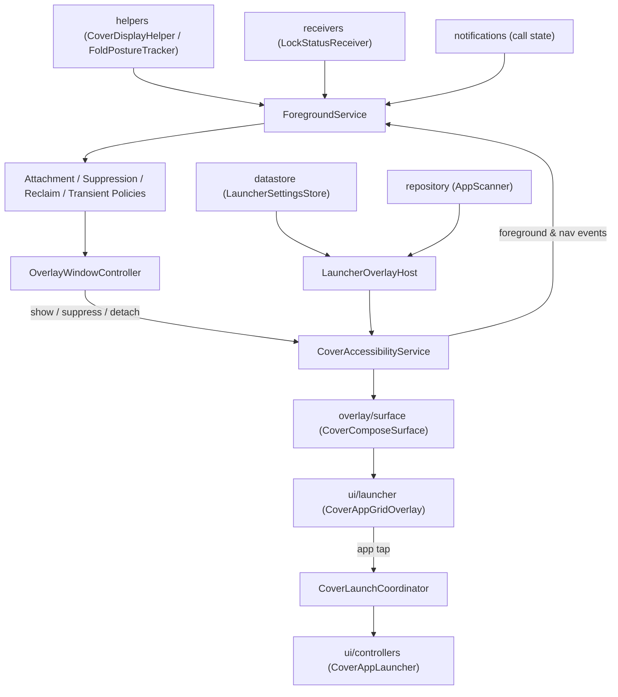

# `overlay` Package

Persistent runtime engine and accessibility-hosted window owner that manages the cover-screen launcher lifecycle, suppression, reclaim policies, and app launch coordination.

## What This Module Holds

| File / Sub-Package | Key Types | Responsibility |
| --- | --- | --- |
| `ForegroundService.kt` | `ForegroundService`, `OverlayEvent`, `RuntimeSnapshot` | Persistent `specialUse` foreground runtime orchestrating display/lock monitoring, suppression, recovery, and host state |
| `CoverAccessibilityService.kt` | `CoverAccessibilityService` | Accessibility service owning the `TYPE_ACCESSIBILITY_OVERLAY` launcher window and emitting foreground/navigation signals |
| `LauncherOverlayHost.kt` | `LauncherOverlayHost` | Dependency & callback handoff container (`StateFlow`s, repository, launch callback) passed from `ForegroundService` to `CoverAccessibilityService` |
| `OverlayWindowController.kt` | `OverlayWindowController` | Command bridge delegating show, suppress, and remove requests to `CoverAccessibilityService` |
| `CoverLaunchCoordinator.kt` | `CoverLaunchCoordinator` | Coordinates app launches from the cover overlay with `CoverAppLauncher` and `UnlockBridgeActivity` |
| `OverlayAttachmentPolicy.kt` | `OverlayAttachmentPolicy` | Evaluates whether the overlay should attach/reattach to the active cover display |
| `OverlaySuppressionState.kt` & `OverlaySuppressionReason.kt` | `OverlaySuppressionState`, `OverlaySuppressionReason` | Tracks active suppression reason (`NONE`, `APP_LAUNCH`, `INCOMING_CALL`, `POSTURE_UNFOLDED`) and session IDs |
| `OverlayReclaimPolicy.kt` | `OverlayReclaimPolicy` | Governs overlay reclaim timing and incoming-call passthrough grace windows |
| `OverlayTransientSignalPolicy.kt` | `OverlayTransientSignalPolicy` | Filters transient SystemUI/AOD foreground events to prevent premature overlay reclaim or flicker |
| `input/` | `CoverScreenInputInjectionEngine`, `TextDelta` | Accessibility-based text input fallback overlay |
| `surface/` | `CoverComposeSurface` | Display-scoped `WindowManager` + `ComposeView` lifecycle host |

## Data Flow Diagram

## Works Hand-in-Hand With

| Module | Relationship | Link |
| --- | --- | --- |
| `overlay/surface` | `CoverAccessibilityService` uses `CoverComposeSurface` to attach Compose UI onto the cover display | [overlay/surface](surface/README.md) |
| `overlay/input` | Coordinates cover-screen input fallback when a focused field needs accessibility text injection | [overlay/input](input/README.md) |
| `ui/launcher` | Rendered inside `CoverComposeSurface` using `LauncherOverlayHost` state | [ui/launcher](../ui/launcher/README.md) |
| `ui/controllers` | `CoverLaunchCoordinator` delegates activity launches and keyguard unlock to `CoverAppLauncher` / `UnlockBridgeActivity` | [ui/controllers](../ui/controllers/README.md) |
| `helpers` & `receivers` | Supply display, fold posture, and lock signals to `ForegroundService` | [helpers](../helpers/README.md) |
| `notifications` & `datastore` | Supply call-state suppression signals and live settings `Flow` | [notifications](../notifications/README.md) |
