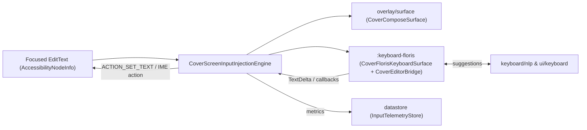

# `overlay.input` Package

Accessibility-based cover-screen input injection engine (`CoverInputAccessibilityService` / `CoverScreenInputInjectionEngine`) used when the system IME is unavailable or an overlay keyboard fallback is needed.

## What This Module Holds

| File | Key Types | Responsibility |
| --- | --- | --- |
| `CoverScreenInputInjectionEngine.kt` | `CoverKeyboardMode`, `InjectionMethod`, `CoverFieldMetadata`, `CoverInputAccessibilityService` | Tracks focused editable `AccessibilityNodeInfo` fields, hosts the cover input overlay, and injects text via `ACTION_SET_TEXT` or clipboard/IME fallback |
| `CoverScreenInputInjectionEnginePatch.kt` | `previousWordLength` | Text-editing helper extensions for word-level deletion/replacement |
| `TextDelta.kt` | `TextDelta`, `TextInjectionTarget` | Computes incremental text deltas and target field descriptors |

## Data Flow Diagram

## Works Hand-in-Hand With

| Module | Relationship | Link |
| --- | --- | --- |
| `overlay/surface` | Attaches the input overlay window on the cover display via `CoverComposeSurface` | [overlay/surface](../surface/README.md) |
| `:keyboard-floris` | Renders `CoverFlorisKeyboardSurface` and routes edits via `CoverEditorBridge` | [keyboard-floris](../../../../../../../../../keyboard-floris/README.md) |
| `ui/keyboard` & `ui/keyboard/primitives` | Supplies T9/prediction toggles, suggestion strips, haptics, and key sound primitives | [ui/keyboard](../../ui/keyboard/README.md) |
| `datastore` | Reads keyboard strategy/preferences and logs `InputTelemetryStore` counters | [datastore](../../datastore/README.md) |
| `helpers` | `InputCapabilityDetector` reports input overlay availability | [helpers](../../helpers/README.md) |
