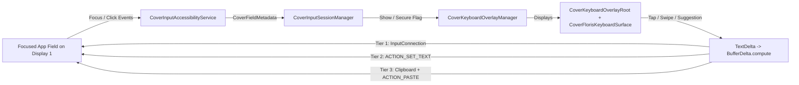

# `overlay.input` Package

## What This Folder Does

Typing on the outer cover screen of a clamshell foldable is tricky: Android OEMs often block third-party apps from acting as the default cover-screen keyboard, or the stock system keyboard covers up the tiny screen. This package works around that by running **Cover-Screen-OS's own floating keyboard overlay** inside an Android `AccessibilityService` (`CoverInputAccessibilityService`).

Think of it like a smart translator standing between a miniature touchscreen keypad and whatever app is open on the cover display. When you tap a text box on the outer screen, this package:
1. Notices which input box you tapped and suppresses the stock system keyboard.
2. Pops up a compact Compose keyboard window tuned for the small cover display.
3. Tracks every letter, backspace, T9 multi-tap, or word suggestion in a safe local scratchpad (`TextBuffer`).
4. Delivers only the smallest possible edit (`BufferDelta`) into the target app using the most reliable channel that app supports—from a real soft-keyboard `InputConnection`, down to accessibility `ACTION_SET_TEXT`, down to clipboard paste.

## How It Works Step-by-Step

1. **Detect a tap on an input field**: `CoverInputAccessibilityService` listens for `TYPE_VIEW_FOCUSED` and `TYPE_VIEW_CLICKED` events whose `displayId` matches the outer cover screen (`COVER_DISPLAY_ID = 1`).
2. **Extract field rules into a snapshot**: `CoverFieldMetadata.fromNode()` inspects the focused `AccessibilityNodeInfo` to figure out whether the box wants numbers/PINs, passwords, multi-line text, or a special Enter button (`Go`, `Search`, `Send`, `Done`).
3. **Start a typing session and show the overlay**: `CoverInputSessionManager.onFieldFocused()` stores the initial text and cursor position in `textBuffer`, chooses a matching keyboard layout (`NUMERIC_PIN`, `T9_MULTITAP`, or `QWERTY`), and asks `CoverKeyboardOverlayManager` to attach `CoverKeyboardOverlayRoot` onto display 1 (turning on `FLAG_SECURE` for passwords).
4. **Turn key presses into minimal edits**: Every keypad tap becomes a `TextDelta` (`Insert`, `ReplacePreviousChar`, `Backspace`, `Clear`, `Commit`, or `CommitCurrentWord`). `CoverInputSessionManager.applyDelta()` acquires `injectionLock`, updates `textBuffer`, and calls `BufferDelta.compute()` to find the exact slice of characters that changed.
5. **Inject the edit through three fallback tiers**:
   - **Tier 1 (`IME_INPUT_CONNECTION`)**: Writes only the changed characters through `InputConnection.commitText()` (required for Flutter, React Native, WebViews, and banking apps).
   - **Tier 2 (`ACTION_SET_TEXT`)**: Replaces the node's text via `AccessibilityNodeInfo.ACTION_SET_TEXT` and restores the caret with `ACTION_SET_SELECTION`.
   - **Tier 3 (`ACTION_PASTE_CLIPBOARD`)**: Copies the text onto `ClipboardManager` and triggers `ACTION_PASTE` (blocked for password fields).
6. **Protect passwords & avoid accidental close**: Password keystrokes stay strictly inside `textBuffer` until you tap Done (`commitAndFinish()`). Meanwhile, `FocusLossGate` and a 50 ms `Handler` check verify that focus is genuinely gone for 400 ms before closing the keyboard.

## File-by-File Guide

### `CoverInputModels.kt`
- **In plain terms**: The shared data models, timing constants, field security scanner, and focus-loss timer (`FocusLossGate`) used across the input injection package.
- **Key variables & state**:
  - `COVER_DISPLAY_ID`, `INTERNAL_CLIP_LABEL`, `CLIPBOARD_RESTORE_DELAY_MS`, `INJECTION_ECHO_IGNORE_WINDOW_MS`, `FIELD_FOCUS_GRACE_MS`, `FOCUS_LOSS_CONFIRM_DELAY_MS`: Package-internal constants governing echo suppression, clipboard restoration, and hysteresis delays.
  - `CoverKeyboardMode`, `InjectionMethod`, `CoverFieldMetadata`, `CoverInputSessionState`, and `FocusLossGate`: Immutable models and focus-loss state machine.
- **How it connects**: Shared foundation imported by `CoverInputSessionManager.kt`, `CoverInputAccessibilityService.kt`, and `CoverKeyboardOverlayUI.kt`.

### `CoverInputSessionManager.kt`
- **In plain terms**: The central session coordinator that owns the scratchpad buffer (`TextBuffer`), serializes edits (`injectionLock`), routes `TextDelta` updates to the target app, and handles speech dictation commits.
- **Key variables & state**:
  - `sessionState` / `_sessionState`: `StateFlow<CoverInputSessionState>` holding the live buffer, cursor index, active keyboard mode, T9 predictive digits, and status message.
  - `textBuffer` & `injectionLock`: Composing-aware `TextBuffer` guarded by a synchronous `ReentrantLock`.
  - `lastInjectedText` & `lastInjectionTimestamp`: Echo-detection state for `isRecentSelfEcho()`.
  - `relinquishedPackage`: Stores an app package opted out to the system keyboard.
- **How it connects**: Driven by UI events and voice dictation (`commitDictatedText`); dispatches minimal `BufferDelta` edits into `AccessibilityServiceInjectionTarget`.

### `CoverInputAccessibilityService.kt`
- **In plain terms**: The Android `AccessibilityService` watching cover-screen focus/window events dynamically via `CoverDisplayHelper`, hiding Samsung HoneyBoard, and delivering text through `InputConnection`, `ACTION_SET_TEXT`, or non-destructive snapshot-and-restore `ACTION_PASTE`.
- **Key variables & state**:
  - `targetFocusedNode`: Cached `AccessibilityNodeInfo` refreshed across interactive windows so our overlay never shadows the target editor.
  - `displayHelper` & `cachedCoverDisplayId`: Dynamically tracks the secondary cover display ID via `DisplayManager.DisplayListener` (cleaned up in `onDestroy`).
  - `focusLossGate` & `pendingFocusLossCheck`: Hysteresis timer and `Handler(Looper.getMainLooper())` runnable confirming true focus loss before dismissing.
  - `injectDeltaViaClipboard` / `restoreClipboardIfInternal`: Tier-3 delta paste selecting `[replaceStart, replaceEnd]` and restoring the user's original `ClipData` after `150ms`.
- **How it connects**: Binds itself to `CoverInputSessionManager` and exposes `connectedService` for BAL-exempt app launches.

### `CoverKeyboardOverlayUI.kt`
- **In plain terms**: The window manager wrapper (`CoverKeyboardOverlayManager`) and Jetpack Compose UI (`CoverKeyboardOverlayRoot`) attaching `CoverFlorisKeyboardSurface` to the cover display, complete with contacts watchdog integration and voice dictation controls.
- **Key variables & state**:
  - `surface` (`CoverComposeSurface`): Attaches `TYPE_ACCESSIBILITY_OVERLAY` with `FLAG_WATCH_OUTSIDE_TOUCH` and `FLAG_SECURE` for password fields.
  - `voiceDictation` & `contactRevision`: Speech-to-text microphone handle and live contacts/permission revision watcher.
- **How it connects**: Renders `:keyboard-floris` (`CoverFlorisKeyboardSurface`), queries `CoverKeyboardNlpManager`, and persists per-app settings in `LauncherSettingsStore`.

### `TextDelta.kt`
- **In plain terms**: The "diffing calculator" that turns high-level keyboard actions (like typing a letter or accepting a word suggestion) into the smallest possible patch (`BufferDelta`) between the old and new text.
- **Key variables & state**:
  - `TextDelta` variants (`Insert`, `ReplacePreviousChar`, `Backspace`, `Clear`, `Commit`, `CommitCurrentWord`): Describe user intentions independent of any Android view API.
  - `BufferDelta.old` & `BufferDelta.new`: Full buffer strings before and after the edit.
  - `BufferDelta.replaceStart` & `BufferDelta.replaceEnd`: Start/end character indices in `old` computed by scanning matching prefixes from the left (`prefix`) and non-overlapping matching suffixes from the right (`suffix`).
  - `BufferDelta.insert` & `BufferDelta.newCaret`: The minimal replacement substring from `new` and the final cursor offset.
  - `TextInjectionTarget`: Test seam interface implemented in production by `AccessibilityServiceInjectionTarget` and mocked in unit tests.
- **How it connects**: Produced by `CoverInputSessionManager` key/candidate methods, computed by `BufferDelta.compute()`, and consumed by `CoverInputAccessibilityService.applyDeltaToFocusedField()`.

### `CoverScreenInputInjectionEnginePatch.kt`
- **In plain terms**: A small helper file containing `previousWordLength(text)`, which measures how many characters to erase when the user triggers a word-level backspace.
- **Key variables & state**:
  - `trimmed`: Input slice before the cursor with trailing spaces removed (`text.trimEnd()`) so deleting a word right after a space removes both the trailing spaces and the word itself.
  - `lastSpace`: Index of the space immediately before the target word (`-1` if there is only one word left before the cursor).
- **How it connects**: Called directly by `CoverInputSessionManager.deletePreviousWord()` to turn a word-delete gesture into an exact `TextDelta.Backspace(count)` call.

## Quick-Reference Summary

| File | Primary Types | Main Job |
| --- | --- | --- |
| `CoverInputModels.kt` | `CoverKeyboardMode`, `InjectionMethod`, `CoverFieldMetadata`, `FocusLossGate`, `CoverInputSessionState` | Shared timing constants, field metadata/security scanner, and focus-loss hysteresis |
| `CoverInputSessionManager.kt` | `CoverInputSessionManager`, `AccessibilityServiceInjectionTarget` | Serializes buffer mutations, computes deltas, and coordinates active typing/voice sessions |
| `CoverInputAccessibilityService.kt` | `CoverInputAccessibilityService` | Watches cover focus/windows, injects via InputConnection / `ACTION_SET_TEXT` / non-destructive Paste |
| `CoverKeyboardOverlayUI.kt` | `CoverKeyboardOverlayManager`, `CoverKeyboardOverlayRoot` | Attaches the `TYPE_ACCESSIBILITY_OVERLAY` window and renders `CoverFlorisKeyboardSurface` |
| `TextDelta.kt` | `TextDelta`, `BufferDelta`, `TextInjectionTarget` | Represents keypad actions and computes minimal O(N) prefix/suffix text patches |
| `CoverScreenInputInjectionEnginePatch.kt` | `previousWordLength` | Calculates character counts for whole-word backward deletion |

## Data Flow Diagram

## Works Hand-in-Hand With

| Module | Relationship | Link |
| --- | --- | --- |
| `overlay/surface` | Attaches the floating keyboard window on the cover display via `CoverComposeSurface` | [overlay/surface](../surface/README.md) |
| `:keyboard-floris` | Renders `CoverFlorisKeyboardSurface` and routes edits via `CoverEditorBridge` | [keyboard-floris](../../../../../../../../../keyboard-floris/README.md) |
| `ui/keyboard` & `ui/keyboard/primitives` | Supplies `TextBuffer`, `ClipboardHistory`, `ComposingTextPreview`, and haptic primitives | [ui/keyboard](../../ui/keyboard/README.md) |
| `datastore` | Reads/persists per-package keyboard mode preferences in `LauncherSettingsStore` | [datastore](../../datastore/README.md) |
| `helpers` | Uses `CoverDisplayHelper` to locate the secondary cover display | [helpers](../../helpers/README.md) |
