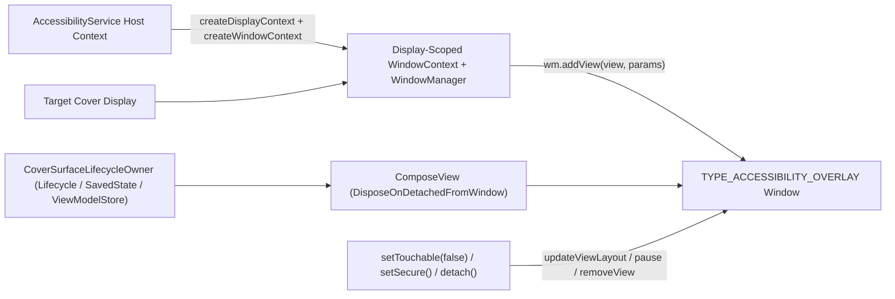

# `overlay.surface` Package

## What This Folder Does

Normally, Jetpack Compose UI lives inside an `Activity` or `Fragment`—containers that automatically give `ComposeView` a display window, a `LifecycleOwner`, a `SavedStateRegistryOwner`, and a `ViewModelStoreOwner`. Inside a background `Service` or `AccessibilityService`, none of those exist out of the box, and attaching directly to the service's default context would paint onto the phone's primary inner display instead of the outer cover screen.

Think of `overlay.surface` as a **custom portable planter** for `ComposeView`. It creates a hardware-display-specific window context, wires up custom AndroidX lifecycle/state owners, mounts the Compose UI onto the exact secondary cover `Display` via `WindowManager`, and lets callers hide the surface instantly without tearing down the whole Compose tree.

---

## How It Works Step-by-Step

1. **Create a Display-Scoped Window Context (`attach`)**: Starting from `hostContext`, `CoverComposeSurface` calls `createDisplayContext(display)` and then `createWindowContext(windowType, null)` (e.g., `WindowManager.LayoutParams.TYPE_ACCESSIBILITY_OVERLAY`). Retrieving `WINDOW_SERVICE` from that `windowContext` guarantees `WindowManager` targets the cover screen rather than `Display.DEFAULT_DISPLAY`.
2. **Build Custom AndroidX Tree Owners**: `CoverComposeSurface` constructs a `CoverSurfaceLifecycleOwner` implementing `LifecycleOwner`, `SavedStateRegistryOwner`, and `ViewModelStoreOwner`. Its `init` block obeys `androidx.savedstate`'s strict ordering rule (`performAttach()` and `performRestore(null)` while still in `INITIALIZED`, *before* `ON_CREATE`). *(Note: `CoverSurfaceLifecycleOwner` does not implement `OnBackPressedDispatcherOwner`; back presses and navigation gestures are handled externally by `CoverAccessibilityService`.)*
3. **Mount `ComposeView` onto `WindowManager`**: Creates a `ComposeView` configured with `ViewCompositionStrategy.DisposeOnDetachedFromWindow`, attaches the view-tree owners (`setViewTreeLifecycleOwner`, `setViewTreeSavedStateRegistryOwner`, `setViewTreeViewModelStoreOwner`), optionally hooks `MotionEvent.ACTION_OUTSIDE` touches, and adds the view to `WindowManager` with `WindowManager.LayoutParams` (`FLAG_LAYOUT_IN_SCREEN`, `FLAG_NOT_FOCUSABLE`, `PixelFormat.TRANSLUCENT`, `LAYOUT_IN_DISPLAY_CUTOUT_MODE_ALWAYS`, and optional `FLAG_SECURE`).
4. **Bring the Surface Alive (`owner.start`)**: Only after `wm.addView(view, params)` succeeds without throwing `BadTokenException`, `owner.start()` dispatches `ON_CREATE` -> `ON_START` -> `ON_RESUME`, waking `collectAsStateWithLifecycle` collectors.
5. **Fast Pause/Hide vs. Full Teardown**:
   - **Temporary suppression (`setTouchable(false)`)**: Instead of destroying the UI every time an app launches, `applyTouchable(false)` adds `FLAG_NOT_TOUCHABLE`, sets `alpha = 0f` (while keeping `View.VISIBLE` so window layout stays valid), pauses `CoverSurfaceLifecycleOwner` (`ON_PAUSE` -> `ON_STOP`), and updates `WindowManager.updateViewLayout()`. Re-enabling touch reverses this (`alpha = 1f`, `owner.resume()`).
   - **Full removal (`detach`)**: Disposes the Compose composition, calls `wm.removeView(view)`, sends `ON_DESTROY`, clears the `ViewModelStore`, and resets all references.

---

## File-by-File Guide

### `CoverComposeSurface.kt`

- **In plain terms**: The reusable window-and-lifecycle wrapper allowing `ComposeView` to run cleanly inside a non-Activity overlay window on a secondary display. Holds three cohesive types: `CoverSurfaceWindowConfig` (layout flags and sizing), `CoverComposeSurface` (window attachment, touch suppression, and `FLAG_SECURE` updates), and `CoverSurfaceLifecycleOwner` (lifecycle/saved-state/ViewModel bridge).
- **Key variables & state**:
  - `CoverSurfaceWindowConfig`: `width`, `height`, `gravity`, `extraFlags`, `windowAnimations`, `cutoutMode` (defaults to full-screen cutout-aware `MATCH_PARENT` with `FLAG_LAYOUT_IN_SCREEN or FLAG_NOT_FOCUSABLE`).
  - `composeView` (`ComposeView?`): the mounted Compose root view (`null` when detached).
  - `windowContext` (`Context?`) & `windowManager` (`WindowManager?`): display-and-window-scoped context and its `WindowManager` bound to the target `Display`.
  - `layoutParams` (`WindowManager.LayoutParams?`): live window parameters updated in place for `FLAG_NOT_TOUCHABLE` and `FLAG_SECURE`.
  - `lifecycleOwner` (`CoverSurfaceLifecycleOwner?`): owns `LifecycleRegistry` (`registry`), `SavedStateRegistryController` (`savedStateController`), and `ViewModelStore` (`store`).
  - `activeDisplayId` (`Int?`): ID of the secondary `Display` currently hosting the view.
  - `isTouchable` (`Boolean`) & `deferredTouchable` (`Boolean?`): tracks touch suppression and queues any `setTouchable()` call that arrives before `onViewAttachedToWindow` fires.
  - `secureRequested` (`Boolean`): caches whether `FLAG_SECURE` is active (or pending before `attach`) to protect sensitive content from screenshots/screen recording.
- **How it connects**: Instantiated by `CoverAccessibilityService` (for `CoverAppGridOverlay`) and `overlay/input` (for the input fallback overlay). All window commands (`show`, `suppress`, `detach`) flow into `CoverComposeSurface` from its owning host service.

---

## Quick-Reference Summary

| File | Key Types | Role in One Line |
| --- | --- | --- |
| `CoverComposeSurface.kt` | `CoverComposeSurface`, `CoverSurfaceWindowConfig`, `CoverSurfaceLifecycleOwner` | Attaches, updates, pauses, and disposes a display-scoped `ComposeView` inside a `TYPE_ACCESSIBILITY_OVERLAY` window |

---

## Data Flow Diagram

---

## Works Hand-in-Hand With

| Module | Relationship | Link |
| --- | --- | --- |
| `overlay` | `CoverAccessibilityService` owns and drives a `CoverComposeSurface` instance for the cover launcher | [overlay](../README.md) |
| `overlay/input` | `CoverScreenInputInjectionEngine` uses `CoverComposeSurface` to host the accessibility keyboard fallback overlay | [overlay/input](../input/README.md) |
