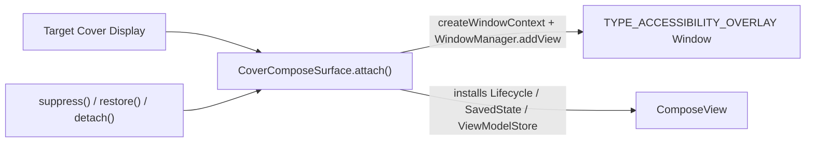

# `overlay.surface` Package

Shared `WindowManager` + Jetpack Compose surface wrapper that hosts Compose UI inside non-Activity accessibility windows on a specific hardware `Display`.

## What This Module Holds

| File | Key Types | Responsibility |
| --- | --- | --- |
| `CoverComposeSurface.kt` | `CoverComposeSurface` | Creates a display-scoped window context (`TYPE_ACCESSIBILITY_OVERLAY`), installs `LifecycleOwner`, `SavedStateRegistryOwner`, and `ViewModelStoreOwner`, attaches a `ComposeView`, and supports zero-alpha/non-touchable suppression vs. full detach |

## Data Flow Diagram

## Works Hand-in-Hand With

| Module | Relationship | Link |
| --- | --- | --- |
| `overlay` | `CoverAccessibilityService` owns and controls `CoverComposeSurface` for the cover launcher | [overlay](../README.md) |
| `overlay/input` | `CoverScreenInputInjectionEngine` uses `CoverComposeSurface` for the input fallback overlay | [overlay/input](../input/README.md) |
