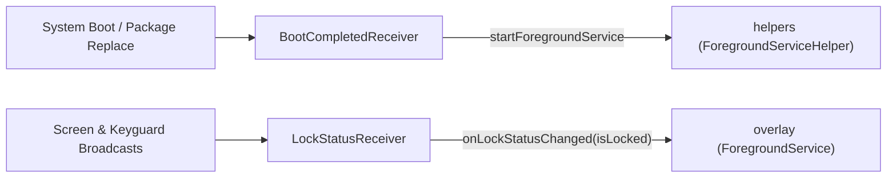

# `receivers` Package

Android `BroadcastReceiver` components for boot-time service recovery and screen/keyguard lock-state monitoring.

## What This Module Holds

| File | Key Types | Responsibility |
| --- | --- | --- |
| `BootCompletedReceiver.kt` | `BootCompletedReceiver` | Listens for `ACTION_BOOT_COMPLETED`, `ACTION_LOCKED_BOOT_COMPLETED`, and `ACTION_MY_PACKAGE_REPLACED` to start `ForegroundService` |
| `LockStatusReceiver.kt` | `LockStatusReceiver` | Listens for `ACTION_SCREEN_OFF`, `ACTION_SCREEN_ON`, `ACTION_USER_PRESENT`, and `ACTION_USER_UNLOCKED` and emits lock state updates |

## Data Flow Diagram

## Works Hand-in-Hand With

| Module | Relationship | Link |
| --- | --- | --- |
| `helpers` | `BootCompletedReceiver` delegates readiness checks and service startup to `ForegroundServiceHelper` | [helpers](../helpers/README.md) |
| `overlay` | `ForegroundService` registers `LockStatusReceiver` to suppress/restore the cover overlay on lock/unlock | [overlay](../overlay/README.md) |
