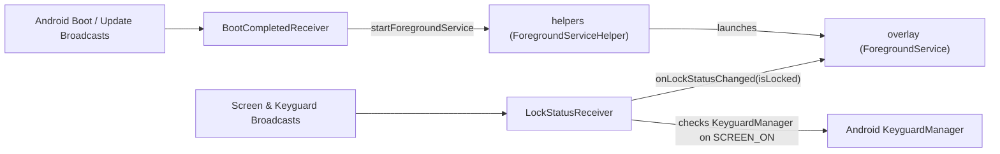

# `receivers` Package

## What This Folder Does

Android is like a busy apartment building with a central intercom: whenever important system events happen—like your phone finishing a reboot, updating an app, turning the screen off, or unlocking the lock screen—Android announces them as **broadcasts**.

This folder holds two small, focused `BroadcastReceiver` listeners that answer only the announcements Cover-Screen-OS needs in order to stay alive automatically and respect your lock screen:

- **Restarting after a reboot or app update** (`BootCompletedReceiver`)
- **Knowing right away whether the phone is locked or unlocked** (`LockStatusReceiver`)

---

## How It Works Step-by-Step

### A. Keeping the Cover Runtime Running After Reboot or Update
1. Your phone reboots (or Google Play / Android installs an update to Cover-Screen-OS).
2. Android wakes up [`BootCompletedReceiver`](BootCompletedReceiver.kt), which is registered in `AndroidManifest.xml`.
3. `BootCompletedReceiver` verifies that the broadcast is one of the allowed startup events (`BOOT_COMPLETED`, `LOCKED_BOOT_COMPLETED`, or `MY_PACKAGE_REPLACED`).
4. It delegates to `ForegroundServiceHelper.startForegroundService(context)` so the overlay service only starts when required permissions allow it.

### B. Tracking Lock & Screen Transitions Live
1. When the persistent `ForegroundService` starts, it creates a [`LockStatusReceiver`](LockStatusReceiver.kt) and registers it dynamically in code using `LockStatusReceiver.getIntentFilter()`. *(Android forbids declaring screen-on/screen-off listeners statically in the manifest to save battery.)*
2. Whenever the screen turns off, wakes up, or finishes unlocking, `LockStatusReceiver.onReceive(...)` translates the broadcast into a simple `isLocked: Boolean` answer.
3. For ambiguous "screen just turned on" events (where the lock screen might still be showing), it double-checks `KeyguardManager` before calling `onLockStatusChanged(isLocked)` so the cover overlay knows whether to hide or show.

---

## File-by-File Guide

### [BootCompletedReceiver.kt](BootCompletedReceiver.kt)

- **In plain terms**: The "wake up after restart" doorbell. Without it, users would have to manually reopen Cover-Screen-OS every time they rebooted their phone or updated the app.
- **Key variables & state**:
  - `action: String` — The broadcast action delivered by Android (`Intent.ACTION_BOOT_COMPLETED` after unlock, `Intent.ACTION_LOCKED_BOOT_COMPLETED` during Direct Boot before the first PIN entry, or `Intent.ACTION_MY_PACKAGE_REPLACED` after an app update).
  - `shouldStart: Boolean` — Safety filter ensuring stray or unexpected intents are ignored before attempting to launch the foreground service.
- **How it connects**: Registered in `AndroidManifest.xml` and delegates startup checks and launching to `ForegroundServiceHelper` in [`helpers`](../helpers/README.md).

### [LockStatusReceiver.kt](LockStatusReceiver.kt)

- **In plain terms**: A live lock-screen watchdog that tells the cover overlay *"the phone just locked—stay out of the way"* or *"the user unlocked—you're good to show."*
- **Key variables & state**:
  - `onLockStatusChanged: (Boolean) -> Unit` — Callback passed in by the host service to notify policy/overlay controllers whenever lock status changes.
  - `action: String` — Broadcast event name (`ACTION_SCREEN_OFF` -> `true`; `ACTION_USER_PRESENT` or `ACTION_USER_UNLOCKED` -> `false`; `ACTION_SCREEN_ON` -> queried live).
  - `isLocked: Boolean` — Derived lock state sent to `onLockStatusChanged`.
  - `keyguardManager: KeyguardManager?` — Android system service handle inspected inside `currentLockStatus(context)` (prefers `isDeviceLocked`, falls back to `isKeyguardLocked`, and conservatively assumes `true` if unavailable).
- **How it connects**: Instantiated and registered/unregistered by `ForegroundService` in [`overlay`](../overlay/README.md) using `LockStatusReceiver.getIntentFilter()`.

---

## Quick-Reference Summary

| File | Registration Style | Listens For | Output / Action |
| --- | --- | --- | --- |
| [BootCompletedReceiver.kt](BootCompletedReceiver.kt) | Static (`AndroidManifest.xml`) | `ACTION_BOOT_COMPLETED`, `ACTION_LOCKED_BOOT_COMPLETED`, `ACTION_MY_PACKAGE_REPLACED` | Calls `ForegroundServiceHelper.startForegroundService(context)` |
| [LockStatusReceiver.kt](LockStatusReceiver.kt) | Dynamic (`Context.registerReceiver` via `getIntentFilter()`) | `ACTION_SCREEN_OFF`, `ACTION_SCREEN_ON`, `ACTION_USER_PRESENT`, `ACTION_USER_UNLOCKED` | Calls `onLockStatusChanged(isLocked)` and exposes `currentLockStatus(context)` |

---

## Architecture & Data Flow

---

## Works Hand-in-Hand With

| Package | How They Work Together | Link |
| --- | --- | --- |
| `helpers` | `ForegroundServiceHelper` checks permission readiness and starts `ForegroundService` on boot/update | [helpers](../helpers/README.md) |
| `overlay` | `ForegroundService` registers `LockStatusReceiver` and feeds lock transitions into overlay suppression policies | [overlay](../overlay/README.md) |
