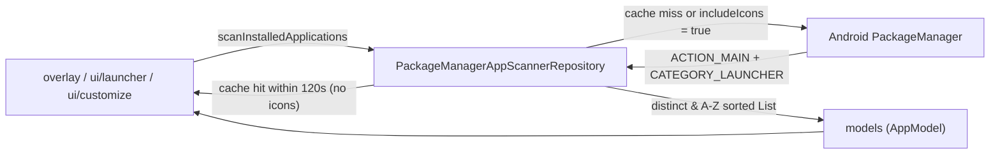

# `repository` Package

## What This Folder Does

Asking Android *"give me every app the user can open"* (`PackageManager.queryIntentActivities`) requires talking across process boundaries to the OS package service—and loading icons for 100+ apps takes noticeable work.

Think of the `repository` folder as a **smart front-desk receptionist with a clipboard**. Instead of sending someone running down the hall to ask Android for the full list of installed apps every single time the cover drawer opens, [`PackageManagerAppScannerRepository`](PackageManagerAppScannerRepository.kt) runs that query on a background I/O thread, removes duplicate entries, sorts apps A–Z, and keeps a lightweight **2-minute memory cache** when icons aren't requested.

---

## How It Works Step-by-Step

1. **Check the caller's request**:
   - Callers invoke `scanInstalledApplications(includeIcons = false)` for fast text/package lists (or `includeIcons = true` when icons are also needed right away).
2. **Serve from the 2-minute cache when possible**:
   - When `includeIcons` is `false`, the repository checks `cachedApps` under `cacheLock`. If the cache is still within `APP_SCAN_CACHE_TTL_MS` (120 seconds) according to the monotonic `elapsedRealtimeProvider`, it returns immediately with zero IPC cost.
   - Icon-inclusive scans intentionally bypass the static cache so heavy `Drawable` graphics are never pinned in memory for the lifetime of the process.
3. **Query Android `PackageManager` on `Dispatchers.IO`**:
   - Builds a standard launcher filter (`Intent(ACTION_MAIN)` + `CATEGORY_LAUNCHER`) and queries `packageManager.queryIntentActivities(...)` using `PackageManager.ResolveInfoFlags.of(0)`.
4. **Normalize, deduplicate, and sort**:
   - Extracts each app's display label (`getApplicationLabel`), package name, and optional icon (`getApplicationIcon`, falling back to `defaultActivityIcon` on error).
   - Collapses apps that expose multiple launcher activities by `packageName` (`distinctBy`) and sorts case-insensitively A–Z (`String.CASE_INSENSITIVE_ORDER`, then case-sensitive tie-break).
5. **Refresh the shared cache**:
   - For metadata-only scans (`includeIcons = false`), stores `scannedApps` and the fresh monotonic timestamp under `cacheLock`.

---

## File-by-File Guide

### [PackageManagerAppScannerRepository.kt](PackageManagerAppScannerRepository.kt)

- **In plain terms**: The single source of truth for discovering which apps are installed and launchable on the device, keeping the app drawer and dock picker snappy.
- **Key variables & state**:
  - `APP_SCAN_CACHE_TTL_MS` (`120_000L`) — 2-minute freshness threshold for reusing cached app metadata.
  - `cacheLock: Any` — Synchronization monitor guarding concurrent reads and writes to the static cache across threads.
  - `cachedApps: List<AppModel>?` — Process-wide cached list of icon-less `AppModel` items (nullable before the first scan).
  - `cachedAtElapsedMs: Long` — Monotonic `SystemClock.elapsedRealtime()` timestamp recording when `cachedApps` was populated (unaffected by manual wall-clock changes; injectable via `elapsedRealtimeProvider` for fast unit tests).
  - `packageManager: PackageManager` — Android IPC handle used to query activities, labels, and icons.
  - `launcherIntent: Intent` — `ACTION_MAIN` + `CATEGORY_LAUNCHER` query matching normal launcher-visible apps.
  - `defaultIcon: Drawable?` — Fallback icon grabbed once if `includeIcons` is `true`, used if loading a specific app's icon fails.
  - `scannedApps: List<AppModel>` — Final deduplicated, alphabetically sorted result list.
- **How it connects**: Produces [`AppModel`](../models/AppModel.kt) lists consumed by `ForegroundService` / `LauncherOverlayHost` ([`overlay`](../overlay/README.md)), the cover app drawer ([`ui/launcher`](../ui/launcher/README.md)), and the phone-side dock picker ([`ui/customize`](../ui/customize/README.md)).

---

## Quick-Reference Summary

| File | Main Class | Cache Policy | Threading | Output Type |
| --- | --- | --- | --- | --- |
| [PackageManagerAppScannerRepository.kt](PackageManagerAppScannerRepository.kt) | `PackageManagerAppScannerRepository` | 120s process-wide TTL cache for `includeIcons = false`; uncached when `includeIcons = true` | Switches to `ioDispatcher` (`Dispatchers.IO`) | `List<AppModel>` |

---

## Architecture & Data Flow

---

## Works Hand-in-Hand With

| Package | How They Work Together | Link |
| --- | --- | --- |
| `models` | Defines `AppModel` returned by `scanInstalledApplications` | [models](../models/README.md) |
| `overlay` | `ForegroundService` triggers scans and shares app lists with `LauncherOverlayHost` | [overlay](../overlay/README.md) |
| `ui/launcher` | Displays scanned apps in the cover app grid, dock, and search results | [ui/launcher](../ui/launcher/README.md) |
| `ui/customize` | Uses scanned apps inside the dock slot customization picker | [ui/customize](../ui/customize/README.md) |
