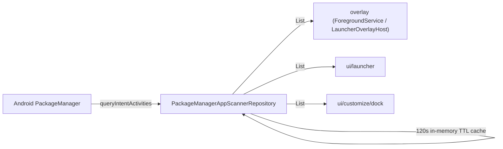

# `repository` Package

App discovery and caching layer that queries `PackageManager` for launchable applications.

## What This Module Holds

| File | Key Types | Responsibility |
| --- | --- | --- |
| `PackageManagerAppScannerRepository.kt` | `PackageManagerAppScannerRepository` | Queries `ACTION_MAIN`/`CATEGORY_LAUNCHER` activities on `Dispatchers.IO`, deduplicates/sorts apps, and caches results with a 120s TTL |

## Data Flow Diagram

## Works Hand-in-Hand With

| Module | Relationship | Link |
| --- | --- | --- |
| `models` | Produces `AppModel` instances | [models](../models/README.md) |
| `overlay` | `ForegroundService` triggers app scans and passes the repository to `LauncherOverlayHost` | [overlay](../overlay/README.md) |
| `ui/launcher` | Displays scanned apps in the cover app drawer and search results | [ui/launcher](../ui/launcher/README.md) |
| `ui/customize/dock` | Uses scanned apps in the dock slot picker dialog | [ui/customize/dock](../ui/customize/dock/README.md) |
