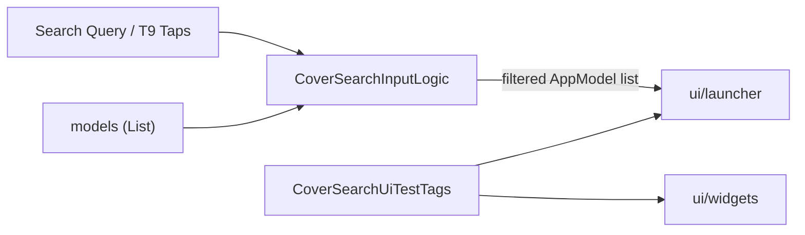

# `ui` Package

Root UI package containing shared cover-search logic, UI test tags, and all inner-display and cover-display UI sub-packages.

## What This Module Holds

| File / Sub-Package | Key Types / Role | Link |
| --- | --- | --- |
| `CoverSearchInputLogic.kt` | `T9CycleState`, `T9TapResult`, `filterAppsForSearchQuery`, `matchesSearchQuery`, `applyT9CharacterTap` | — |
| `CoverSearchUiTestTags.kt` | `CoverSearchUiTestTags` | — |
| `about/` | About & setup walkthrough screen | [about](about/README.md) |
| `appshell/` | Inner-display `NavHost`, routes, top bar, and welcome tour | [appshell](appshell/README.md) |
| `controllers/` | Cover display app launcher and keyguard unlock bridge | [controllers](controllers/README.md) |
| `customize/` | Customization hub and sub-screens (`appearance`, `dock`, `input`, `wallpaper`) | [customize](customize/README.md) |
| `dashboard/` | Runtime status hero card, quick actions, recent activity, and tips | [dashboard](dashboard/README.md) |
| `keyboard/` | Cover T9 prediction toggle, suggestion strip, and keyboard primitives | [keyboard](keyboard/README.md) |
| `launcher/` | Cover-display overlay pager, app grid, dock, notifications, media, search, wallpaper, and quick settings | [launcher](launcher/README.md) |
| `permissions/` | Core readiness checklist and degraded-feature notices | [permissions](permissions/README.md) |
| `theme/` | Material/CoverOS theme, One UI tokens, and One UI components | [theme](theme/README.md) |
| `widgets/` | `AppWidgetHost` manager and tile renderer | [widgets](widgets/README.md) |

## Data Flow Diagram

## Works Hand-in-Hand With

| Module | Relationship | Link |
| --- | --- | --- |
| `ui/launcher` | Uses `CoverSearchInputLogic` and `CoverSearchUiTestTags` for cover search and testability | [ui/launcher](launcher/README.md) |
| `ui/widgets` | Uses `CoverSearchUiTestTags` for widget host tile tagging | [ui/widgets](widgets/README.md) |
| `models` | Filters `AppModel` lists in `filterAppsForSearchQuery` | [models](../models/README.md) |
