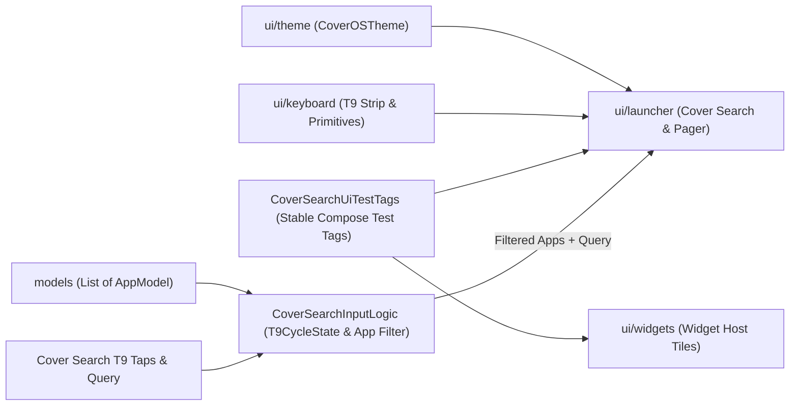

# `ui` Package

## What This Folder Does

Think of `ui/` as the **"face and touch layer"** of Cover-Screen-OS. Everything a person sees or taps—both on the phone's big inside screen (settings, setup tour, dashboard) and on the tiny outside cover screen (lock-screen pager, app grid, widgets, search bar, and custom keyboard)—lives either directly in this folder or inside one of its specialized sub-folders.

At the root level of `ui/`, you will find two small, shared building blocks that multiple screens rely on:
1. **Pure search filtering and classic T9 multi-tap math** (`CoverSearchInputLogic.kt`) so typing app names on a 9-key dialpad works cleanly without dragging Android UI dependencies into unit tests.
2. **Stable UI test labels** (`CoverSearchUiTestTags.kt`) so automated tests can reliably find and tap every search bar, keypad, and padding container even if text labels or visual styling change.

---

## How It Works Step-by-Step

1. **You open the inner app vs. the cover overlay**: Inside the phone, `appshell/` routes you between `dashboard/`, `customize/`, `permissions/`, and `about/` using shared styling from `theme/`.
2. **You swipe on the cover screen**: `launcher/` renders the outer-display pager (lock-screen tiles, `widgets/`, app drawer, and quick settings), pulling app-launch and unlock helpers from `controllers/`.
3. **You tap Search on the cover screen**: The search UI attaches stable identifiers from `CoverSearchUiTestTags` so automated tests know whether the system keyboard (`WITH_IME_PADDING`) or built-in T9 keypad (`NO_IME_PADDING`) is active.
4. **You type using T9 or text**: `CoverSearchInputLogic` trims whitespace, cycles letters when you tap the same digit twice within 900 milliseconds (like `"2"` -> `a`, `b`, `c`), and filters the installed app list by display name or package name.
5. **Typing UI comes from `keyboard/`**: All cover keyboard toggles, prediction strips, key buttons, haptics, and clipboard helpers are grouped cleanly inside the `keyboard/` subpackage.

---

## File-by-File Guide

### `CoverSearchInputLogic.kt`
- **In plain terms**: The brain behind cover-screen app search—both figuring out which letter a fast T9 multi-tap meant and deciding which installed apps match what you typed.
- **Key variables & state**:
  - `T9_MULTI_TAP_WINDOW_MS` (`900L`): The 0.9-second window where tapping the same digit again cycles to the next letter (`a -> b -> c`) instead of adding a new character.
  - `T9CycleState` (`lastDigit`, `lastTapElapsedMs`, `cycleIndex`): Remembers which digit was pressed last, when it happened, and which letter on that key is currently showing.
  - `T9TapResult` (`query`, `cycleState`): Bundles the updated search string together with the next `T9CycleState`.
  - `normalizedQuery` & `shouldCycle`: Trim stray spaces before matching and verify the user tapped the same key within 900ms before overwriting the previous letter.
- **How it connects**: Called by the cover launcher search screen (`ui/launcher`) to filter `List<AppModel>` from `models/`.

### `CoverSearchUiTestTags.kt`
- **In plain terms**: A shared checklist of permanent "name tags" (`Modifier.testTag`) pinned onto cover-screen pages, search inputs, and quick-settings panels so automated tests never have to guess where buttons live.
- **Key variables & state**:
  - Pager & page tags (`OVERLAY_PAGER`, `LOCKSCREEN_TILE_PAGE`, `WIDGET_HOST_PAGE`, `SEARCH_WIDGET_GRID_PAGE`): Identify each horizontal page of the cover overlay.
  - Search bar & mode controls (`SEARCH_INPUT_ROW`, `SEARCH_DISMISS_INPUT_BUTTON`, `SEARCH_INPUT_MODE_LABEL`, `SEARCH_INPUT_MODE_TOGGLE_BUTTON`, `SEARCH_IME_PICKER_BUTTON`): Track the search header and T9/IME mode switcher.
  - Input & inset containers (`SEARCH_SYSTEM_IME_FIELD`, `SEARCH_T9_FIELD`, `SEARCH_T9_KEYPAD_ROOT`, `SEARCH_CONTENT_CONTAINER_WITH_IME_PADDING`, `SEARCH_CONTENT_CONTAINER_NO_IME_PADDING`): Verify that system-IME padding is applied *only* when the system keyboard is open—never stacked on top of the built-in T9 pad.
- **How it connects**: Consumed by `ui/launcher`, `ui/widgets`, and Android instrumentation tests.

### `about/`
- **In plain terms**: The setup walkthrough and About page explaining permissions and cover-screen onboarding.
- **Key variables & state**: Guided onboarding steps and app/project info views documented in [about/README.md](about/README.md).
- **How it connects**: Hosted as a destination inside `appshell/`.

### `appshell/`
- **In plain terms**: The outer frame of the phone-side companion app—navigation routes, top bar, and first-run welcome tour.
- **Key variables & state**: Jetpack Navigation `NavHost` routes and tour progression state in [appshell/README.md](appshell/README.md).
- **How it connects**: Connects `dashboard/`, `customize/`, `permissions/`, and `about/`.

### `controllers/`
- **In plain terms**: Traffic cops that launch apps onto the cover display and ask Android to unlock the keyguard when needed.
- **Key variables & state**: Cover `displayId` launch options and keyguard dismiss bridges in [controllers/README.md](controllers/README.md).
- **How it connects**: Triggered by `launcher/` tiles, app shortcuts, and search results.

### `customize/`
- **In plain terms**: The settings hub where users tweak cover `appearance`, `dock`, `input` (keyboard size, haptics, predictions), and `wallpaper`.
- **Key variables & state**: Preference controls backed by `datastore` in [customize/README.md](customize/README.md).
- **How it connects**: Writes settings that `ui/keyboard/primitives` and `launcher/` read back live.

### `dashboard/`
- **In plain terms**: The home screen inside the companion app showing whether the cover service is running, quick-start buttons, recent activity, and setup tips.
- **Key variables & state**: Runtime readiness summary and action cards in [dashboard/README.md](dashboard/README.md).
- **How it connects**: Links straight into `permissions/` and `customize/`.

### `keyboard/`
- **In plain terms**: Cover-screen T9 prediction toggle, suggestion strip, and the full library of reusable keyboard UI primitives (`primitives/`).
- **Key variables & state**: Contact suggestion revision keys, T9/ABC mode toggles, key caps, popups, haptics, sounds, and text buffers in [keyboard/README.md](keyboard/README.md).
- **How it connects**: Embedded by `overlay/input`, `launcher/` search, and `:keyboard-floris`.

### `launcher/`
- **In plain terms**: The actual cover-screen desktop—pager, app grid, dock, notifications, media controls, quick settings, wallpaper, and cover search UI.
- **Key variables & state**: Cover pager state, search query state, and quick-settings toggles in [launcher/README.md](launcher/README.md).
- **How it connects**: Uses `CoverSearchInputLogic`, `CoverSearchUiTestTags`, `controllers/`, `widgets/`, and `keyboard/`.

### `permissions/`
- **In plain terms**: The permission checklist making sure Accessibility, Overlay, Notification Access, and Contacts permissions are explained and granted cleanly.
- **Key variables & state**: Per-permission readiness checks and degraded-feature notices in [permissions/README.md](permissions/README.md).
- **How it connects**: Surfaced from `dashboard/` and `appshell/`.

### `theme/`
- **In plain terms**: Shared Material 3 / CoverOS colors, typography, and One UI-styled cards and rows.
- **Key variables & state**: Color schemes and One UI design tokens in [theme/README.md](theme/README.md).
- **How it connects**: Wraps every screen across `ui/` and `ui/keyboard/primitives/`.

### `widgets/`
- **In plain terms**: Hosts and renders Android home-screen widgets directly onto the cover-screen widget page.
- **Key variables & state**: `AppWidgetHost` bindings and widget tile layouts in [widgets/README.md](widgets/README.md).
- **How it connects**: Embedded inside `launcher/` and tagged via `CoverSearchUiTestTags`.

---

## Quick-Reference Summary Table

| File / Sub-Package | Role | Key Types / Entry Points | Link |
| --- | --- | --- | --- |
| `CoverSearchInputLogic.kt` | App query matching & T9 multi-tap state machine | `T9CycleState`, `T9TapResult`, `filterAppsForSearchQuery`, `applyT9CharacterTap` | — |
| `CoverSearchUiTestTags.kt` | Stable Compose UI test tag constants | `CoverSearchUiTestTags` | — |
| `about/` | About & setup walkthrough | Onboarding & info screens | [about](about/README.md) |
| `appshell/` | Inner-display `NavHost`, top bar, welcome tour | App navigation shell | [appshell](appshell/README.md) |
| `controllers/` | Cover display launch & keyguard unlock bridge | Launch/unlock controllers | [controllers](controllers/README.md) |
| `customize/` | Customization screens (`appearance`, `dock`, `input`, `wallpaper`) | Settings UI | [customize](customize/README.md) |
| `dashboard/` | Service status card, quick actions, tips | Companion home screen | [dashboard](dashboard/README.md) |
| `keyboard/` | T9 controls, suggestion strip, and keyboard primitives | `CoverT9SuggestionStrip`, `primitives/` | [keyboard](keyboard/README.md) |
| `launcher/` | Cover overlay pager, app grid, dock, search, quick settings | Cover desktop UI | [launcher](launcher/README.md) |
| `permissions/` | Core permission readiness & notices | Permission onboarding | [permissions](permissions/README.md) |
| `theme/` | CoverOS Material3 & One UI tokens | `CoverOSTheme` | [theme](theme/README.md) |
| `widgets/` | `AppWidgetHost` manager & tile renderer | Cover widgets UI | [widgets](widgets/README.md) |

---

## Architecture Flow

---

## Works Hand-in-Hand With

| Module | Relationship | Link |
| --- | --- | --- |
| `ui/launcher` | Uses `CoverSearchInputLogic` and `CoverSearchUiTestTags` for cover search and testability | [ui/launcher](launcher/README.md) |
| `ui/widgets` | Uses `CoverSearchUiTestTags` for widget host tile tagging | [ui/widgets](widgets/README.md) |
| `ui/keyboard` | Supplies cover keyboard toggles, suggestion bars, and key primitives | [ui/keyboard](keyboard/README.md) |
| `models` | Provides `AppModel` records filtered by `filterAppsForSearchQuery` | [models](../models/README.md) |
