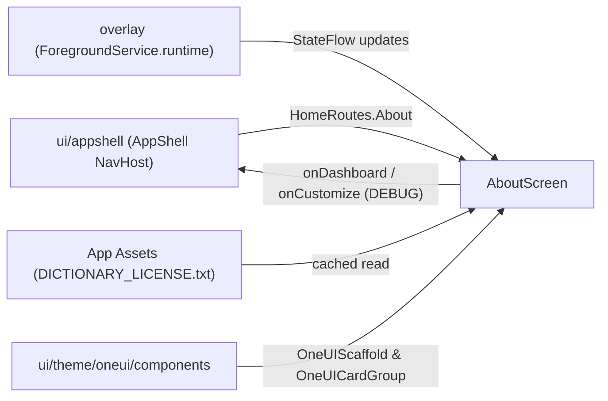

# `ui.about` Package

## What This Folder Does

Think of the `ui/about` folder as the **owner's manual and live inspection window** for Cover Screen OS. When someone opens the **About** tab on their phone, this screen answers four simple questions in one place:

- **What version am I running?** Shows the app name, version number, and build type (`debug` vs `release`).
- **How does Cover Screen OS work?** Presents a quick three-card walkthrough (*Grant Access → Make It Yours → Cover Display*).
- **Is everything healthy under the hood right now?** Reads live signals from the background `ForegroundService` to show whether the service, accessibility launcher host, and outer cover surface are active—plus the latest recorded event.
- **Where are the legal notices (and debug shortcuts)?** Lets anyone expand the bundled dictionary license right from app assets, and gives developers one-tap shortcuts back to Dashboard and Customize tools during debug builds.

## How It Works Step-by-Step

1. **Enter from the shell**: The user taps the **About** tab (or swipes across tabs) in `AppShell`, which loads `AboutScreen`.
2. **Subscribe to live service health**: `AboutScreen` listens to `ForegroundService.runtime` using `collectAsState()`. Whenever the cover service starts, stops, or logs an event, the diagnostics card updates on screen automatically.
3. **Load the license once**: On first composition for the current Android `Context`, `AboutScreen` reads `DICTIONARY_LICENSE.txt` from the app's `assets/` directory and caches it in memory so opening or closing the text does not re-read disk files.
4. **Render One UI card groups**: `OneUIScaffold` draws the header, and a scrollable `LazyColumn` arranges each topic into rounded `OneUICardGroup` sections—including the horizontal `LazyRow` of `AboutStepCard`s under *How It Works*.
5. **Handle user interactions & build variants**:
   - Tapping **"View dictionary license"** toggles `showLicense` (preserved across folding/unfolding via `rememberSaveable`).
   - If the app is a debug build (`BuildConfig.DEBUG`), a **Developer Tools** card renders buttons calling `onDashboard` and `onCustomize` to jump straight to those tabs.

## File-by-File Guide

### AboutScreen.kt

- **In plain terms**: The entire About tab UI—app info header, three-card horizontal onboarding summary, live runtime diagnostics readout, expandable open-source dictionary license, debug-only navigation shortcuts, and Light/OLED Dark Compose previews.
- **Key variables & state**:
  - `context`: Android `Context` used to open `DICTIONARY_LICENSE.txt` from `assets`.
  - `runtime`: Live `RuntimeSnapshot` collected from `ForegroundService.runtime` (`serviceActive`, `launcherHostActive`, `overlayActive`, and `events`).
  - `showLicense`: `rememberSaveable` boolean controlling whether the full license text is expanded beneath the toggle button.
  - `license`: Cached string contents of `DICTIONARY_LICENSE.txt` loaded once per `context` with `remember(context)`.
- **How it connects**: Hosted inside `AppShell`'s `NavHost` at `HomeRoutes.About`, styled with `OneUIScaffold` / `OneUICardGroup` / `OneUITheme`, and wired back to `Dashboard` and `Customize` tabs via the `onDashboard` and `onCustomize` callbacks.

## Quick-Reference Summary

| File | Main Composables | Key State / Inputs | Purpose |
| --- | --- | --- | --- |
| `AboutScreen.kt` | `AboutScreen`, `AboutStepCard`, `AboutScreenPreview` | `runtime` (`ForegroundService.runtime`), `showLicense`, `license` asset text | Displays app version info, "How It Works" cards, live runtime diagnostics, legal notice, and debug shortcuts |

## Architecture Flowchart

## Works Hand-in-Hand With

| Module | Relationship | Link |
| --- | --- | --- |
| `ui/appshell` | Hosts `AboutScreen` as a top-level tab and receives debug navigation callbacks | [ui/appshell](../appshell/README.md) |
| `overlay` | Streams live service, accessibility host, overlay visibility, and event history via `ForegroundService.runtime` | [overlay](../../overlay/README.md) |
| `ui/theme/oneui/components` | Provides `OneUIScaffold`, `OneUICardGroup`, and One UI typography/colors | [oneui/components](../theme/oneui/components/README.md) |
