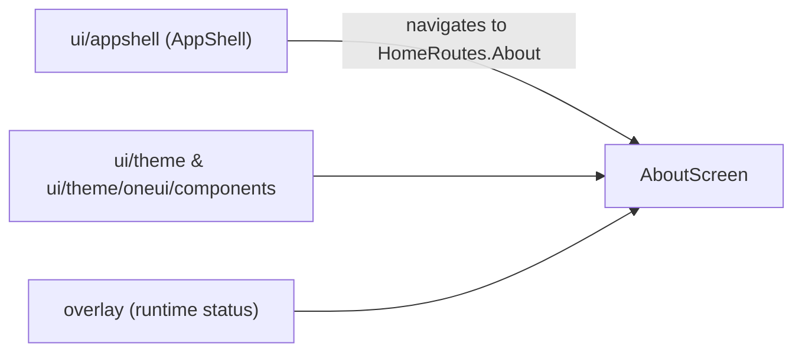

# `ui.about` Package

Inner-display About screen presenting setup steps, runtime overview, and app metadata.

## What This Module Holds

| File | Key Types | Responsibility |
| --- | --- | --- |
| `AboutScreen.kt` | `AboutScreen`, `AboutStepCard`, `AboutScreenPreview` | Renders the About destination in `AppShell` using One UI scaffold and card group components |

## Data Flow Diagram

## Works Hand-in-Hand With

| Module | Relationship | Link |
| --- | --- | --- |
| `ui/appshell` | Hosts `AboutScreen` as a top-level navigation destination | [ui/appshell](../appshell/README.md) |
| `ui/theme/oneui/components` | Provides `OneUIScaffold` and `OneUICardGroup` | [oneui/components](../theme/oneui/components/README.md) |
| `overlay` | Supplies runtime/service context referenced in About info | [overlay](../../overlay/README.md) |
