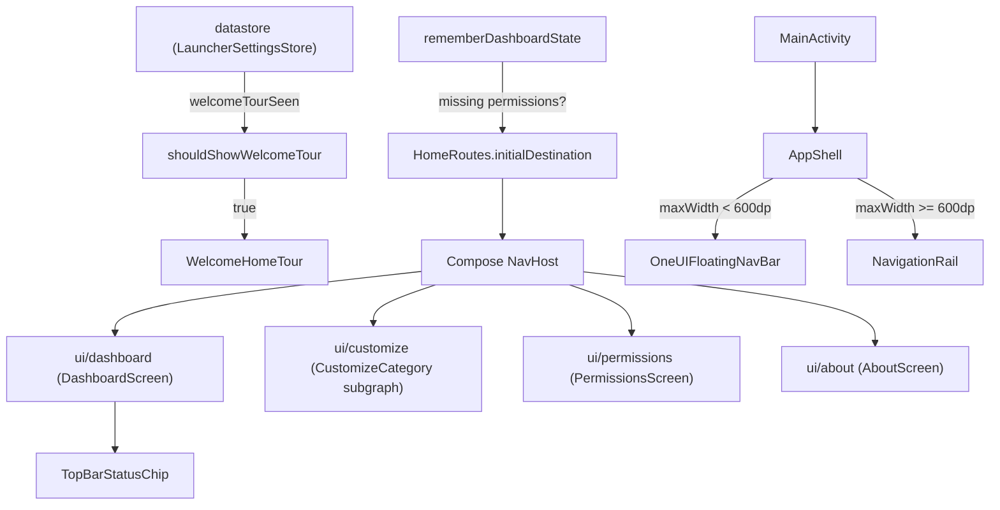

# `ui.appshell` Package

## What This Folder Does

Think of `ui/appshell` as the **hallway, front door, and tour guide** of the phone-side companion app. Before the user visits any individual room (*Dashboard*, *Customize*, *Permissions*, or *About*), this folder decides which room opens first, draws the navigation bar (or side rail on wider foldable/tablet screens), lets the user swipe left or right between tabs, and greets brand-new users with a quick four-step welcome tour.

It also owns the tiny **"Active / Setup / Stopped" chip** in the top corner of the Dashboard so users can tap it anytime for a full status check without leaving their screen.

## How It Works Step-by-Step

1. **Check readiness at startup**: `AppShell` calls `rememberDashboardState()` to see which required Android permissions are currently missing.
2. **Pick the first screen**: `HomeRoutes.initialDestination(...)` opens **Permissions** right away if any required permission is missing, or **Dashboard** if setup is already complete. (This choice is remembered once so fixing permissions mid-session doesn't suddenly yank the user to another tab.)
3. **Auto-start the cover service when ready**: A `LaunchedEffect` watches `dashboardState.permissions.missing.isEmpty()`. The moment all 4 required permissions are granted and the service isn't already running, `AppShell` calls `ForegroundServiceHelper.startForegroundService(context)`.
4. **Adapt navigation to screen size**: Using `BoxWithConstraints`:
   - On phone-width screens (`< 600dp`), `AppShell` renders a floating bottom bar (`OneUIFloatingNavBar`) padded safely away from gesture navigation bars and cutouts.
   - On unfolded/tablet widths (`>= 600dp`), it switches automatically to a left-hand Material3 `NavigationRail`.
5. **Switch tabs by tap, swipe, or deep link**:
   - Tapping a tab or swiping horizontally (`>= 72dp` drag) calls `NavController.navigateToTab(...)`, saving and restoring each tab's state cleanly.
   - `HomeRoutes.Customize` hosts a nested subgraph (`CustomizeCategory`: Wallpaper, Dock, Appearance, Input) while preserving per-category scroll positions (`categoryScrollPositions`).
   - `coverscreenos://...` deep links jump straight into any tab or Customize category.
6. **Show the first-run tour (only when appropriate)**: `shouldShowWelcomeTour(...)` checks DataStore (`tourStore.welcomeTourSeen`). If it is explicitly `false` (not still loading as `null`), the user didn't arrive via a deep link, and they haven't dismissed it yet, `WelcomeHomeTour` slides up as a bottom sheet.

## File-by-File Guide

### AppShell.kt

- **In plain terms**: The main navigation frame of the companion app—holding the responsive Scaffold, bottom floating bar / side rail, horizontal swipe-to-switch-tab gesture detector, `NavHost` wiring all four top-level tabs + nested Customize sub-pages, service auto-start trigger, and welcome tour overlay.
- **Key variables & state**:
  - `homeTabs`: Canonical list of the 4 top-level `HomeTab` entries (*Dashboard*, *Customize*, *Permissions*, *About*) with labels and icons.
  - `context`: Android `Context` used for launch intent inspection, DataStore creation, and service start/stop calls.
  - `tourStore` / `tourSeen` / `deepLinkLaunch` / `tourDismissed`: Together prevent the welcome tour from flickering while DataStore loads (`initial = null`), skip the tour on deep-link launches, and close it immediately on dismiss while persisting to disk.
  - `permissionRefreshKey`: Integer bumped whenever `PermissionsScreen` changes grants so `rememberDashboardState` refreshes right away.
  - `dashboardState`: Live permissions + `ForegroundService` runtime state shared across the shell, Dashboard, and Customize tabs.
  - `startDestination`: Initial `NavHost` route locked on first composition via `HomeRoutes.initialDestination(...)`.
  - `navController` / `backStackEntry` / `destination` / `selectedTab`: Drive Compose Navigation and highlight the right tab (using `destination.hierarchy` so nested Customize pages keep the Customize tab highlighted).
  - `customizeActionScope` / `customizeSnackbar` / `categoryScrollPositions`: Coroutine scope, snackbar host, and per-category scroll offset array passed into `CustomizeScreen`.
  - `expanded` / `isCompactHeight` / `navItems`: Responsive size flags (`>= 600dp` width for `NavigationRail`; `<= 480dp` height for tighter bottom padding) and mapped nav items.
- **How it connects**: Mounted by `MainActivity` as the app root; routes into `DashboardScreen`, `CustomizeScreen`, `PermissionsScreen`, and `AboutScreen`, and reads/writes `LauncherSettingsStore` and `ForegroundServiceHelper`.

### HomeRoutes.kt

- **In plain terms**: The address book for app navigation—stores route names, builds `coverscreenos://` deep-link URIs, picks the start tab, and defines the four nested Customize sub-pages.
- **Key variables & state**:
  - `HomeRoutes.Dashboard`, `Customize`, `Permissions`, `About`: String constants identifying the four top-level destinations.
  - `CustomizeCategory.WALLPAPER`, `DOCK`, `APPEARANCE`, `INPUT`: Enum entries each holding a URL-like `segment`, user-facing `title`, derived `route` (`customize/<segment>`), and `deepLink` (`coverscreenos://customize/<segment>`).
- **How it connects**: Referenced across `AppShell` (for `NavHost` route registration and `navDeepLink` matching) and navigation callbacks from other screens.

### TopBarStatusChip.kt

- **In plain terms**: A compact pill button in the top-right app bar that shows `"Active"`, `"Setup"`, or `"Stopped"` at a glance and opens a detailed bottom sheet when tapped.
- **Key variables & state**:
  - `showDetails`: Boolean (`remember`) toggling whether the `ModalBottomSheet` containing `DashboardStatusDetails(state)` is open.
- **How it connects**: Placed inside `DashboardScreen`'s top-bar `actions` slot, reading `DashboardState` and delegating detail rendering to `DashboardStatusDetails` in `ui/dashboard`.

### WelcomeHomeTour.kt

- **In plain terms**: A friendly four-tab bottom sheet that walks first-time users through *Dashboard*, *Customize*, *Permissions*, and *About*, with Skip and Next/Done controls.
- **Key variables & state**:
  - `steps`: Ordered list of `TourStep` items pairing each tab title with its tour description string resource.
  - `selectedStep`: `rememberSaveable` index (`0..3`) remembering which tour page is active across rotation or folding.
  - `isCompactHeight` / `horizontalPad`: Adjusts spacing, horizontal padding (`16.dp` vs `24.dp`), and typography when viewport height is `<= 480dp`.
- **How it connects**: Shown as an overlay inside `AppShell` when `shouldShowWelcomeTour(...)` returns `true`; calling `onDismiss` updates `tourDismissed` and persists completion via `LauncherSettingsStore.markWelcomeTourSeen()`.

## Quick-Reference Summary

| File | Key Types / Functions | Primary Responsibility |
| --- | --- | --- |
| `AppShell.kt` | `AppShell`, `shouldShowWelcomeTour`, `isDeepLinkLaunch`, `navigateToTab` | Adaptive navigation shell (`OneUIFloatingNavBar` / `NavigationRail`), swipe tab switching, service auto-start, and `NavHost` wiring |
| `HomeRoutes.kt` | `HomeRoutes`, `CustomizeCategory` | Route strings, `coverscreenos://` deep-link builders, start-tab policy, and Customize category enum |
| `TopBarStatusChip.kt` | `TopBarStatusChip` | Top-bar `AssistChip` summarizing `DashboardStatus` and opening a `ModalBottomSheet` of diagnostics |
| `WelcomeHomeTour.kt` | `WelcomeHomeTour`, `TourStep` | First-run `ModalBottomSheet` walkthrough with scrollable tabs and compact-height adaptation |

## Architecture Flowchart

## Works Hand-in-Hand With

| Module | Relationship | Link |
| --- | --- | --- |
| Root package | `MainActivity` mounts `AppShell` as the companion app's UI root | [MainActivity](../../README.md) |
| `ui/dashboard` | Supplies `rememberDashboardState`, `DashboardScreen`, and `DashboardStatusDetails` | [ui/dashboard](../dashboard/README.md) |
| `ui/permissions` | Hosted at `HomeRoutes.Permissions` and increments `permissionRefreshKey` on grant updates | [ui/permissions](../permissions/README.md) |
| `ui/about` | Hosted at `HomeRoutes.About` with callbacks back to Dashboard and Customize | [ui/about](../about/README.md) |
| `helpers` | Starts/stops the foreground cover service via `ForegroundServiceHelper` | [helpers](../../helpers/README.md) |
| `ui/theme/oneui/components` | Supplies `OneUIFloatingNavBar` and One UI styling tokens | [oneui/components](../theme/oneui/components/README.md) |
