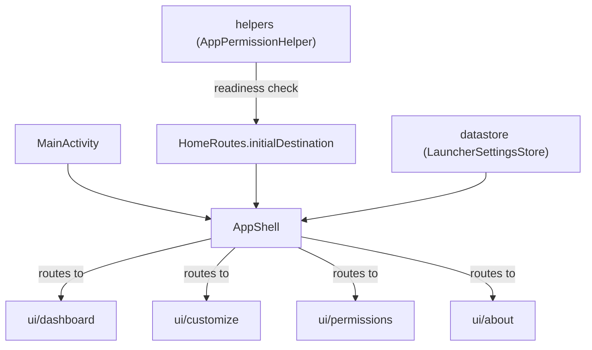

# `ui.appshell` Package

Inner-display application shell, Navigation Compose route definitions, floating navigation bar, top status chip, and first-run welcome tour.

## What This Module Holds

| File | Key Types | Responsibility |
| --- | --- | --- |
| `AppShell.kt` | `AppShell`, `shouldShowWelcomeTour`, `isDeepLinkLaunch` | Root inner-display composable managing `NavHost`, deep links, floating nav bar, and tour presentation |
| `HomeRoutes.kt` | `HomeRoutes`, `CustomizeCategory` | Route constants (`dashboard`, `customize`, `permissions`, `about`), deep-link builders, and start-destination resolver |
| `TopBarStatusChip.kt` | `TopBarStatusChip` | Compact runtime status pill displayed in the top bar |
| `WelcomeHomeTour.kt` | `WelcomeHomeTour` | First-run onboarding tour overlay |

## Data Flow Diagram

## Works Hand-in-Hand With

| Module | Relationship | Link |
| --- | --- | --- |
| Root package | `MainActivity` mounts `AppShell` as the inner-display root | [MainActivity](../../README.md) |
| `ui/dashboard`, `ui/customize`, `ui/permissions`, `ui/about` | Hosted as destinations inside `AppShell`'s `NavHost` | [ui/dashboard](../dashboard/README.md) |
| `helpers` & `datastore` | Determine initial route readiness and persist welcome tour completion | [helpers](../../helpers/README.md) |
| `ui/theme/oneui/components` | Provides `OneUIFloatingNavBar` and `OneUIScaffold` | [oneui/components](../theme/oneui/components/README.md) |
