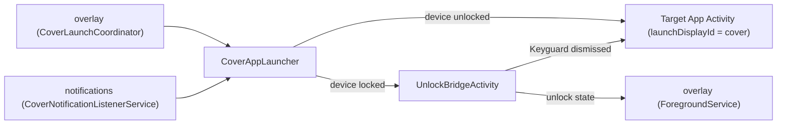

# `ui.controllers` Package

Activity launch routing and keyguard unlock orchestration for launching target apps onto the secondary cover display.

## What This Module Holds

| File | Key Types | Responsibility |
| --- | --- | --- |
| `CoverAppLauncher.kt` | `CoverAppLauncher`, `ActivityLaunchExecutor` | Resolves launch intents and dispatches activities with `ActivityOptions.makeBasic().setLaunchDisplayId(...)` |
| `UnlockBridgeActivity.kt` | `UnlockBridgeActivity` | Transparent bridge `FragmentActivity` requesting `KeyguardManager.requestDismissKeyguard()` before completing a pending cover app launch |

## Data Flow Diagram

## Works Hand-in-Hand With

| Module | Relationship | Link |
| --- | --- | --- |
| `overlay` | `CoverLaunchCoordinator` invokes `CoverAppLauncher`; `ForegroundService` suppresses overlay during `UnlockBridgeActivity` | [overlay](../../overlay/README.md) |
| `notifications` | Launches notification target apps on the cover display | [notifications](../../notifications/README.md) |
| `models` | Consumes `AppModel` for target package resolution | [models](../../models/README.md) |
| `overlay/input` | Coordinates input session state across app launches | [overlay/input](../../overlay/input/README.md) |
