# `ui.controllers` Package

## What This Folder Does

Think of `ui.controllers` as the **air-traffic controller and security bouncer** for opening apps on the outer cover screen.

Opening an app on a secondary screen isn't as simple as tapping an icon on a normal phone:
1. Android normally puts newly launched apps on the **main inner screen** unless told otherwise with a specific target display ID.
2. Background services (like our cover launcher overlay) aren't allowed to jump straight into starting activities unless they route through an exempt channel like a connected `AccessibilityService`.
3. If the phone is **locked**, launching a private app straight onto the cover screen would fail—so an invisible "bridge" screen has to wake up above the lockscreen, ask for your fingerprint/PIN, slide the lockscreen away, and *then* hand off to the app you tapped.

`CoverAppLauncher` and `UnlockBridgeActivity` handle that entire choreography automatically.

---

## How It Works Step-by-Step

1. **You tap an app or notification on the cover screen**: A UI or service component hands the package name or `Intent` to `CoverAppLauncher`.
2. **Check the lockscreen**: `CoverAppLauncher` asks Android's `KeyguardManager` if the phone is locked.
   - **If unlocked**: It validates that the app's launcher activity exists, is enabled, and is exported, wraps the target cover `displayId` into `ActivityOptions.makeBasic()`, launches it through a connected `AccessibilityService` (to satisfy Android's Background-Activity-Launch rules), and tells `ForegroundService` to hide the cover overlay so the app receives your touches.
   - **If locked**: `CoverAppLauncher` pauses the app launch and calls `UnlockBridgeActivity.startUnlockRequest(...)`, targeting the same cover display so the unlock prompt pops up right where you tapped.
3. **Authenticate over the lockscreen**: `UnlockBridgeActivity` opens over the keyguard (`setShowWhenLocked(true)` + `setTurnScreenOn(true)`), tells `ForegroundService` to keep the overlay out of the way, waits for window focus so Samsung's lockscreen transition doesn't accidentally cancel the prompt, and shows `BiometricPrompt` (strong biometrics or PIN/pattern/password).
4. **Dismiss the lockscreen curtain**: Even after biometrics pass, Android may still keep the keyguard active on cover displays—so `UnlockBridgeActivity` explicitly calls `KeyguardManager.requestDismissKeyguard(...)`.
5. **Finish the handoff**: Once the keyguard dismisses, `UnlockBridgeActivity` invokes `CoverAppLauncher.launchPackageOnDisplayAfterUnlock(...)` using its own focused `Activity` context (which holds foreground launch privilege) and removes itself cleanly from Recents via `finishAndRemoveTask()`.

---

## File-by-File Guide

### `CoverAppLauncher.kt`

- **In plain terms**: The **launch dispatcher**. It figures out which screen ID to target, checks lockscreen status, makes sure Android package-visibility rules aren't hiding the app, routes the launch past Background-Activity-Launch (BAL) blocks, and tucks the cover overlay away once the app starts.
- **Key variables & state**:
  - `ActivityLaunchExecutor` / `defaultActivityLaunchExecutor`: Internal functional interface and default implementation that packs `launchDisplayId` into `ActivityOptions.makeBasic()` and calls `dispatchActivityStartBalExempt(...)` (swappable in tests).
  - `dispatchedViaAccessibility`: Tracks whether `CoverInputAccessibilityService` handled the BAL-exempt launch before trying `CoverAccessibilityService` or direct `startActivity`.
  - `launchIntent`, `launchActivityInfo`, `launchDisplayId`: Resolved main launcher `Intent`, verified `ActivityInfo` (`enabled` & `exported`), and resolved target display ID (`explicit ID` -> `context.display.displayId` -> `DisplayManager.DEFAULT_DISPLAY`).
  - `hideIntent`: Service command (`ForegroundService.createHideOverlayIntent`) sent immediately after launch so the cover overlay steps aside for the new app.
  - `keyguardManager`: `KeyguardManager` handle checked before launching so locked taps go through `UnlockBridgeActivity` first.
- **How it connects**: Called by `overlay` (`CoverLaunchCoordinator`), `notifications` (`CoverNotificationListenerService`), and `UnlockBridgeActivity` once unlocking completes.

### `UnlockBridgeActivity.kt`

- **In plain terms**: The **lockscreen bridge**. It's a short-lived `FragmentActivity` that steps in front of the lockscreen on the cover display, runs biometric or PIN/pattern/password verification, asks Android to dismiss the keyguard, and resumes the app launch (or simply unlocks the phone if `packageName` is `null`).
- **Key variables & state**:
  - `UnlockLaunchRequest`: Parsed payload holding `packageName` (`null` for unlock-only taps), `displayId`, `requestId`, and `requestedAtElapsedMs`.
  - `requestInProgress` / `requestStartedAtElapsedMs` & `REQUEST_STALE_TIMEOUT_MS`: `@Volatile` deduplication guard and 15-second timeout preventing rapid double-taps or stale tasks from piling up or launching forgotten apps.
  - `EARLY_BIOMETRIC_CANCEL_RETRY_WINDOW_MS` (`600L`), `BIOMETRIC_RETRY_DELAY_MS` (`180L`), `hasRetriedEarlyCancel`, `pendingRetryRunnable`: Single-retry timing guard handling Samsung keyguard transitions that briefly cancel `BiometricPrompt` on startup.
  - `completionGuard`, `promptReleasedGuard`, `authStartedGuard`: `AtomicBoolean` one-shot latches ensuring authentication starts once, completion runs once, and `ForegroundService.setUnlockPromptActive(false)` fires once.
  - `authenticationCancellationSignal` & `biometricManager` / `prompt` / `callback`: Android biometric capability checker, `BiometricPrompt` dialog, callback, and `CancellationSignal` aborted cleanly in `onDestroy()`.
  - `keyguardManager` & `dismissCallback`: `KeyguardManager` handle and `KeyguardDismissCallback` waiting for keyguard dismissal before calling `dispatchLaunchAfterUnlock(...)`.
- **How it connects**: Invoked by `CoverAppLauncher` when locked; toggles `ForegroundService.setUnlockPromptActive(...)` in `overlay` and resumes into `CoverAppLauncher.launchPackageOnDisplayAfterUnlock(...)` once unlocked.

---

## Quick-Reference Summary

| File | Key Types | Role in Plain English |
| --- | --- | --- |
| `CoverAppLauncher.kt` | `CoverAppLauncher`, `ActivityLaunchExecutor` | Targets apps/intents to the cover display, enforces lock checks, bypasses BAL restrictions via AccessibilityServices, and hides the overlay |
| `UnlockBridgeActivity.kt` | `UnlockBridgeActivity`, `UnlockLaunchRequest` | Wakes/renders over the lockscreen on the cover display, verifies biometrics/PIN, dismisses the keyguard, and resumes the pending launch |

---

## Data Flow Diagram

```mermaid
flowchart LR
    Coord["overlay (CoverLaunchCoordinator)"] -->|"app or intent launch"| Launcher["CoverAppLauncher"]
    Notif["notifications (CoverNotificationListenerService)"] -->|"notification app launch"| Launcher
    Launcher -->|"check KeyguardManager"| LockCheck{"Device locked?"}
    LockCheck -->|"No (unlocked)"| Target["Target App Activity (ActivityOptions launchDisplayId = cover)"]
    LockCheck -->|"Yes (locked)"| Unlock["UnlockBridgeActivity (setShowWhenLocked + BiometricPrompt)"]
    Unlock -->|"suppress overlay while prompting"| Overlay["overlay (ForegroundService)"]
    Unlock -->|"requestDismissKeyguard succeeded"| Resume["CoverAppLauncher.launchPackageOnDisplayAfterUnlock"]
    Resume -->|"skipUnlockChallenge = true"| Target
    Target -->|"hide overlay for focus"| Overlay
```

---

## Works Hand-in-Hand With

| Module | Relationship | Link |
| --- | --- | --- |
| `overlay` | `CoverLaunchCoordinator` triggers `CoverAppLauncher`; `ForegroundService` hides the overlay while `UnlockBridgeActivity` is prompting or when a cover app launches | [overlay](../../overlay/README.md) |
| `notifications` | Dispatches notification tap targets onto the cover display through `CoverAppLauncher` | [notifications](../../notifications/README.md) |
| `models` | Passes `AppModel` entries into `CoverAppLauncher.launchAppOnCoverScreen(...)` | [models](../../models/README.md) |
| `overlay/input` | `CoverInputAccessibilityService` serves as the primary BAL-exempt activity launch channel for `CoverAppLauncher` | [overlay/input](../../overlay/input/README.md) |
