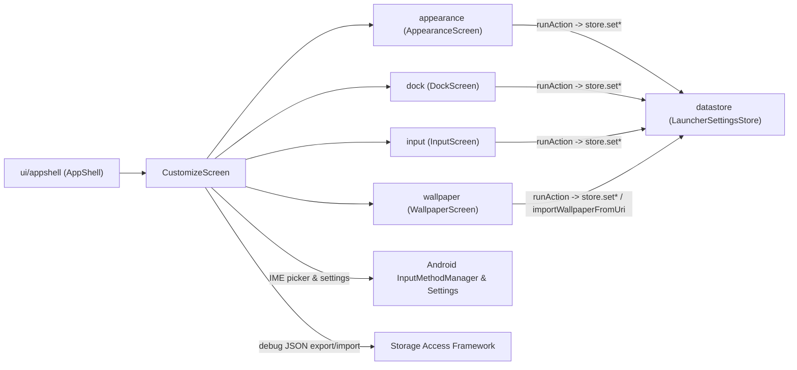

# `ui.customize` Package

## 1. What This Folder Does

Think of this folder as the **control room** for personalizing your phone's outer cover screen. While the launcher shows your customized cover screen, `ui.customize` is where you open the main settings hub on your inner screen and tweak how everything looks, behaves, and feels.

To keep things organized instead of cramming every switch onto one giant scrolling page, `CustomizeScreen.kt` acts like a **tabbed organizer binder** with four dedicated sections (each living in its own subfolder):
- **`appearance/`**: Dark/light theme, accent colors, and how rounded the overlay panels look.
- **`dock/`**: Which shortcut apps sit in your cover dock and in what order.
- **`input/`**: Which keyboard style you type with (built-in T9 keypad vs. system keyboard), vibration strength, and keyboard size.
- **`wallpaper/`**: Picking an image, GIF, or video background, plus zooming, cropping, dimming, and blurring it.

---

## 2. How It Works Step-by-Step

1. **Load saved settings once at the top**: `CustomizeScreen` creates a single `LauncherSettingsStore` and subscribes to it (`settings`), so any change saved anywhere immediately flows back down to every tab.
2. **Pick the best layout for the screen size**:
   - On a **wide screen** (unfolded inner display / tablet), categories appear as a permanent left-hand navigation rail.
   - On a **short/compact screen** (landscape or small pane `<= 480dp` tall), a slim header and horizontal filter chips keep vertical room for controls.
   - On a **regular phone screen**, a standard Material 3 top bar and scrollable tab row sit at the top.
3. **Remember where you scrolled**: When you switch from Wallpaper to Dock and back, `DisposableEffect` saves your scroll offset (`scroll.value`) so you don't lose your place.
4. **Surface missing permission reminders**: If required accessibility or overlay permissions aren't enabled yet, non-blocking banners explain that changes still save safely, even if the cover overlay can't show them yet.
5. **Run saves & backups safely**: Every DataStore edit or file export/import runs through `runAction`, which catches file or permission errors and shows a clean snackbar message instead of crashing.
6. **Handle system keyboard tools & resets**: The Input tab uses Android's `InputMethodManager` and Settings intents to open the system keyboard picker/settings (bumping `keyboardRefreshNonce` so status updates when you return), and the top-bar menu offers a category-scoped "Reset to defaults" dialog plus debug-only JSON backup/restore.

---

## 3. File-by-File Guide

### `CustomizeScreen.kt`

- **In plain terms**: The main hub frame that renders the top bar, category tabs/rail, permission reminder banners, reset confirmation popup, and debug JSON backup/import actions, then hands the body area to whichever category screen (`WallpaperScreen`, `DockScreen`, `AppearanceScreen`, or `InputScreen`) is active.
- **Key variables & state**:
  - `LOG_TAG` & `MAX_SETTINGS_JSON_BYTES`: Log tag for diagnostics and a 1 MiB safety cap so importing a huge file can't exhaust memory.
  - `appContext`: Application-wide `Context` so DataStore, `ContentResolver`, and `InputMethodManager` never leak an Activity reference.
  - `store` & `settings`: Remembered `LauncherSettingsStore` instance and the live `LauncherSettings` snapshot collected from DataStore.
  - `scope`: Long-lived `actionScope` coroutine scope so saves and file I/O finish reliably even if UI recomposes mid-action.
  - `menuExpanded`, `confirmReset`, `noticeDismissed`: UI flags controlling the overflow three-dot menu, the "Reset to defaults?" confirmation dialog, and permission banner dismissal.
  - `keyboardRefreshNonce`: Counter incremented after opening Android's keyboard picker or IME settings so `InputScreen` re-checks keyboard readiness when you come back.
  - `isCompactHeight` & `scroll`: Layout breakpoint (`screenHeightDp <= 480`) and preserved vertical `ScrollState` per category.
  - `exportLauncher` & `importLauncher`: Storage Access Framework (`CreateDocument` / `OpenDocument`) file pickers used in `BuildConfig.DEBUG` builds to export or restore settings as JSON.
- **How it connects**: Mounted by `ui/appshell`, reads/writes `LauncherSettingsStore` in `datastore`, displays `FeatureDegradedNotice` from `ui/permissions`, and delegates to `WallpaperScreen`, `DockScreen`, `AppearanceScreen`, and `InputScreen`.

---

## 4. Quick-Reference Summary Table

| Item | Role | Key APIs / Components | Subfolder |
| --- | --- | --- | --- |
| `CustomizeScreen.kt` | Tabbed/rail hub, safe async runner, reset dialog, debug JSON backup/restore | `LauncherSettingsStore`, `ActivityResultContracts`, `InputMethodManager` | `.` |
| `appearance/` | Theme mode, accent color swatches, overlay panel corner radius | `OneUIPillSlider`, `coverAccentScheme`, `SingleChoiceSegmentedButtonRow` | [appearance](appearance/README.md) |
| `dock/` | App scanning, dock toggles, drag-to-reorder strip, searchable app picker | `PackageManagerAppScannerRepository`, `detectDragGesturesAfterLongPress` | [dock](dock/README.md) |
| `input/` | T9 vs system IME strategy, capability diagnostics, haptics, size & anchor | `InputCapabilityDetector`, `InputTelemetryStore`, `InputMethodManager` | [input](input/README.md) |
| `wallpaper/` | Media file picker, live cover preview, full-screen pinch/pan crop editor | `OpenDocument`, `CoverDisplayHelper`, `detectTransformGestures` | [wallpaper](wallpaper/README.md) |

---

## 5. Architecture & Data Flow

---

## 6. Works Hand-in-Hand With

| Module | Relationship | Link |
| --- | --- | --- |
| `ui/appshell` | Navigates into `CustomizeScreen` and tracks the active `CustomizeCategory` | [ui/appshell](../appshell/README.md) |
| `datastore` | Provides `LauncherSettings` stream and persists every customization mutation | [datastore](../../datastore/README.md) |
| `ui/permissions` | Supplies `FeatureDegradedNotice` when overlay or input services are off | [ui/permissions](../permissions/README.md) |
| `ui/customize/appearance` | Theme mode, accent color, and panel corner radius sub-screen | [appearance](appearance/README.md) |
| `ui/customize/dock` | Dock visibility, app pinning, and drag-and-drop slot reordering | [dock](dock/README.md) |
| `ui/customize/input` | Keyboard strategy, capability diagnostics, haptics, and sizing | [input](input/README.md) |
| `ui/customize/wallpaper` | Image/GIF/video selection, preview, and full-screen crop/zoom editor | [wallpaper](wallpaper/README.md) |
