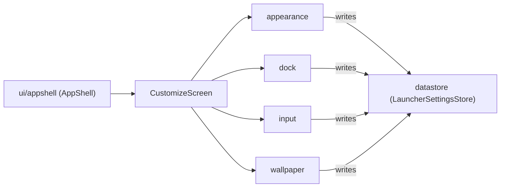

# `ui.customize` Package

Customization hub screen and nested category sub-packages (`appearance`, `dock`, `input`, `wallpaper`) for configuring the cover-screen launcher.

## What This Module Holds

| File / Sub-Package | Key Types / Role | Link |
| --- | --- | --- |
| `CustomizeScreen.kt` | `CustomizeScreen` | Category hub linking to Wallpaper, Dock, Appearance, and Input screens |
| `appearance/` | Panel corner radius, blur/opacity, and accent styling | [appearance](appearance/README.md) |
| `dock/` | Pinned dock slots configuration and reordering | [dock](dock/README.md) |
| `input/` | Keyboard strategy, haptics, size, and one-handed anchor controls | [input](input/README.md) |
| `wallpaper/` | Cover wallpaper media selection, scale mode, crop, and preview | [wallpaper](wallpaper/README.md) |

## Data Flow Diagram

## Works Hand-in-Hand With

| Module | Relationship | Link |
| --- | --- | --- |
| `ui/appshell` | Routes to `CustomizeScreen` and nested `CustomizeCategory` sub-routes | [ui/appshell](../appshell/README.md) |
| `datastore` | Reads and updates `LauncherSettingsStore` | [datastore](../../datastore/README.md) |
| `ui/customize/*` | Sub-screens implementing each customization category | [appearance](appearance/README.md) |
