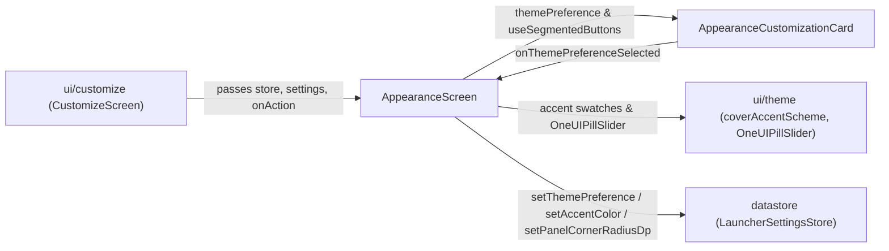

# `ui.customize.appearance` Package

## 1. What This Folder Does

If Cover-Screen-OS were a wristwatch or car dashboard, this folder is the **paint and trim shop**. It controls how the cover launcher's interface is styled:
1. **Light, Dark, or System theme**: Should the cover interface stay dark, go bright, or follow your phone's system setting?
2. **Accent color**: Which highlight color paints active buttons, toggles, and focus states?
3. **Panel corner roundness**: Should overlay panels have crisp corners or soft, pill-like curves?

To let you test corner roundness smoothly without waiting on disk writes, the slider updates a tiny live preview box instantaneously while persisting your chosen value to `LauncherSettingsStore`.

---

## 2. How It Works Step-by-Step

1. **Resolve the active light/dark palette**: `AppearanceScreen` checks `settings.themePreference`. If it's set to `SYSTEM`, it reads Android's `isSystemInDarkTheme()` so the accent color swatches below match what your eyes will actually see.
2. **Render the theme selector**: `AppearanceCustomizationCard` shows System, Light, and Dark options as a compact three-part segmented bar (or equal-width buttons when reused standalone).
3. **Pick an accent color**: Tapping any color swatch updates `settings.accentColor` through `onAction` and moves the thick highlight border to the chosen swatch.
4. **Adjust overlay panel corners**: Dragging the `OneUIPillSlider` updates `previewRadius` right away so the `"Panel preview"` box rounds or sharpens in real time while saving `panelCornerRadiusDp` into DataStore.

---

## 3. File-by-File Guide

### `AppearanceScreen.kt`

- **In plain terms**: The main Appearance tab content. It pairs the theme-mode card with an Accent Color picker and an interactive corner-radius slider + preview box.
- **Key variables & state**:
  - `dark`: Effective boolean dark-mode flag derived from `settings.themePreference` (falling back to `isSystemInDarkTheme()` for `ThemePreference.SYSTEM`), used to preview accurate light/dark swatch hues.
  - `previewRadius`: Local float state initialized from `settings.panelCornerRadiusDp` so dragging the corner-radius slider updates both the dp readout and `"Panel preview"` box immediately.
  - `selected` & `shape`: Inside the accent color loop, marks the currently saved `AccentColor` for a thicker highlight border and shares a `12.dp` `RoundedCornerShape` across background and border.
- **How it connects**: Hosted inside `CustomizeScreen` (`ui/customize`), delegates theme selection to `AppearanceCustomizationCard`, reads/writes `LauncherSettingsStore`, and uses `coverAccentScheme`, `LocalCoverPanelCornerRadius`, and `OneUIPillSlider` from `ui/theme`.

### `AppearanceCustomizationComponents.kt`

- **In plain terms**: Reusable UI card (`AppearanceCustomizationCard`) dedicated to picking `ThemePreference` (`SYSTEM`, `LIGHT`, `DARK`).
- **Key variables & state**:
  - `useSegmentedButtons`: Boolean switch allowing callers to pick a compact Material 3 `SingleChoiceSegmentedButtonRow` (used in `AppearanceScreen`) or larger equal-width `Button`/`OutlinedButton` controls sized with `coverMinimumTouchTarget()`.
  - `label` & `selected`: Friendly text (`"System"`, `"Light"`, `"Dark"`) and active-state flag deciding whether an option renders as a filled primary button or an outlined button.
- **How it connects**: Called by `AppearanceScreen` (and reusable in onboarding/other customize layouts), forwarding taps via `onThemePreferenceSelected` without holding its own DataStore reference.

---

## 4. Quick-Reference Summary Table

| File | Key Composables | What It Controls | Persistence Target |
| --- | --- | --- | --- |
| `AppearanceScreen.kt` | `AppearanceScreen` | Effective theme preview, accent swatch selection, corner-radius slider & preview box | `LauncherSettingsStore.setAccentColor`, `setPanelCornerRadiusDp` |
| `AppearanceCustomizationComponents.kt` | `AppearanceCustomizationCard` | Theme mode (`System`, `Light`, `Dark`) via segmented row or action buttons | Emits `onThemePreferenceSelected(ThemePreference)` |

---

## 5. Architecture & Data Flow

---

## 6. Works Hand-in-Hand With

| Module | Relationship | Link |
| --- | --- | --- |
| `ui/customize` | Parent customization hub routing to `AppearanceScreen` | [ui/customize](../README.md) |
| `datastore` | Defines `ThemePreference`, `AccentColor`, corner-radius bounds, and `LauncherSettingsStore` | [datastore](../../../datastore/README.md) |
| `ui/theme` | Provides `coverAccentScheme`, `LocalCoverPanelCornerRadius`, `OneUIPillSlider`, and touch-target helpers | [ui/theme](../../theme/README.md) |
