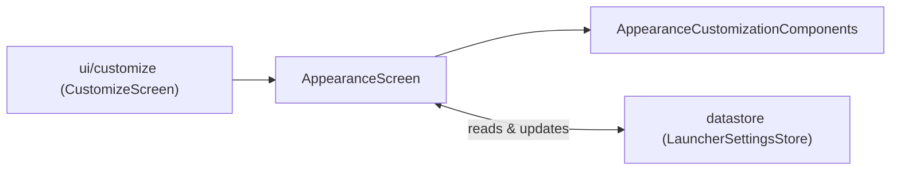

# `ui.customize.appearance` Package

Inner-display customization screen and components for cover launcher visual styling (theme/accent, panel corner radius, blur/haze, and layout density).

## What This Module Holds

| File | Key Types | Responsibility |
| --- | --- | --- |
| `AppearanceScreen.kt` | `AppearanceScreen` | Screen layout bound to `LauncherSettingsStore` appearance settings |
| `AppearanceCustomizationComponents.kt` | `AppearanceCustomizationCard` | Reusable controls for appearance sliders and toggles |

## Data Flow Diagram

## Works Hand-in-Hand With

| Module | Relationship | Link |
| --- | --- | --- |
| `ui/customize` | Parent customization hub routing to `AppearanceScreen` | [ui/customize](../README.md) |
| `datastore` | Persists appearance preferences in `LauncherSettingsStore` | [datastore](../../../datastore/README.md) |
| `ui/theme` & `ui/theme/oneui/components` | Supplies One UI sliders, cards, and theme tokens | [ui/theme](../../theme/README.md) |
