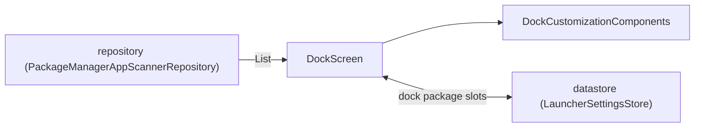

# `ui.customize.dock` Package

Inner-display customization screen and components for managing pinned dock app slots on the cover launcher.

## What This Module Holds

| File | Key Types | Responsibility |
| --- | --- | --- |
| `DockScreen.kt` | `DockScreen` | Screen displaying current dock slots and launching the app picker |
| `DockCustomizationComponents.kt` | `DockCustomizationCard`, `DockSlotEditorRow`, `DockReorderStrip`, `DockAppPickerDialog`, `normalizeDockPackageSlots` | Dock slot reordering, app selection dialog, and slot normalization |

## Data Flow Diagram

## Works Hand-in-Hand With

| Module | Relationship | Link |
| --- | --- | --- |
| `ui/customize` | Parent customization hub routing to `DockScreen` | [ui/customize](../README.md) |
| `repository` & `models` | Provides installed `AppModel` list for `DockAppPickerDialog` | [repository](../../../repository/README.md) |
| `datastore` | Persists normalized dock package slots in `LauncherSettingsStore` | [datastore](../../../datastore/README.md) |
| `ui/theme` | Applies One UI / CoverOS styling | [ui/theme](../../theme/README.md) |
