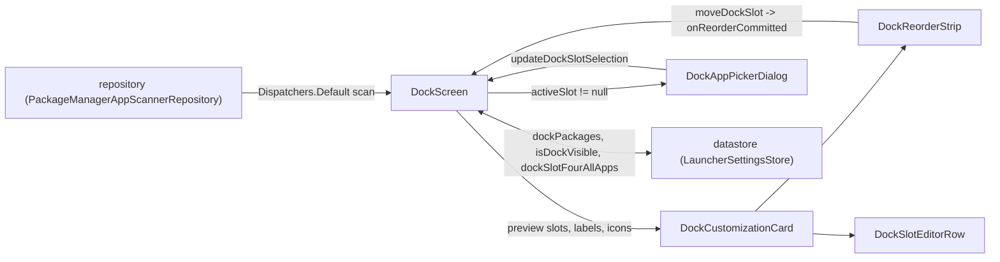

# `ui.customize.dock` Package

## 1. What This Folder Does

Think of the cover screen dock like the **favorites tray at the bottom of your phone**—a tight row of up to `COVER_DOCK_SLOT_COUNT` quick-launch spots on the small outer display. This folder gives you everything needed to manage that tray:
- Turn the whole dock on or off on the cover screen.
- Reserve **Slot 4** as a dedicated **"All apps"** drawer button (while keeping your previously pinned Slot 4 app safely remembered underneath).
- **Drag and drop tiles** horizontally on a tactile reorder strip with haptic clicks and spring physics.
- **Pick or clear** any individual slot using a searchable list of installed apps.

---

## 2. How It Works Step-by-Step

1. **Scan installed apps in the background**: When `DockScreen` opens, `produceState` runs `PackageManagerAppScannerRepository.scanInstalledApplications()` on `Dispatchers.Default` so the UI never freezes while reading app labels and icons.
2. **Seed defaults if nothing is saved yet**: If DataStore's `dockPackages` is empty, `DockScreen` pre-fills `preview` with the first few scanned apps; otherwise it normalizes saved entries with `normalizeDockPackageSlots`.
3. **Toggle visibility or Slot 4 "All apps"**: Flipping either switch saves immediately via `onAction` -> `store.setDockVisible` / `setDockSlotFourAllApps`.
4. **Reorder with a long-press drag**: Inside `DockReorderStrip`, pressing and holding a numbered tile lifts it (`slotScale`, `slotLiftOffset`, `slotShadow`) and vibrates. Sliding past a tile's width (`slotWidthPx`) calls `moveDockSlot`, shuffles `workingDockPackages` live, and updates `preview` immediately—only writing to DataStore (`onReorderCommitted`) when you let go and the order actually changed.
5. **Choose or clear a specific slot**: Tapping **"Choose"** opens `DockAppPickerDialog`, where typing filters `apps` by name or package ID; picking an app calls `updateDockSlotSelection` (automatically clearing any duplicate slot holding that same app) and saves to DataStore. Tapping **"Clear"** (or long-pressing an occupied row) sets that slot to `null`.

---

## 3. File-by-File Guide

### `DockScreen.kt`

- **In plain terms**: Connects the background app scanner and DataStore settings to the dock switches, reorder card, and app picker modal.
- **Key variables & state**:
  - `context` & `repository`: Application context and `PackageManagerAppScannerRepository` used to scan launchable apps safely off the main thread.
  - `scan`, `apps`, `appsByPackage`: Async scan `Result`, extracted `List<AppModel>`, and an O(1) lookup map from package name to app label/icon.
  - `stored`, `defaults`, `editorSlots`: Normalized saved slot list, fallback first-N-apps list, and the active starting slot list.
  - `preview`: Mutable local copy of the dock slots updated instantly during drags, picks, or clears before/alongside DataStore persistence.
  - `activeSlot`: Zero-based slot index currently selecting an app in `DockAppPickerDialog` (or `null` when the dialog is closed).
  - `dockContext`: Local Compose context used only as a fallback to query `PackageManager.getApplicationIcon` for persisted packages missing from `appsByPackage`.
- **How it connects**: Hosted by `CustomizeScreen`, reads apps from `repository`, reads/writes `LauncherSettingsStore`, and renders `DockCustomizationCard` and `DockAppPickerDialog`.

### `DockCustomizationComponents.kt`

- **In plain terms**: Holds all the dock UI pieces—the drag-and-drop reorder strip, per-slot editor rows, searchable app picker dialog, and pure list-manipulation helpers that guarantee dock slots stay deduplicated and fixed-length.
- **Key variables & state**:
  - `latestDockPackages`: `rememberUpdatedState` wrapper so long-lived `pointerInput` gesture blocks always see the latest slots without restarting mid-drag.
  - `draggingSlotIndex`, `dragDeltaX`, `slotWidthPx`: Active dragged tile index, horizontal pixels traveled since the last swap, and measured pixel width of one tile.
  - `workingDockPackages`, `dragStartDockSnapshot`, `lastReorderedDockSnapshot`: Mid-drag working order plus start/end snapshots compared on release (`commitReorderIfChanged`) so unchanged drags skip DataStore writes.
  - `neighborSnapDistance` & `dragProgress` / `neighborSnapOffset`, `slotScale`, `slotLiftOffset`, `slotShadow`: Spring-animated visual feedback lifting the active tile and nudging adjacent tiles aside.
  - `query` & `filteredApps`: Live search text and memoized matching `AppModel` list inside `DockAppPickerDialog`.
- **How it connects**: Purely driven by state and callbacks from `DockScreen`. Uses `AndroidView` + `ImageView` (caching `resolvedIcon` in `imageView.tag` to avoid redundant redraws) to display Android `Drawable` app icons inside Compose. Also exports `normalizeDockPackageSlots`, `moveDockSlot`, and `updateDockSlotSelection`.

---

## 4. Quick-Reference Summary Table

| Symbol | File | Purpose | Notable Behavior |
| --- | --- | --- | --- |
| `DockScreen` | `DockScreen.kt` | Hosts switches, async app scan, and dialog state | Seeds defaults if no slots saved; preserves Slot 4 app under All-Apps toggle |
| `DockCustomizationCard` | `DockCustomizationComponents.kt` | Combines reorder strip and slot rows | Supports `longPressToClear` and custom icon/label resolvers |
| `DockReorderStrip` | `DockCustomizationComponents.kt` | Long-press horizontal drag-and-drop strip | Spring animations + haptic ticks; saves only on drop if changed |
| `DockAppPickerDialog` | `DockCustomizationComponents.kt` | Searchable modal listing installed apps | Filters by display name or package ID; caches icon drawables via `tag` |
| `normalizeDockPackageSlots` | `DockCustomizationComponents.kt` | Pads/trims to `COVER_DOCK_SLOT_COUNT` | Trims blanks and drops duplicate package names |
| `moveDockSlot` / `updateDockSlotSelection` | `DockCustomizationComponents.kt` | Pure list reorder / slot assignment helpers | Guarantees each app appears in at most one slot |

---

## 5. Architecture & Data Flow

---

## 6. Works Hand-in-Hand With

| Module | Relationship | Link |
| --- | --- | --- |
| `ui/customize` | Parent customization hub routing to `DockScreen` | [ui/customize](../README.md) |
| `repository` | Supplies `PackageManagerAppScannerRepository` for installed app discovery | [repository](../../../repository/README.md) |
| `models` | Defines `AppModel` entries displayed in rows and `DockAppPickerDialog` | [models](../../../models/README.md) |
| `datastore` | Defines `COVER_DOCK_SLOT_COUNT` and persists dock preferences | [datastore](../../../datastore/README.md) |
| `ui/theme` | Provides `CoverOSCornerRadiusMedium`, `coverMinimumTouchTarget`, and padding modifiers | [ui/theme](../../theme/README.md) |
