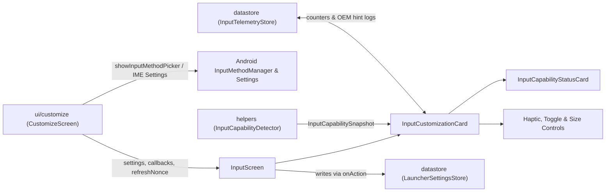

# `ui.customize.input` Package

## 1. What This Folder Does

Typing on a tiny cover screen is a lot like **texting on a smartwatch vs. a full phone**: some people prefer big, easy-to-tap T9 keypad buttons, while others want their full system keyboard (like Gboard or Samsung Keyboard) whenever the phone's manufacturer allows it.

This folder gives the user full control over cover-screen typing:
- **Strategy choice**: Switch between the built-in **T9 keypad** and the **System keyboard** (`SYSTEM_IME`).
- **Live readiness checkup**: Inspect which keyboards are enabled, whether CoverScreenOS T9 or Gboard is active, whether the phone maker restricts third-party keyboards on the outer screen, and how reliably the system keyboard picker actually opens in practice.
- **Feel & layout tuning**: Configure haptic strength, key-press sounds, suggestion strip, autocorrect, popup key previews, keyboard height presets (`Compact` / `Standard` / `Tall`), and one-handed left/right anchoring.
- **System shortcuts**: Jump straight to Android's keyboard picker, system IME settings, or reset saved per-field keyboard mode preferences.

---

## 2. How It Works Step-by-Step

1. **Check device IME readiness safely**: `InputCustomizationCard` uses `produceState` (re-triggered by `capabilityRefreshNonce` from `CustomizeScreen` or `localRefreshNonce` from **"Refresh status"**) to run `InputCapabilityDetector(context).detect()`. Any failure sets `capabilityLoadFailed = true` instead of crashing.
2. **Track OEM restriction warnings**: If `capabilitySnapshot.oemRestrictionHint` is non-blank, a `LaunchedEffect` records `recordOemBlockedHintShown()` in `InputTelemetryStore`.
3. **Blend theory with real-world results**: `InputCapabilityStatusCard` takes the static heuristic readiness score (`availabilityEstimatePercent`) and, once real picker attempts exist (`imeShowRequestCount > 0L`), averages it with `imeShowSuccessRatePercent` to show a calibrated availability estimate.
4. **Update preferences immediately**: Selecting a strategy, haptic tier, toggle, height preset, or one-handed anchor invokes callbacks wired back to `CustomizeScreen` -> `LauncherSettingsStore`.
5. **Open Android's keyboard dialogs**: Clicking **"Keyboard picker"** triggers `InputMethodManager.showInputMethodPicker()` in `CustomizeScreen`; clicking **"Keyboard settings"** launches `Settings.ACTION_INPUT_METHOD_SETTINGS` and increments `refreshNonce` so the status card updates upon return.
6. **Optional QA sandbox (debug builds only)**: In `BuildConfig.DEBUG` builds, `InputScreen` renders an expandable preview of `SuggestionStrip` and `KeyboardKey` primitives so developers can test tap/suggestion behavior without switching their device keyboard.

---

## 3. File-by-File Guide

### `InputScreen.kt`

- **In plain terms**: A clean pass-through screen connecting saved `LauncherSettings` and mutation callbacks to `InputCustomizationCard`, plus a debug-only miniature keyboard playground at the bottom.
- **Key variables & state**:
  - `showPreview`: (`BuildConfig.DEBUG` only) Toggles visibility of the interactive keyboard primitives sandbox (`rememberSaveable`).
  - `sampleText`: (`BuildConfig.DEBUG` only) Scratch string updated when tapping sample `KeyboardKey` buttons or picking words from `SuggestionStrip`.
- **How it connects**: Rendered by `CustomizeScreen` (`ui/customize`), delegates main UI to `InputCustomizationCard`, and imports `KeyboardKey` / `SuggestionStrip` from `ui/keyboard/primitives`.

### `InputCustomizationComponents.kt`

- **In plain terms**: Houses the full Input settings card (`InputCustomizationCard`), the IME diagnostic readout (`InputCapabilityStatusCard`), and focused control rows (`HapticStrengthPicker`, `KeyboardCustomizationToggles`, `CustomizationToggleRow`, `KeyboardSizeAndAnchorControls`).
- **Key variables & state**:
  - `inputTelemetryStore` & `telemetryCounters`: DataStore-backed telemetry tracking how often the IME picker succeeded/failed and how often OEM warnings appeared.
  - `localRefreshNonce`, `capabilityLoadFailed`, `capabilitySnapshot`: Refresh trigger, error guard flag, and latest `InputCapabilitySnapshot` from `InputCapabilityDetector`.
  - `oemRestrictionHint`: Optional manufacturer notice explaining cover-display keyboard limits.
  - `options`: Pair of `KeyboardStrategyUiOption` descriptors (`KeyboardStrategy.T9` vs `KeyboardStrategy.SYSTEM_IME`).
  - `presets`: Three height choices (`COMPACT_EXTRA_KEY_HEIGHT_DP`, `STANDARD_EXTRA_KEY_HEIGHT_DP`, `TALL_EXTRA_KEY_HEIGHT_DP`) matched within a `2f` dp tolerance.
  - `defaultImeLabel`, `enabledImeLabels`, `availabilityTierLabel`, `observedSuccessRate`, `hasObservedRuntimeSamples`, `calibratedAvailabilityPercent`: Formatted diagnostic strings and blended availability percentage shown inside `InputCapabilityStatusCard`.
- **How it connects**: Reads `InputCapabilityDetector` (`helpers`) and `InputTelemetryStore` (`datastore`), uses `HapticStrength` / `KeyboardAnchor` / `KeyboardStrategy` enums (`datastore`), and tags toggle rows (`input_toggle_*`) for UI tests.

---

## 4. Quick-Reference Summary Table

| Component | File | Role | Key Inputs / Dependencies |
| --- | --- | --- | --- |
| `InputScreen` | `InputScreen.kt` | Wires `LauncherSettings` & callbacks; renders debug QA sandbox | `LauncherSettings`, `BuildConfig.DEBUG`, `SuggestionStrip`, `KeyboardKey` |
| `InputCustomizationCard` | `InputCustomizationComponents.kt` | Top-level card coordinating IME detection, strategy buttons, and sub-controls | `InputCapabilityDetector`, `InputTelemetryStore` |
| `InputCapabilityStatusCard` | `InputCustomizationComponents.kt` | Shows default/enabled IMEs, telemetry, OEM hint, calibrated estimate | `InputCapabilitySnapshot`, `InputTelemetryCounters` |
| `HapticStrengthPicker` | `InputCustomizationComponents.kt` | Segmented selector for `Off` / `Light` / `Standard` / `Strong` | `HapticStrength` |
| `KeyboardCustomizationToggles` | `InputCustomizationComponents.kt` | Switches for sound, suggestion strip, autocorrect, key popups | `CustomizationToggleRow` with test tags |
| `KeyboardSizeAndAnchorControls` | `InputCustomizationComponents.kt` | Compact/Standard/Tall size presets + one-handed Left/Right anchor | `KeyboardAnchor`, height dp constants |

---

## 5. Architecture & Data Flow

---

## 6. Works Hand-in-Hand With

| Module | Relationship | Link |
| --- | --- | --- |
| `ui/customize` | Parent hub dispatching DataStore updates and launching Android IME picker/settings | [ui/customize](../README.md) |
| `datastore` | Stores `KeyboardStrategy`, haptics, sizing, anchoring, and `InputTelemetryStore` counters | [datastore](../../../datastore/README.md) |
| `helpers` | Provides `InputCapabilityDetector` to inspect enabled/default system IMEs and OEM limits | [helpers](../../../helpers/README.md) |
| `ui/keyboard/primitives` | Provides `KeyboardKey` and `SuggestionStrip` used in the debug QA preview | [ui/keyboard/primitives](../../keyboard/primitives/README.md) |
