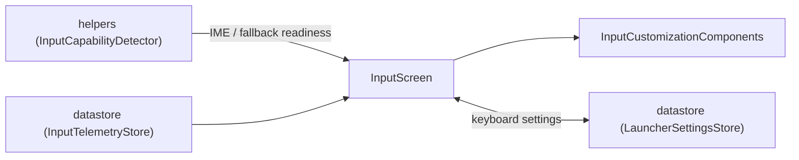

# `ui.customize.input` Package

Inner-display customization screen and components for cover-screen keyboard strategy, haptics, sound, sizing, and one-handed anchoring.

## What This Module Holds

| File | Key Types | Responsibility |
| --- | --- | --- |
| `InputScreen.kt` | `InputScreen` | Screen binding input capability status and keyboard preferences |
| `InputCustomizationComponents.kt` | `InputCustomizationCard`, `HapticStrengthPicker`, `KeyboardCustomizationToggles`, `CustomizationToggleRow`, `KeyboardSizeAndAnchorControls` | Controls for haptic tier, key sound, keyboard height/scale, and dock anchor |

## Data Flow Diagram

## Works Hand-in-Hand With

| Module | Relationship | Link |
| --- | --- | --- |
| `ui/customize` | Parent customization hub routing to `InputScreen` | [ui/customize](../README.md) |
| `datastore` | Persists `KeyboardStrategy` and keyboard preferences, and reads `InputTelemetryStore` | [datastore](../../../datastore/README.md) |
| `helpers` | Uses `InputCapabilityDetector` to display IME/accessibility input status | [helpers](../../../helpers/README.md) |
| `ui/keyboard/primitives` | Shares `HapticTier` and sizing presets | [ui/keyboard/primitives](../../keyboard/primitives/README.md) |
