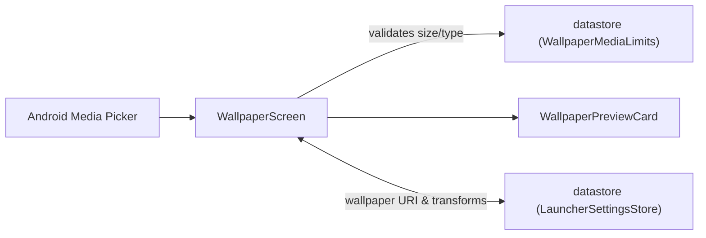

# `ui.customize.wallpaper` Package

Inner-display customization screen and components for selecting, cropping, scaling, and previewing cover-screen wallpapers (image, GIF, video).

## What This Module Holds

| File | Key Types | Responsibility |
| --- | --- | --- |
| `WallpaperScreen.kt` | `WallpaperScreen` | Handles media picker integration, validation, and wallpaper state updates |
| `WallpaperCustomizationComponents.kt` | `WallpaperCustomizationCard`, `WallpaperPreviewCard` | Interactive wallpaper preview and scale/crop/zoom/rotation controls |

## Data Flow Diagram

## Works Hand-in-Hand With

| Module | Relationship | Link |
| --- | --- | --- |
| `ui/customize` | Parent customization hub routing to `WallpaperScreen` | [ui/customize](../README.md) |
| `datastore` | Validates `WallpaperMediaLimits` and persists URI, scale mode, crop, zoom, and rotation | [datastore](../../../datastore/README.md) |
| `ui/launcher` | `OverlayWallpaperLayer` renders the saved wallpaper configuration on the cover display | [ui/launcher](../../launcher/README.md) |
| `helpers` & `ui/theme` | Uses display metrics/helpers and CoverOS theme components | [ui/theme](../../theme/README.md) |
