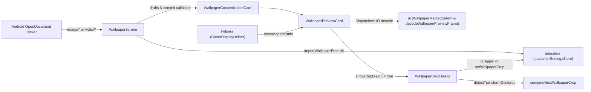

# `ui.customize.wallpaper` Package

## 1. What This Folder Does

Think of this folder as a **custom picture framer sized specifically for your flip phone's outer screen**. Instead of guessing how a photo, animated GIF, or video will look once cropped onto a narrow or boxy cover display, you get:
- A **media picker** that accepts static images, GIFs, or short videos (with clear size, resolution, frame-rate, and codec limits displayed right below the controls).
- A **live cover-ratio preview** showing how your wallpaper sits behind sample lock-screen clock text—complete with drag-to-pan, dim, and blur adjustments.
- A **full-screen Zoom & Crop modal** with pinch-to-zoom, drag panning, a photography rule-of-thirds grid, Crop vs. Fit framing toggle, and 90-degree rotation.

---

## 2. How It Works Step-by-Step

1. **Pick media safely**: Tapping **"Choose wallpaper"** launches `ActivityResultContracts.OpenDocument()` filtered to `image/*` and `video/*`. When you select a file, `WallpaperScreen` sets `importing = true`, delegates copying/validation to `store.importWallpaperFromUri(uri)`, and automatically opens the full-screen `WallpaperCropDialog` once the import succeeds.
2. **Keep sliders silky-smooth without flooding DataStore**: `WallpaperScreen` mirrors persisted settings into local draft variables (`scale`, `dim`, `blur`, `cropX`, `cropY`, `zoom`, `rotation`). Dragging a slider or long-press panning updates the live preview every frame, while DataStore writes happen only when you release (`on*Commit`) or hit **Apply**.
3. **Match the cover screen's real shape**: `WallpaperPreviewCard` queries `CoverDisplayHelper(context).getCoverDisplay()` (falling back to `context.display` or `9f / 19f`) so the preview box matches your physical outer display's aspect ratio.
4. **Decode thumbnails off the main thread**: `produceState` calls `decodeWallpaperPreviewFrame` on `Dispatchers.IO`, sizing the preview bitmap to `availableWidth` × `previewHeight` and rethrowing `CancellationException` cleanly if you navigate away mid-decode.
5. **Convert finger drags into normalized crop math**: Inside `WallpaperCropDialog`, `detectTransformGestures` feeds pixel pan deltas into `computeNextWallpaperCrop`, which accounts for 90° rotation swaps, `CROP` (fill) vs `FIT` (contain) base scaling, and `zoom` overflow to compute normalized `[-1f, 1f]` offsets matching `WallpaperTransformFrame`.

---

## 3. File-by-File Guide

### `WallpaperScreen.kt`

- **In plain terms**: The state coordinator for wallpaper customization. It launches the file picker, kicks off URI import into app storage, holds local slider/gesture drafts, and saves committed changes to `LauncherSettingsStore`.
- **Key variables & state**:
  - `importing`: Prevents starting overlapping media imports while `store.importWallpaperFromUri(uri)` is still copying/validating a file.
  - `scale`, `dim`, `blur`, `cropX`, `cropY`, `zoom`, `rotation`: Local draft transform values keyed on `settings.*` (with `isFinite()` and range clamping guards on `dim` and `blur`) so preview controls stay responsive before saving.
  - `showCropDialog`: Controls visibility of the full-screen `WallpaperCropDialog` (`rememberSaveable` keeps it open across screen rotations).
  - `picker`: `ActivityResultContracts.OpenDocument` launcher requesting `image/*` or `video/*` files from Android's document picker.
- **How it connects**: Mounted inside `CustomizeScreen`, reads/writes `LauncherSettingsStore`, and passes state + preview/commit callbacks down to `WallpaperCustomizationCard`.

### `WallpaperCustomizationComponents.kt`

- **In plain terms**: Renders the wallpaper control card (action buttons, Crop/Fit/Rotate/Reset controls, Zoom/Dim/Blur sliders, and media limit notes) plus the live cover-aspect-ratio preview card that supports inline long-press panning.
- **Key variables & state**:
  - `displayZoom`: Zoom factor rounded to one decimal place for the `"Zoom: X.Xx"` slider label.
  - `context`, `fallbackWidth`, `coverAspectRatio`, `availableWidth`, `previewHeight`: Used to measure the physical cover screen aspect ratio via `CoverDisplayHelper` and compute memory-safe decode bounds.
  - `normalizedUri` & `uri`: Cleaned wallpaper URI string parsed into an Android `Uri` (or `null` when using pure black mode).
  - `preview` (`WallpaperPreviewLoad`): Asynchronous decode result from `decodeWallpaperPreviewFrame` (`frame` or `failureMessage`).
  - `latestCropX`, `latestCropY`, `latestCropPreviewChanged`, `latestCropCommit`: `rememberUpdatedState` refs keeping inline `detectDragGesturesAfterLongPress` callbacks fresh without restarting active gestures.
  - `previewFrame` & `cropFrame`: Decoded `WallpaperFrame` instances gating both the preview render and opening `WallpaperCropDialog`.
- **How it connects**: Called by `WallpaperScreen`, uses `CoverDisplayHelper` (`helpers`), `decodeWallpaperPreviewFrame` / `WallpaperMediaContent` (`ui`), and launches `WallpaperCropDialog`.

### `WallpaperCropDialog.kt`

- **In plain terms**: A dedicated full-screen black-stage editor where you pinch, drag, toggle Crop/Fit, and rotate in 90-degree steps over a subtle 3×3 rule-of-thirds grid before hitting **Apply** or **Reset**.
- **Key variables & state**:
  - `draftScaleMode`, `draftCropX`, `draftCropY`, `draftZoom`, `draftRotation`: Temporary in-dialog drafts so you can experiment freely or tap **Reset**/**Cancel** without touching saved settings until **Apply**.
  - `isCompactHeight`: Detects short viewports (`<= 480dp`) to shrink header padding and hide the floating `"Pinch to zoom • Drag to reposition"` hint pill.
  - `frameModifier`: `BoxWithConstraints` sizing calculation maximizing the `coverAspectRatio` frame inside available stage space.
  - `widthPx`, `heightPx`, `rotatedWidth`, `rotatedHeight`, `widthScale`, `heightScale`, `baseScale`, `scaledWidth`, `scaledHeight`, `maxPanX`, `maxPanY`, `nextX`, `nextY` (inside `computeNextWallpaperCrop`): Exact scaling and overflow math mapping pixel finger drags to normalized `[-1f, 1f]` crop offsets.
  - `gridColor`, `stroke`, `thirdW`, `thirdH` & `displayZoom`: `Canvas` overlay measurements for the 3×3 grid and rounded `"1.5x"` zoom readout.
- **How it connects**: Launched from `WallpaperPreviewCard` when `showCropDialog && uri != null && cropFrame != null`, rendering the live media via `WallpaperMediaContent` and sharing identical scaling math with `WallpaperTransformFrame`.

---

## 4. Quick-Reference Summary Table

| Item | File | Role | Key Limits / Behaviors |
| --- | --- | --- | --- |
| `WallpaperScreen` | `WallpaperScreen.kt` | SAF `OpenDocument` picker, import lock, draft/commit sync | Imports `image/*` & `video/*`; opens crop dialog right after import |
| `WallpaperCustomizationCard` | `WallpaperCustomizationComponents.kt` | Controls for media, framing, zoom/dim/blur, and format limits | Documents 64 MiB max; images <= 8192×8192 / 40 MP; video/GIF <= 2048×2048 / 4.19 MP, 10 s / 30 fps / 300 frames (MP4/WebM H.264/HEVC/VP9) |
| `WallpaperPreviewCard` | `WallpaperCustomizationComponents.kt` | Cover-ratio preview with inline long-press pan | Uses `CoverDisplayHelper` physical mode ratio; decodes on `Dispatchers.IO` |
| `WallpaperCropDialog` | `WallpaperCropDialog.kt` | Full-screen pinch-to-zoom, pan, mode, and 90° rotation modal | Holds temporary drafts until **Apply**; shows rule-of-thirds `Canvas` grid |
| `computeNextWallpaperCrop` | `WallpaperCropDialog.kt` | Pixel-pan to normalized `[-1f, 1f]` offset converter | Matches `WallpaperTransformFrame` scaling; locks non-overflowing axes to `0f` |

---

## 5. Architecture & Data Flow

---

## 6. Works Hand-in-Hand With

| Module | Relationship | Link |
| --- | --- | --- |
| `ui/customize` | Parent hub hosting `WallpaperScreen` and wrapping saves/imports in `runAction` | [ui/customize](../README.md) |
| `datastore` | Validates media limits, copies picked URIs, and persists transform preferences | [datastore](../../../datastore/README.md) |
| `helpers` | Supplies `CoverDisplayHelper` to read the outer cover display's physical aspect ratio | [helpers](../../../helpers/README.md) |
| `ui/launcher` | Renders the saved wallpaper and transforms on the live cover launcher overlay | [ui/launcher](../../launcher/README.md) |
| `ui/theme` | Provides One UI theme tokens, rounded shapes, and touch-target helpers | [ui/theme](../../theme/README.md) |
