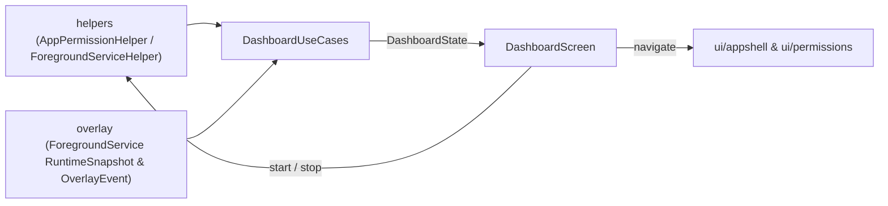

# `ui.dashboard` Package

Inner-display runtime dashboard showing service status, permission readiness, quick actions, recent overlay events, and usage tips.

## What This Module Holds

| File | Key Types | Responsibility |
| --- | --- | --- |
| `DashboardScreen.kt` | `DashboardScreen`, `DashboardScreenPreview` | Main dashboard layout composing hero card, quick actions, recent activity, and tips |
| `DashboardUseCases.kt` | `DashboardPermissions`, `DashboardStatus`, `DashboardState`, `DashboardUseCases`, `rememberDashboardState` | Aggregates permission checks, `ForegroundService.RuntimeSnapshot`, and overlay events into `DashboardState` |
| `DashboardHeroCard.kt` | `DashboardHeroCard`, `DashboardStatusDetails` | Primary status card with start/stop runtime controls |
| `QuickActionsRow.kt` | `QuickActionsRow`, `QuickAction` | Shortcut row for common actions (customize, permissions, service control) |
| `RecentActivityCard.kt` | `RecentActivityCard` | Displays recent `OverlayEvent` entries from the runtime |
| `TipsCarousel.kt` | `TipsCarousel` | Swipeable tips carousel for cover-screen usage |

## Data Flow Diagram

## Works Hand-in-Hand With

| Module | Relationship | Link |
| --- | --- | --- |
| `ui/appshell` | Hosts `DashboardScreen` as the primary destination | [ui/appshell](../appshell/README.md) |
| `overlay` | Reads `ForegroundService` runtime state and recent `OverlayEvent` history | [overlay](../../overlay/README.md) |
| `helpers` | Checks readiness via `AppPermissionHelper` and starts/stops runtime via `ForegroundServiceHelper` | [helpers](../../helpers/README.md) |
| `ui/permissions` | Navigates to `PermissionsScreen` when core readiness is incomplete | [ui/permissions](../permissions/README.md) |
| `ui/theme/oneui/components` | Uses One UI cards and scaffold components | [oneui/components](../theme/oneui/components/README.md) |
