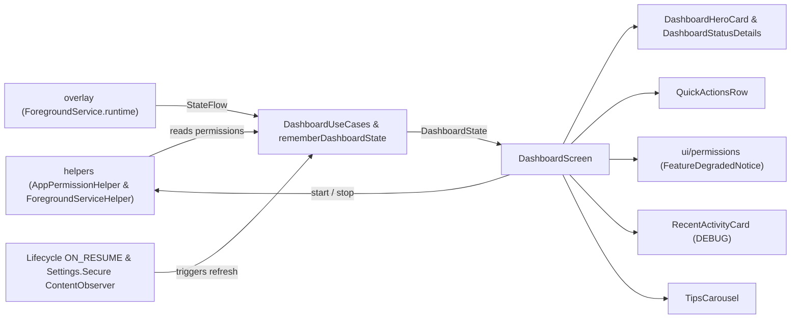

# `ui.dashboard` Package

## What This Folder Does

Think of `ui/dashboard` as the **car dashboard and ignition switch** for Cover Screen OS. Every time the user opens the main screen on their phone, this folder answers:

- **Is the cover screen running right now?** Shows a live pill (`Cover Active` / `Cover Dormant`) and an expandable hero card summarizing overall readiness (`Active`, `Setup needed`, or `Service stopped`).
- **Can I turn it on or preview it in one tap?** Offers big circular One UI quick-action buttons to start/stop the foreground service, jump to Permissions, or open a safe local layout preview dialog.
- **What if something is missing?** Embeds a dismissible *Limited features* notice when required permissions aren't granted yet, and flags an inline warning if starting the service is blocked.
- **How do I learn more or inspect debug events?** Includes a dismissible tip card (`TipsCarousel`) and—in debug builds—an expandable log of recent cover overlay events (`RecentActivityCard`).

## How It Works Step-by-Step

1. **Gather live state (`rememberDashboardState`)**:
   - Reads the 5 Android permission flags via `DashboardUseCases.readPermissions(context)`.
   - Collects `ForegroundService.runtime` (`StateFlow`) to see if the foreground service, launcher accessibility host, and cover overlay are currently active.
2. **Stay fresh automatically**: `DisposableEffect` registers both a `LifecycleEventObserver` (re-polling permissions on `ON_RESUME` after visiting System Settings) and a `ContentObserver` on `Settings.Secure.CONTENT_URI` (catching live Accessibility/Notification Listener changes even in split-screen or via ADB). Both observers clean up in `onDispose`.
3. **Compute overall status (`DashboardState`)**: Evaluates priorities in order—missing required permissions (`SETUP_NEEDED`) → service stopped (`STOPPED`) → accessibility host disconnected (`SETUP_NEEDED`) → fully connected (`ACTIVE`).
4. **Render the One UI scaffold (`DashboardScreen`)**: Displays the `OneUINowPill` toggle in the header, `TopBarStatusChip` in top-bar actions, and a `LazyColumn` of One UI cards:
   - `DashboardHeroCard` (tap to expand `DashboardStatusDetails` with uptime and last event)
   - `FeatureDegradedNotice` (shown if any of the 4 required permissions are missing and not dismissed)
   - `QuickActionsRow` (*Start/Stop service*, *Grant permissions*, *Preview overlay*)
   - Debug-only `RecentActivityCard` and `TipsCarousel`

## File-by-File Guide

### DashboardUseCases.kt

- **In plain terms**: The data brain behind the dashboard—polls Android permission checks, watches `ForegroundService` state, listens for Settings changes in real time, and bundles everything into `DashboardState`.
- **Key variables & state**:
  - `DashboardPermissions`: Holds `notifications`, `launcherAccessibility`, `notificationListener`, `batteryExemption`, and `inputAccessibility`, plus computed `missing` list, `grantedCount`, and `totalCount` (`4`).
  - `DashboardStatus`: Enum (`ACTIVE`, `SETUP_NEEDED`, `STOPPED`).
  - `DashboardState`: Combines `permissions` + `runtime` and computes `status` and human-readable `title`.
  - `rememberDashboardState`: Tracks `permissions` state, `runtime` flow, `lifecycleObserver` (`ON_RESUME`), and `settingsObserver` (`Settings.Secure.CONTENT_URI`), cleaning up both on dispose.
- **How it connects**: Called by `AppShell` and passed down into `DashboardScreen`, `TopBarStatusChip`, and `CustomizeScreen` (`permissions`).

### DashboardScreen.kt

- **In plain terms**: The main Dashboard page layout combining the One UI header, live active/dormant pill, status card, degraded-feature notice, quick action buttons, debug event log, tips card, and mock preview dialog.
- **Key variables & state**:
  - `previewVisible`: Controls whether the local `"Cover Surface Preview"` `AlertDialog` is open.
  - `startBlocked`: Set to `true` when `onToggleService()` returns `false` (meaning required permissions blocked service startup), displaying an inline error message.
  - `noticeDismissed`: `rememberSaveable` boolean keeping the *Limited features* notice hidden for the session after the user closes it.
  - `missingList` & `verb`: Formats singular/plural grammar (`"is"` vs `"are"`) in the degraded-notice message.
- **How it connects**: Hosted by `AppShell` at `HomeRoutes.Dashboard`; delegates service start/stop to `AppShell`'s `ForegroundServiceHelper` callback and permission navigation to `HomeRoutes.Permissions`.

### DashboardHeroCard.kt

- **In plain terms**: An expandable summary card showing the current status icon, title, `"X of 4 required permissions ready"`, a one-line next-step hint, and—when tapped—a detailed diagnostic breakdown (`DashboardStatusDetails`).
- **Key variables & state**:
  - `expanded`: Toggles inline visibility of `DashboardStatusDetails` and updates TalkBack `stateDescription`.
  - `isCompactHeight`: Adjusts padding and spacing when `screenHeightDp <= 480`.
- **How it connects**: Embedded at the top of `DashboardScreen`, while `DashboardStatusDetails` is also reused inside `TopBarStatusChip`'s bottom sheet in `ui/appshell`.

### QuickActionsRow.kt

- **In plain terms**: A horizontal row of three equal-width One UI circular icon buttons on the Dashboard for **Start/Stop service**, **Grant permissions**, and **Preview overlay**.
- **Key variables & state**:
  - `interactionSource` (inside private `QuickAction`): Tracks press gestures to power `oneUIPressable` squeeze animation instead of a standard Material ripple (`indication = null`).
- **How it connects**: Embedded in `DashboardScreen` under *Quick Controls*, forwarding taps to `onToggleService`, `onPermissions`, and `onPreview`.

### RecentActivityCard.kt

- **In plain terms**: A collapsible debug card showing recent `OverlayEvent` messages recorded by `ForegroundService` (capped at `240.dp` tall inside a scrollable list when expanded).
- **Key variables & state**:
  - `expanded`: Toggles between collapsed header (`+`) and expanded event list (`-`).
- **How it connects**: Rendered inside `DashboardScreen` only when `BuildConfig.DEBUG` is `true`, reading `state.runtime.events`.

### TipsCarousel.kt

- **In plain terms**: A helpful tip card that steps through four setup/customization hints via **Next tip** and **Dismiss tip** buttons, disappearing completely if every tip is dismissed.
- **Key variables & state**:
  - `tips`: Static list of 4 cover-screen onboarding hints.
  - `dismissed`: Integer bitmask persisted with `rememberSaveable` tracking which tip indices have been dismissed (`1 shl index`).
  - `selected` / `available` / `index`: Picks the next non-dismissed tip index and wraps around cleanly at the end.
- **How it connects**: Placed at the bottom of `DashboardScreen` under *Tips & Guidance*.

## Quick-Reference Summary

| File | Key Types / Functions | Purpose |
| --- | --- | --- |
| `DashboardUseCases.kt` | `DashboardPermissions`, `DashboardStatus`, `DashboardState`, `DashboardUseCases`, `rememberDashboardState` | Polls permissions, watches `ON_RESUME` + `Settings.Secure`, and collects `ForegroundService.runtime` |
| `DashboardScreen.kt` | `DashboardScreen`, `DashboardScreenPreview` | Main One UI dashboard layout, `OneUINowPill`, degraded banner, blocked-start hint, and preview dialog |
| `DashboardHeroCard.kt` | `DashboardHeroCard`, `DashboardStatusDetails` | Expandable status summary card and reusable diagnostic breakdown (uptime via `SystemClock.elapsedRealtime()`) |
| `QuickActionsRow.kt` | `QuickActionsRow`, `QuickAction` | Three circular One UI action buttons (Start/Stop service, Grant permissions, Preview overlay) |
| `RecentActivityCard.kt` | `RecentActivityCard` | Expandable debug card listing recent `OverlayEvent` entries |
| `TipsCarousel.kt` | `TipsCarousel` | Button-driven tip card with `rememberSaveable` bitmask dismissal |

## Architecture Flowchart

## Works Hand-in-Hand With

| Module | Relationship | Link |
| --- | --- | --- |
| `ui/appshell` | Creates `rememberDashboardState`, hosts `DashboardScreen`, and reuses `DashboardStatusDetails` in `TopBarStatusChip` | [ui/appshell](../appshell/README.md) |
| `overlay` | Provides `ForegroundService.runtime` (`RuntimeSnapshot` & `OverlayEvent`) | [overlay](../../overlay/README.md) |
| `helpers` | Supplies permission checks (`AppPermissionHelper`) and service toggles (`ForegroundServiceHelper`) | [helpers](../../helpers/README.md) |
| `ui/permissions` | Supplies `FeatureDegradedNotice` and handles permission granting when tapped | [ui/permissions](../permissions/README.md) |
| `ui/theme/oneui/components` | Provides `OneUIScaffold`, `OneUICardGroup`, and `OneUINowPill` | [oneui/components](../theme/oneui/components/README.md) |
