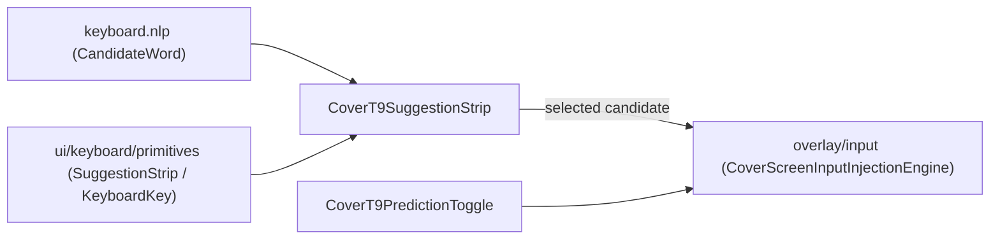

# `ui.keyboard` Package

Cover-screen keyboard UI helpers bridging `:keyboard-floris` / `keyboard.nlp` predictions with `:app` keyboard primitives.

## What This Module Holds

| File / Sub-Package | Key Types | Responsibility |
| --- | --- | --- |
| `ContactSuggestionRevision.kt` | `rememberContactSuggestionRevision` | Tracks contact/suggestion revision state for cover input |
| `CoverT9PredictionToggle.kt` | `CoverT9PredictionToggle` | Toggle chip/control switching T9 predictive mode |
| `CoverT9SuggestionStrip.kt` | `CoverT9SuggestionStrip` | Displays `CandidateWord` suggestions for T9 input |
| `primitives/` | `KeyboardKey`, `SuggestionStrip`, `ClipboardToolbar`, `HapticTier`, `KeySound`, `TextBuffer`, etc. | Reusable keyboard UI primitives and feedback utilities |

## Data Flow Diagram

## Works Hand-in-Hand With

| Module | Relationship | Link |
| --- | --- | --- |
| `ui/keyboard/primitives` | Supplies `SuggestionStrip`, `KeyboardKey`, and state primitives | [primitives](primitives/README.md) |
| `overlay/input` | Embeds `CoverT9SuggestionStrip` and `CoverT9PredictionToggle` in the input fallback overlay | [overlay/input](../../overlay/input/README.md) |
| `:keyboard-floris` (`keyboard.floris`, `keyboard.nlp`) | Supplies `CandidateWord` and Floris keyboard state | [floris](../../../../../../../../../keyboard-floris/src/main/java/com/tyejaedon/coverscreenos/keyboard/floris/README.md) |
