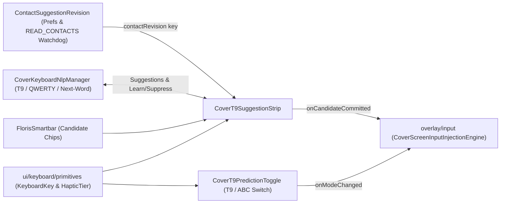

# `ui.keyboard` Package

## What This Folder Does

Think of `ui/keyboard/` as the **"smart adapter"** between the word-guessing brain (`CoverKeyboardNlpManager` + `:keyboard-floris`) and the raw visual building blocks inside `primitives/`.

When you type on the small cover screen using the classic 9-key T9 dialpad or cover search, this package handles three focused jobs:
1. **Showing live word suggestions** (`CoverT9SuggestionStrip.kt`)—whether you are tapping T9 digits (`4663`), typing QWERTY letters, or starting the next word after a space.
2. **Giving you a one-tap switch between Predictive T9 and ABC multi-tap** (`CoverT9PredictionToggle.kt`).
3. **Keeping contact-name suggestions fresh** (`ContactSuggestionRevision.kt`) whenever you flip the "Include contact names" toggle or grant/revoke the Contacts permission in Android Settings.

---

## How It Works Step-by-Step

1. **You open the cover T9 keyboard or search bar**: `CoverT9SuggestionStrip` initializes `CoverKeyboardNlpManager` and calls `rememberContactSuggestionRevision` to start watching contact preferences and permissions.
2. **You pick predictive or manual mode**: Tapping `CoverT9PredictionToggle` flips between **T9** (smart word prediction, highlighted with accent color and a strong haptic click) and **ABC** (classic multi-tap cycling).
3. **You tap keys**: `CoverT9SuggestionStrip` inspects either the buffered `predictiveDigits` or the partial `word` right before the cursor (`textBeforeCursor.takeLastWhile { it.isLetter() }`) and chooses the matching engine query (T9 digits -> QWERTY prefix -> next-word prediction).
4. **Results appear in `FlorisSmartbar`**: Tapping a chip verifies the word is still available and passes it to `onCandidateCommitted`; long-pressing lets you **Learn** or **Suppress** words in your personal dictionary.
5. **You change contact settings in the background**: `ContactSuggestionRevision` catches preference changes immediately via `DisposableEffect` and checks `READ_CONTACTS` every 5 seconds while mounted, bumping `revision` so contacts are reloaded without restarting the overlay.

---

## File-by-File Guide

### `ContactSuggestionRevision.kt`
- **In plain terms**: A quiet watchdog that bumps a counter whenever contact-name suggestions need to be reloaded—either because you changed a setting or revoked the Contacts permission while the keyboard stayed open.
- **Key variables & state**:
  - `revision`: Compose integer state incremented on every change; passed as a `LaunchedEffect` / `remember` key so stale contact lists refresh automatically.
  - `preferences`: `"keyboard_words"` `SharedPreferences` holding the `"include_contact_names"` boolean.
  - `preferenceListener`: Registered in `DisposableEffect` and cleanly unregistered in `onDispose` to prevent leaks.
  - `wasGranted` / `isGranted`: Snapshots of `READ_CONTACTS` checked every 5 seconds in a coroutine loop (since Android does not fire a broadcast on permission revocation).
- **How it connects**: Called directly by `CoverT9SuggestionStrip`.

### `CoverT9PredictionToggle.kt`
- **In plain terms**: A compact button labeled **`"T9"`** (highlighted in accent color when predictive typing is on) or **`"ABC"`** (default surface color when classic multi-tap is active).
- **Key variables & state**:
  - `isPredictive`: Boolean controlling label (`"T9"` vs `"ABC"`), TalkBack description (`"Predictive T9 on"` vs `"off"`), and key color (`KeyboardKeyColors.accent()` vs `default()`).
  - `onModeChanged`: Callback fired with `!isPredictive` on tap, paired with `HapticTier.Strong` feedback and test tag `"keyboard_t9_prediction_toggle"`.
- **How it connects**: Wraps `KeyboardKey` from `primitives/` and is embedded in `overlay/input` T9 bars.

### `CoverT9SuggestionStrip.kt`
- **In plain terms**: The suggestion bar sitting above the T9 keypad that guesses what word you want next and lets you tap to commit or long-press to teach/hide words.
- **Key variables & state**:
  - `contactRevision`: Trigger from `rememberContactSuggestionRevision` that reloads contact words into `CoverKeyboardNlpManager`.
  - `revision`: Local integer bumped after Learn/Suppress actions or stale-word hits so suggestions recompute right away.
  - `word`: The partial letters immediately before the cursor when typing without T9 digits.
  - `suggestions`: Cached list prioritized as: (1) `getT9Suggestions(predictiveDigits)` -> (2) `getQwertySuggestions(word)` -> (3) `getNextWordSuggestions(...)`.
  - `haptic`: `rememberHapticPerformer(HapticTier.Light)` passed into `FlorisSmartbar`.
- **How it connects**: Bridges `CoverKeyboardNlpManager` (`keyboard.nlp`) and `FlorisSmartbar` (`:keyboard-floris`) into cover input hosts.

### `primitives/`
- **In plain terms**: The toolbox of low-level, reusable keyboard parts—key buttons, floating key previews, haptic/sound performers, clipboard history/toolbar, resize/one-handed wrappers, composing text readout, and `TextBuffer`.
- **Key variables & state**: Documented in full in [primitives/README.md](primitives/README.md).
- **How it connects**: Supplies `KeyboardKey`, `HapticTier`, and `rememberHapticPerformer` used throughout `ui/keyboard/` and `overlay/input/`.

---

## Quick-Reference Summary Table

| File / Sub-Package | Role | Key Types / Composables | Link |
| --- | --- | --- | --- |
| `ContactSuggestionRevision.kt` | Invalidates contact suggestions on pref or permission changes | `rememberContactSuggestionRevision` | — |
| `CoverT9PredictionToggle.kt` | Toggles predictive T9 vs. ABC multi-tap mode | `CoverT9PredictionToggle` | — |
| `CoverT9SuggestionStrip.kt` | Runs T9/QWERTY/next-word NLP queries inside `FlorisSmartbar` | `CoverT9SuggestionStrip` | — |
| `primitives/` | Shared keys, popups, haptics, sound, clipboard, resize, `TextBuffer` | `KeyboardKey`, `HapticTier`, `TextBuffer`, etc. | [primitives](primitives/README.md) |

---

## Architecture Flow

---

## Works Hand-in-Hand With

| Module | Relationship | Link |
| --- | --- | --- |
| `ui/keyboard/primitives` | Supplies `KeyboardKey`, `HapticTier`, `rememberHapticPerformer`, and shared UI primitives | [primitives](primitives/README.md) |
| `overlay/input` | Embeds `CoverT9SuggestionStrip` and `CoverT9PredictionToggle` in the input fallback overlay | [overlay/input](../../overlay/input/README.md) |
| `:keyboard-floris` (`keyboard.floris`, `keyboard.nlp`) | Supplies `FlorisSmartbar`, `FlorisThemePalette`, and `CoverKeyboardNlpManager` | [floris](../../../../../../../../../keyboard-floris/src/main/java/com/tyejaedon/coverscreenos/keyboard/floris/README.md) |
