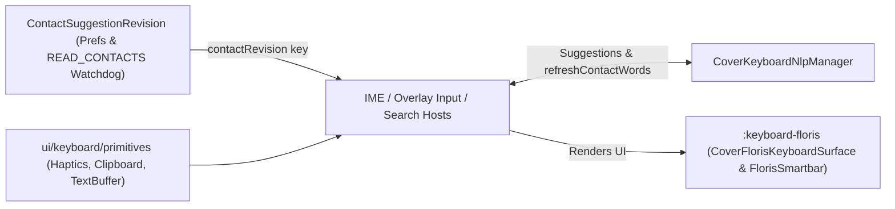

# `ui.keyboard` Package

## What This Folder Does

The `ui/keyboard/` package now focuses strictly on shared keyboard watchdogs and state primitives (`primitives/`), while all live keypad, smartbar, popup, and resize UI is rendered through `:keyboard-floris` (`CoverFlorisKeyboardSurface` & `FlorisSmartbar`).

Inside this folder:
- **`ContactSuggestionRevision.kt`**: Watches `"keyboard_words"` preferences (`"include_contact_names"`) and periodically polls `READ_CONTACTS` so every active Floris keyboard host (`CoverT9InputMethodService`, `CoverKeyboardOverlayRoot`, and `SearchFlorisKeyboardHost`) reloads contact suggestions immediately when opt-in or permissions change.
- **`primitives/`**: Houses active shared building blocks (`TextBuffer`, `ClipboardHistory`, `ClipboardToolbar`, `ComposingTextPreview`, `HapticTier`, and `KeySound`). Legacy duplicate UI widgets superseded by `:keyboard-floris` were removed cleanly.

---

## File-by-File Guide

### `ContactSuggestionRevision.kt`
- **In plain terms**: A quiet watchdog that bumps a counter whenever contact-name suggestions need to be reloaded—either because you changed a setting or revoked the Contacts permission while the keyboard stayed open.
- **Key variables & state**:
  - `revision`: Compose integer state incremented on every change; passed as a `LaunchedEffect` / `remember` key so stale contact lists refresh automatically.
  - `preferences`: `"keyboard_words"` `SharedPreferences` holding the `"include_contact_names"` boolean.
  - `preferenceListener`: Registered in `DisposableEffect` and cleanly unregistered in `onDispose` to prevent leaks.
  - `wasGranted` / `isGranted`: Snapshots of `READ_CONTACTS` checked every 5 seconds in a coroutine loop (since Android does not fire a broadcast on permission revocation).
- **How it connects**: Called by `CoverT9InputMethodService`, `CoverKeyboardOverlayRoot`, and `SearchFlorisKeyboardHost`.

### `primitives/`
- **In plain terms**: The active keyboard state and utility bricks—haptic/sound performers, clipboard history/toolbar, composing text readout, and `TextBuffer`.
- **Key variables & state**: Documented in full in [primitives/README.md](primitives/README.md).
- **How it connects**: Supplies `HapticTier`, `KeySound`, `ClipboardHistory`, `ClipboardToolbar`, `ComposingTextPreview`, and `TextBuffer` across `:app`.

---

## Quick-Reference Summary Table

| File / Sub-Package | Role | Key Types / Composables | Link |
| --- | --- | --- | --- |
| `ContactSuggestionRevision.kt` | Invalidates contact suggestions on pref or permission changes | `rememberContactSuggestionRevision` | — |
| `primitives/` | Shared haptics, sound, clipboard, preview, and `TextBuffer` | `HapticTier`, `KeySound`, `ClipboardHistory`, `TextBuffer`, etc. | [primitives](primitives/README.md) |

---

## Architecture Flow

---

## Works Hand-in-Hand With

| Module | Relationship | Link |
| --- | --- | --- |
| `ui/keyboard/primitives` | Supplies `HapticTier`, `ClipboardHistory`, `ComposingTextPreview`, and `TextBuffer` | [primitives](primitives/README.md) |
| `overlay/input` | Uses `rememberContactSuggestionRevision`, `TextBuffer`, `ClipboardHistory`, and `HapticTier` | [overlay/input](../../overlay/input/README.md) |
| `ime` & `ui/launcher` | Uses `rememberContactSuggestionRevision` to refresh contact candidates live | [ime](../../ime/README.md) |
| `:keyboard-floris` (`keyboard.floris`) | Renders `CoverFlorisKeyboardSurface` and `FlorisSmartbar` | [floris](../../../../../../../../../keyboard-floris/src/main/java/com/tyejaedon/coverscreenos/keyboard/floris/README.md) |
